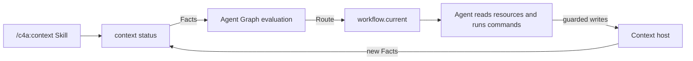

# Agent Graph in Context

<!-- context:section id="why" -->
Context is the largest public Agent Graph adopter, and it shows when a graph is worth having. Its lifecycle is long and stateful: sources must be scoped and captured, one Indexer lifecycle turns every authorized input into a current Candidate batch, human Gates may pause the run, and approved knowledge must be closed, verified, translated, versioned and built. A plain Skill would need to carry all of that in its prompt and still could not prove what had already happened.

Context is not evidence that every Skill needs a graph. It is evidence that a graph helps when a Skill fronts a workflow with external Facts, several Gates, repeated batches and a real recovery requirement. Agent Graph does not extract code, interpret documents or approve knowledge; Context remains the host.
<!-- /context:section -->

<!-- context:section id="layers" -->
## Who does what



| Layer | Responsibility in Context |
| --- | --- |
| Skill | Discovery and the small Route-consumption contract |
| Context host | Observe files and external systems, execute commands, enforce authority, record evidence |
| Provider | Bind the `workspace` Graph, entrypoints, Actions, resources and the reason-code catalog |
| Graph | Describe legal lifecycle states, dependencies, Gates, loops and terminal outcomes |
| Route | Expose one current action, its required resources and its completion contract |
| Facts and Outcomes | Prove what has actually happened; conversation claims are not completion evidence |

`context status` is the observation boundary: it inspects the workspace, supplies Facts to Agent Graph and returns `workflow.current` with the selected Route, reason code, command plan, Gate and only the resources needed now. The Context-side view of this loop is in [Workflow Execution](../context/workflow-execution.md).
<!-- /context:section -->

<!-- context:section id="entry" -->

## One thin public entry

Knowledge production has one public Agent entry, `/c4a:context`. Its first `context entry` call resolves initialization, workspace relocation or ordinary continuation, then hands control to `workflow.current`. The plugin's other public Skills — `context-plan` for planning, `context-inspect-search` for querying and `context-repo-content` for same-repository content — do not drive the lifecycle themselves; they hand plans and accepted knowledge suggestions back to this entry. The entry's body describes only how to start and how to consume a Route; phase procedures, schemas, source views, review contracts and package guidance live in independently addressable workflow resources.

That is the [Skills and Providers](skills-and-providers.md) pattern at scale: one small, stable shell in front of a large body of instructions that the Graph selects piece by piece. The detail has not been summarized away — it is separated, selected and made verifiable instead of being loaded on every turn.

<!-- /context:section -->

<!-- context:section id="workflow" -->
## The published workflow

The whole integration is public in the Context repository under `packages/context-cli/context-workflow/`:

| Path | Contents |
| --- | --- |
| `provider.yaml` | Provider `c4a/context`, binding the `workspace` and `indexer` Graphs, Actions, Resources and the entrypoint |
| `graphs/workspace.yaml` | The static top-level lifecycle, from task start through capture, Indexer lifecycle, review, close, package output, translation, version and build |
| `graphs/indexer.yaml` | The single Indexer lifecycle: requirement confirmation, Provider selection, authorized worksets, partitioned authoring, reconciliation, layout and Candidate compilation |
| `actions/` | Executable contracts: runner, host command or handler, effect, authority boundary and expected Outcome |
| `resources/` | Procedures, dialogue files for human decisions, live workspace views, semantic references, diagnostics and manuals |
| `codes.yaml` | Stable meanings for Route and diagnostic codes |
| `tests/` | Route-selection tests from Facts, run without an Agent or model |

The top-level `run-indexer-lifecycle` Action is an Agent Action that hands indexing to the Indexer Graph and is satisfied only when `indexer.lifecycle_current` is true. Repeated sources and partitions do not need repeated graph definitions: the workspace Graph has stable states such as "a capture target remains", and runtime Facts identify the current workset.
<!-- /context:section -->

<!-- context:section id="managed" -->
## Managed mode is a delegated Gate

Context calls its unattended experience *managed mode*. That is a host concept, not an Agent Graph field: the host maps it to session-scoped authorities and each Gate's `delegated` policy. The final knowledge review shows the shape:

```yaml
- id: review-current-batch
  kind: gate
  reasonCode: route.review.decision-required
  inspectionAction: actions/inspect-review.yaml
  resolutionAction: actions/apply-confirmed-review.yaml
  delegated:
    inspection: skip
    resolutionAction: actions/apply-managed-review.yaml
    resources:
      required:
        - resources/views/review-current.yaml
  gate:
    id: knowledge-review
    authority: context.knowledge-review
    delegatable: true
  satisfiedBy:
    - path: gates.knowledge_review_resolved
      equals: true
```

Without the authority the Route stops for a person. With `context.knowledge-review` granted for the session, the same Gate resolves through the host handler `context.review.approve-current`. A route test, `tests/managed-review.yaml`, pins exactly that: with the authority present it expects `primaryNode: review-current-batch`, `gateResolution: session-authority` and that resolution handler. Session authority never becomes permanent project configuration, and Routes that need semantic judgment or an unsafe repair still stop.
<!-- /context:section -->

<!-- context:section id="idempotent" -->
## Idempotent continuation

Invoking the Skill again does not replay every instruction or repeat every write. With the same Provider bundle, Facts and Outcomes, Agent Graph selects the same Route, and unchanged resource receipts keep the same read state. Context binds mutating commands to the selected workflow revision and checks their external evidence: work already satisfied by workspace Facts is skipped, and a stale command is rejected instead of being applied to newer state.

The boundary is explicit. Agent Graph makes evaluation repeatable and exposes completion contracts; the Context host makes each filesystem effect atomic, guarded or a proven no-op. Agent Graph does not make an arbitrary script idempotent by itself — see [Runs and Recovery](runs-and-recovery.md).
<!-- /context:section -->

<!-- context:section id="replay" -->
## Recording and replay

With Context debug mode on, the host records CLI invocation boundaries and Agent Graph evaluations. A replay then shows which Route was selected at each Fact change, where a multi-source loop advanced and how many iterations completed, when an authority or review Gate paused progress, which reason code justified each transition and how the final package was reached.

The [interactive replay](https://context4ai.github.io/context/case-studies/workflow/?lang=en) is normalized from a sanitized Context recording; its **Workspace graph** control draws the static contract, and each step links its Action and Resources back to the workflow files. Route traces like these expose wasteful loops, repeated resource reads, incomplete recovery paths and misleading status priorities, and those observations become new route tests and graph changes — the improvement loop described in [Why Graph Engineering](why-graph-engineering.md).
<!-- /context:section -->

<!-- context:section id="this-site" -->

## Built with Context

This documentation site is itself a Context knowledge workspace, produced through the same `/c4a:context` entry and workflow.

- **Workspace.** The Portal repository root is the workspace: `package.json` declares it, `src/index.ts` registers sources and outputs, `src/indexers.yaml` states each reader group's needs, and `src/knowledge-map.yaml` holds the navigation.
- **Sources.** Three community repositories, each pinned to one commit (Context first at `v0.7.60` and updated to `v0.7.61` before the final stage, Agent Graph at `v0.3.0`, and Source Graph at a commit without a release number), plus five sanitized notes on usage experience, measured compression, retrieval evaluation, the knowledge service Agent design and frequently asked questions. A maintainer reviewed each note before registering it.
- **Plan.** Because the sources span three repositories, production started with a `context-plan` investigation and a PLAN report that split the site into six stages — getting started and Context internals; source, production, review, update and query guides; outputs, Indexers, the knowledge service, workspace maintenance, practices and the Context reference; Source Graph; Agent Graph; and the More menu with homepage links — plus one revision round that added seven pages and unified naming and links.
- **Each stage.** `task prepare` and `task resume` opened a new production stage; the Agent wrote articles in batches by reader question, every section carrying references to source lines or notes, and submissions were checked for format, links and references.
- **Review.** Each stage produced an HTML review report that was checked for unplaced navigation and diagrams that fail to render before approval. The maintainer reviewed the first two stages, then delegated review to the Agent, which checked each article against its sources and used `revise` to correct approved pages when it found a factual deviation.
- **Translation and versions.** Approved articles and navigation titles were translated into Simplified Chinese by several parallel sub-Agents, with a script confirming that section markers, code blocks, links and inline code were unchanged. Each stage recorded a workspace version and Changelog entry, counting up from 0.1.0, before building the site and package.

Three observations from the run:

- One public entry carried every stage. After each interruption or new session, the Agent resumed from the Route that `context status` returned, not from conversation memory.
- Several drafts disagreed with the source code — for example which error code a timeout returns, or what anonymous rate limiting counts. Section references made those checks possible one section at a time, and each was fixed before submission.
- Revising an approved page changed only the affected sections instead of reproducing the whole article.
- Updating the Context source from `v0.7.60` to `v0.7.61` did not restart production: `context verify` listed the pages whose cited source regions had changed or moved, `context update` offered them as candidates, and the Agent decided page by page whether a revision was needed. The More menu pages were written as new topics of the same update.

<!-- /context:section -->
