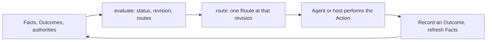

# Core Model

<!-- context:section id="loop" -->
Agent Graph turns a static work contract and the current state into one legal next step. Every interaction follows the same loop:



Evaluation and route resolution are read-only and deterministic: the same definitions and inputs give the same revision, the same Routes and the same order. Nothing is executed by Agent Graph itself; it returns what to run and what to read.
<!-- /context:section -->

<!-- context:section id="provider-graph" -->
## Providers and Graphs

A **Provider** is one independently versioned trust and publication boundary. Its manifest (`agent-graph.provider.v1`) lists Graph files explicitly — nothing is discovered by scanning — plus an optional Code Catalog and the supported toolchain range. References stay inside the Provider root, and several Providers stay isolated from each other.

A **Graph** (`agent-graph.graph.v1`) is a deterministic route definition: named `entrypoints`, nodes and edges. Its topology is static. Target names, dates, phases or queue items belong in Facts, and a stable host Action resolves the concrete target, so a Provider never regenerates nodes because parameters changed. Every Graph declares at least one terminal node.

| Node kind | Required field | Meaning |
| --- | --- | --- |
| `action` | `action` | Work done by a command, script, Agent Skill or host handler |
| `gate` | `gate` | A decision that needs user or session authority |
| `subgraph` | `graph`, `entry` | Enter another Graph in the same Provider |
| `terminal` | `terminalOutcome` | End the frame with an explicit Outcome |

Action and Gate nodes must carry a `reasonCode` starting with `route.` — a stable machine explanation of why the Route is offered. `priority` ranks routes that are legal at the same time; it never decides semantic fitness. `join: all` (the default) needs every incoming edge to match, `join: any` needs one.
<!-- /context:section -->

<!-- context:section id="facts" -->
## Facts

Facts are observed state supplied by the Provider integration or host. Nodes test them with a deliberately small data model, not expressions:

```yaml
requiresFacts:
  - path: sources.registered
    equals: true
satisfiedBy:
  - path: artifact.digest
    exists: true
```

`path` is a dotted lookup in which numeric segments index arrays (`items.0.digest`); each check has exactly one of `exists` or `equals` with a scalar value. There is no JavaScript, template expansion or shell evaluation.

- `requiresFacts` makes a node legal only under current state; if a check fails the node is `blocked` with a `required-fact-missing` diagnostic.
- `satisfiedBy` proves a node complete without replaying it. Matching facts make it `completed` even with no Run record; a recorded `completed` without them becomes `unverified`.

A claim made in conversation never creates a fact.
<!-- /context:section -->

<!-- context:section id="outcomes" -->
## Outcomes and edges

Outcomes are the typed results of nodes:

```text
completed partial failed unverified skipped pending blocked waiting-user
```

They are not aliases: `partial`, `unverified` and `skipped` never silently become `completed`, because the difference is what lets a graph recover. Every edge names the Outcomes that permit it (default `[completed]`):

| Edge kind | Meaning |
| --- | --- |
| `flow` | General control transition |
| `consumes` | The target consumes an artifact the source produced |
| `requires` | The source is a prerequisite of the target |
| `gatedBy` | A Gate source resolves the target's policy boundary |
| `repeat` | A matching result re-arms an Action or Gate for another iteration |

All non-repeat kinds use the same reachability rule; the kind records causal intent for inspection, tests and host policy. Edges carry no values or artifacts — hosts persist outputs and publish references or digests as Facts. Non-repeat edges must form an acyclic graph, so every loop is an explicit `repeat`. Fan-out and fan-in describe legal reachability, not parallel execution.
<!-- /context:section -->

<!-- context:section id="evaluation" -->
## How an Evaluation is computed

Starting at the entry node, the evaluator repeatedly settles each reached node's Outcome — from `satisfiedBy` facts, then the recorded Outcome, then `pending` — and follows every edge whose Outcomes match, honouring `join` and re-arming `repeat` targets. Subgraph nodes evaluate their child Graph in place and take its terminal Outcome. Then:

- a pending Action becomes an **immediate** candidate;
- a pending Gate becomes a **requires-user** candidate, or an immediate one when the input carries its delegatable authority;
- if exactly one terminal Outcome is reached the frame is `complete`; conflicting terminal Outcomes are an `error` (`terminal-outcome-ambiguous`); nothing reachable is `blocked` with `no-route`.

Candidates are ordered by availability (immediate, then requires-user), then by higher `priority`, then by route ID. The `agent-graph.evaluation.v1` result has a `statusCode` (`actionable`, `waiting-user`, `blocked`, `complete` or `error`), an optional terminal `outcome`, one `primaryRoute` and up to three `alternativeRoutes` — each with its `reasonCode`, an optional Catalog `hint` and a label — plus compact diagnostics. A `route-alternatives-truncated` info diagnostic reports when more alternatives exist.

The `revision` is a digest of the selected Graph's same-Provider dependency closure, the facts, the normalized outcomes and the authorities. Timestamps on outcome records and files used only by unrelated Graphs do not change it.
<!-- /context:section -->

<!-- context:section id="route" -->

## Routes

`route` resolves one route ID from an Evaluation into an `agent-graph.route.v1` plan:

| Field | Content |
| --- | --- |
| `revision`, `routeId` | The Evaluation it belongs to; the route ID is derived from that revision |
| `graph`, `node`, `callPath` | Where the step sits, including the Subgraph path |
| `statusCode`, `reasonCode`, `hint`, `availability` | Why and how it is offered |
| `action` | Action identity, runner and effect |
| `commandPlan` | The exact command, script invocation or host handler, with its working directory |
| `resources` | Required and recommended locations, each keeping its complete file, Graph-action or Host-action location envelope and a `readState` of `current` or `read-required` |
| `gate` | For Gates: authority, resolution, and the separate inspection and resolution Actions |
| `afterAction` | `recordNode` — the state key to record — and `evaluate: true` |

If the caller passes the Evaluation's revision and the state has changed, resolution fails with `route-revision-stale`; a route ID no longer available fails with `route-stale`. An Agent Skill used by an `agent` Action is added as the first required resource. Document bodies are never embedded; the Route points to files and digests.

<!-- /context:section -->

<!-- context:section id="gates" -->
## Gates and authority

```yaml
kind: gate
reasonCode: route.review.approval-required
gate:
  id: result-review
  prompt: Review the prepared result.
  authority: review
  delegatable: true
inspectionAction: actions/inspect-review.yaml
resolutionAction: actions/apply-review.yaml
delegated:
  inspection: skip
  resolutionAction: actions/accept-review.yaml
  resources: { required: [], recommended: [] }
```

Without matching authority the Route is `waiting-user` and its ordinary `commandPlan` is empty. The optional read-only **inspection Action** prepares evidence for the decision and stays available while the Gate waits. The optional **resolution Action** (effect `write` or `external`) applies the decision, but a host must not run it until the user has confirmed. When `delegatable` is true and the current evaluation or Run carries the named authority, the Gate becomes actionable with `resolution: session-authority`; the `delegated` policy can then skip inspection, swap in a different resolution Action and replace the Gate's resources.

Authority belongs to the current input or Run, never to the Provider definition. It resolves only delegatable Gates and never satisfies facts or bypasses validation. Context's fully managed mode is built on exactly this mechanism; see [Agent Graph in Context](agent-graph-in-context.md).
<!-- /context:section -->

<!-- context:section id="reasons" -->
## Explaining every step

Every Route carries a machine-stable `reasonCode`. A Provider may add a Code Catalog (`agent-graph.code-catalog.v1`) whose `route-reason` entries give each code a short summary and an optional explanatory document, and whose `diagnostic` entries name product conditions with a severity. Once a Catalog exists, every Action and Gate reason code must be listed in it, turning reasons into a closed, documented set. Hosts and Agents branch on schema, status, reason and diagnostic codes, never on human descriptions.

The exact fields of every object are in the [Specification](../../product/reference/agent-graph/specification.md); how Runs persist Outcomes is in [Runs and Recovery](runs-and-recovery.md).
<!-- /context:section -->
