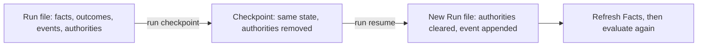

# Runs and Recovery

<!-- context:section id="facts-first" -->
## Facts first, history second

The most robust state is the real system. When a host can observe what has happened — an artifact digest, a source revision, a test receipt, a deployed version — it passes those values as Facts and evaluation needs no stored state at all:

```bash
agent-graph evaluate build --manifest provider.yaml --facts @observed-facts.json --format json
```

Such facts survive restarts and can invalidate stale work by themselves. When trust depends on who observed a value, the Fact carries the observer's identity and health too (for example `sourceRevision`, `available`, `fresh`). The host applies its own clock, lease or health policy and publishes stable states; Agent Graph never reads the wall clock. Because the whole Facts object is part of the revision, replacing an observer or a value turning stale invalidates an already resolved Route without touching the Graph.

Use a **Run** only when you need execution history, a checkpoint for a long task, Outcomes that cannot be observed from outside, or repeated iterations.
<!-- /context:section -->

<!-- context:section id="run" -->
## Runs

A Run (`agent-graph.run.v1`) is optional, host-owned execution memory in one JSON file:

| Field | Content |
| --- | --- |
| `provider`, `graph`, `entry`, `workspace` | What the Run executes |
| `facts` | Facts supplied to routing |
| `outcomes` | The latest Outcome record per fully qualified state key |
| `authorities` | Session authorities currently granted |
| `events` | Append-only, numbered events such as `run.started`, `node.outcome-recorded`, `facts.updated`, `run.checkpointed`, `run.resumed` |

```bash
agent-graph run start monitor --manifest provider.yaml --state .runtime/monitor.json --workspace .
agent-graph route monitor --manifest provider.yaml --state .runtime/monitor.json --format json
agent-graph run record monitor/poll partial --state .runtime/monitor.json
```

After an Action, record its Outcome under the exact `afterAction.recordNode` key from the Route — a key such as `monitor/poll`, prefixed with the Subgraph call path when nested. Outcomes keep only the latest record per key, while events keep every iteration. `run start`, `checkpoint` and `resume` refuse to overwrite an existing file, and every write is validated against the Run schema and written atomically. There is no default directory: the host chooses where Runs live.
<!-- /context:section -->

<!-- context:section id="loops" -->
## Loops

```yaml
edges:
  - { from: poll, to: poll, kind: repeat, outcomes: [partial] }
  - { from: poll, to: done, outcomes: [completed] }
```

Recording `partial` re-arms `poll`; recording `completed` reaches the terminal. Agent Graph does not busy-wait, sleep or run the loop itself: the Agent or host decides when to take each Route and may stop by its own time or budget policy. Transport retries, model retries and workflow Outcomes are different things — an exhausted retry should be recorded as `failed` or `unverified`, never `completed`.
<!-- /context:section -->

<!-- context:section id="failure" -->
## Partial work and failure paths

Recovery is modelled with explicit Outcomes and edges, not hidden in prose:

```yaml
edges:
  - { from: verify, to: done, outcomes: [completed] }
  - { from: verify, to: repair, outcomes: [failed, unverified] }
```

Use `partial` when some required work succeeded and some did not; counts and receipts go in event details or Facts, while routing still uses the Outcome. Never drop the failed items and report the rest as a complete batch. When a result must be provable, add `satisfiedBy`: a recorded success without its proof evaluates as `unverified`, so a crash or handoff between "done" and "proved" routes deterministically to verification or repair.
<!-- /context:section -->

<!-- context:section id="checkpoint" -->
## Checkpoint and resume



```bash
agent-graph run checkpoint --state .runtime/monitor.json --to .runtime/checkpoints/before-handoff.json
agent-graph run resume .runtime/checkpoints/before-handoff.json --state .runtime/resumed.json
```

A checkpoint is a validated copy of the Run with session authorities stripped. Resume copies it to a new path, clears authorities again, appends `run.resumed` and evaluates against the **current** Provider definitions. Authority must be granted again explicitly, so a checkpoint can never become a permanent unattended mode. Facts may have changed while paused, so the host refreshes them first; `satisfiedBy` checks run again. A checkpoint is execution memory, not a truth anchor.
<!-- /context:section -->

<!-- context:section id="stale" -->
## Rejecting stale plans

Every Evaluation has a revision derived from the Graph closure, Facts, Outcomes and authorities, and every route ID is derived from that revision. An Agent passes the revision when resolving:

```bash
agent-graph route main <route-id> --revision <revision> --format json
```

If anything relevant changed in between, resolution fails with `route-revision-stale`; a route that is no longer available fails with `route-stale`. The Agent then evaluates again instead of executing a plan computed for older state. Hosts extend the same idea to their own write commands — Context binds every mutating command to the workflow revision that selected it, see [Agent Graph in Context](agent-graph-in-context.md).
<!-- /context:section -->

<!-- context:section id="authority" -->
## Session authority

Authority can be given to one evaluation (`--authority release.approve`) or set on a Run for a host-defined session (`run authority --set release.approve`). The host clears it when the user's delegation ends, and `run resume` clears it automatically. It only resolves Gates marked `delegatable` and never bypasses fact checks, schema validation, verification or non-delegatable Gates.
<!-- /context:section -->

<!-- context:section id="host" -->
## What the host owns

Agent Graph selects a legal Route; it does not own the resources used to execute it. A host running several Actions in one process should give each one an execution scope for child processes, timers, temporary files, locks and watchers, closed in reverse order before it publishes the Action's receipt or evaluates again. That scope is not a transaction: lasting results still need their own revision checks, atomic commits and verification, published as Facts.

The same holds for host-materialized resources: the host validates the result envelope against the computed input digest, persists it as a Run Fact or in its own store, and on recovery reuses it only if the digest still matches; a mismatch must lead to an explicit `failed` or `unverified` path rather than silent re-execution. Run files, checkpoints and caches live wherever the host chooses — a product runtime directory, an ignored workspace folder, a task store or a temporary location. Provider bundles stay read-only, and materialized resources are cache entries that must be reproducible after deletion.
<!-- /context:section -->
