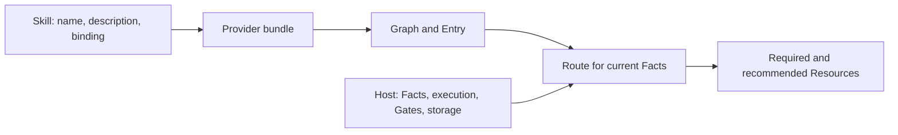

# Skills and Providers

<!-- context:section id="layers" -->
Agent Graph extends Agent Skills instead of replacing them. Each part of an integration has one job:



| Part | Responsibility |
| --- | --- |
| Skill | Advertise when the capability applies and bind Provider, Graph and Entry |
| Provider bundle | Define the static legal work, Resources, Gates, reason codes and route tests |
| Host | Resolve bundles, observe Facts, persist state, materialize dynamic Resources, run host Actions, enforce Gates |
| Agent | Consume the selected Route, read required Resources, do the work and report an Outcome |
| Agent Graph | Validate contracts and deterministically evaluate and resolve Routes |
<!-- /context:section -->

<!-- context:section id="binding" -->
## Binding a Skill

A host still uses the Skill's `name` and `description` to decide whether it matches a request. Once selected, three metadata fields form one machine binding:

```yaml
---
name: release-package
description: Inspect, review, and release a package through the installed workflow.
metadata:
  agent-graph: path:../../release-graph/provider.yaml
  agent-graph.graph: release
  agent-graph.entry: default
---
```

| Field | Purpose |
| --- | --- |
| `agent-graph` | Locate the Provider |
| `agent-graph.graph` | Select one Graph in it |
| `agent-graph.entry` | Select a public entrypoint in that Graph |

All three are required and validated together; the Agent never infers the Graph or Entry from prose. The Skill body keeps only the bootstrap contract — evaluate the bound Graph, resolve the Route, read every required resource marked `read-required`, stop at unresolved Gates, record an explicit Outcome and evaluate again. Phase procedures, schemas and generated context stay Route resources instead of being copied into the Skill.
<!-- /context:section -->

<!-- context:section id="locators" -->
## Locating Providers

- **`path:<relative-path>`** resolves from the directory of that exact `SKILL.md`, never from the process working directory, and points to a source manifest or a built `manifest.json`. The Provider directory can have any name.
- **`provider:<id>`** delegates the location to a host registry or bundle resolver, for example a registry file mapping `company/release` to an installed `manifest.json`.

The registry belongs to the host. Skills must not hard-code npm prefixes, plugin cache versions or machine paths, and there is no global `~/.agent-graph` or per-project `.agent-graph` directory. The host separately decides where bundles are resolved from, where Run files live (`--state`) and where dynamic resources are cached (`--cache`).
<!-- /context:section -->

<!-- context:section id="sharing" -->
## One Provider, many Skills

Several Skills can share one Provider and select different Graphs or Entries; Graph files, procedures and schemas stay single-source, and sharing an Action or Resource creates no execution dependency. One host can also install several Providers: their identities and state stay separate by Provider ID, manifests are never merged, the current Skill picks its own Provider, and a Subgraph cannot call into another Provider in version 1. Each plugin publishes its own bundle instead of mutating a shared manifest.

Graphs stay static while work stays dynamic. Instead of a node per module, document or date, a stable host Action such as `handler: batch.process-next` receives the same Facts used for evaluation and resolves the concrete target itself, then the host refreshes Facts and evaluates again.
<!-- /context:section -->

<!-- context:section id="resources" -->
## Resources

Long material lives in Resources declared on the node that needs it. Three independent protocols can appear in the same Route:

| Protocol | What it is | How it is delivered |
| --- | --- | --- |
| File (`agent-graph.resource-location.file.v1`) | Static procedures, diagnostics, templates, schemas and Skills; Markdown carries `id`, `kind` and `media-type` in frontmatter, other formats use a small descriptor | Absolute installed path, media type and content digest |
| Graph action (`agent-graph.resource.graph-action.v1`) | A dynamic context view whose materializer is a read-only command or script Action | An opaque materialization request bound to the Route revision; runs only when the host calls `resource materialize` |
| Host action (`agent-graph.resource.host-action.v1`) | A resource the integrating host produces through a stable handler with versioned input and output schemas | Handler, input schema and canonical input value; Agent Graph computes the input digest and validates the returned envelope |

Normative instructions belong in procedures; generated or workspace-derived evidence does not. Routes return locations and digests, never document bodies, so routine output never becomes an accidental prompt.
<!-- /context:section -->

<!-- context:section id="materialize" -->
## Materializing context views

Evaluation and route resolution never run a materializer. `resource materialize` runs it explicitly with the selecting Route's revision, writes stdout to a content-addressed file in the host-chosen cache (`<digest>.json`, `.md`, `.txt` or `.bin` by media type) plus a receipt recording the revision and digest, and returns a location the host can check for staleness.

The process gets `AGENT_GRAPH_PROVIDER_ROOT`, `AGENT_GRAPH_WORKSPACE`, `AGENT_GRAPH_REVISION` and `AGENT_GRAPH_INPUT` (JSON), plus only a minimal inherited environment — `PATH`, temporary-directory, locale and time-zone variables and their Windows equivalents. SDK hosts can add variables explicitly. Defaults are a 30-second timeout, 10 MiB of stdout and 1 MiB of stderr; exceeding one terminates the process without writing a receipt. `effect: read` is a declared contract, not a sandbox, so hosts isolate untrusted Provider code themselves.

For a host-action resource, materialization returns `materializer-host-required`: the host invokes the handler, echoes the computed input digest, returns exactly one inline value or managed resource reference, validates the content against the Provider's output schema and persists it before exposing it to the Agent.
<!-- /context:section -->

<!-- context:section id="receipts" -->
## Read receipts

To avoid re-reading unchanged material, a host may attach an `agent-graph.resource-read-receipts.v1` set for the current conversation when resolving a Route. Each Route resource then gets a `readState`:

- `current` — a receipt matches: the same ID and exact digest for a static file, or the same ID and the selecting Route revision for a dynamic view;
- `read-required` — anything else, including no receipt or a stale one.

A receipt may be issued only after the Agent actually read that content and while it is still in the conversation. Receipts are scoped to one Provider, are never stored in Runs or checkpoints, and are not Facts, Outcomes, authority or proof that an Action finished — they only suppress redundant reads.
<!-- /context:section -->

<!-- context:section id="sdk" -->
## A thin host

```ts
import { evaluateGraph, loadProvider, resolveRoute, resolveSkillBinding } from "@c4a/agent-graph";

const binding = await resolveSkillBinding(skillPath, { registry });
const provider = await loadProvider(binding.manifestPath);
const { evaluation } = evaluateGraph(provider, binding.graph, binding.entry, currentState);
if (evaluation.primaryRoute) {
  const route = await resolveRoute(provider, binding.graph, binding.entry,
    evaluation.primaryRoute.routeId, currentState, evaluation.revision);
  // Present the route's resources and action to the Agent; do not execute implicitly.
}
```

Use the SDK for an in-process Node.js host, or the JSON CLI when the host runs in another runtime or needs a process boundary; both read the same files. Only explicitly named authoring, Run, build and materialization functions write anything. The full export list is in [CLI and SDK](../../product/reference/agent-graph/cli-and-sdk.md).
<!-- /context:section -->
