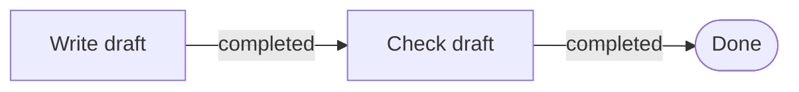

# Why Graph Engineering

<!-- context:section id="what" -->

Agent Graph is a work-contract layer for Agent Skills. You describe a workflow as a small graph of legal steps; at runtime it reads the current **Facts** and tells an Agent what to do next, which files to read for that step and what proves the step is done. It never calls a model, assigns Agent identities, moves shared state or schedules workers — it coordinates the work, not the Agents. Existing Agents and hosts consume its Routes and keep the execution boundary.

Agent Graph ships as `@c4a/agent-graph`: versioned file specifications with JSON Schemas, a Node.js SDK and an `agent-graph` CLI for authoring, inspecting, testing, building and resuming workflows. Context runs its whole knowledge workflow on it; see [Agent Graph in Context](agent-graph-in-context.md). The source code, issues and discussions live in the GitHub repository [context4ai/agent-graph](https://github.com/context4ai/agent-graph).

Where to go next:

- **How it works:** [Core Model](core-model.md), [Runs and Recovery](runs-and-recovery.md), [Skills and Providers](skills-and-providers.md).
- **Guides:** [Getting Started](../../sop/agent-graph/getting-started.md), [Authoring Graphs](../../sop/agent-graph/authoring-graphs.md), [Testing and Publishing](../../sop/agent-graph/testing-and-publishing.md).
- **Reference:** [Specification](../../product/reference/agent-graph/specification.md), [CLI and SDK](../../product/reference/agent-graph/cli-and-sdk.md), [Migration](../../product/reference/agent-graph/migration.md).

<!-- /context:section -->

<!-- context:section id="problem" -->
## The problem

Agents usually know enough. The harder problem in a long task is knowing which part applies **now**, which action is legal next, what proves that action is complete and where to resume after an interruption. Making the prompt longer does not solve this reliably: a complex Skill in one document has a flat topology, every rule sits next to every other and is often loaded together, and the Agent has to infer the current phase from the conversation. Such a workflow is also hard to test without running the whole model behavior.

> Context should be discovered, not accumulated. The plan is explicit; the path is selected from current reality.
<!-- /context:section -->

<!-- context:section id="example" -->
## A small example

An Agent has one job: write a draft, check it, finish.

The host can observe two facts: `draft.saved = true` and `review.passed = false`. The draft exists but has not passed the check, so Agent Graph returns **Check draft** as the current Route. Nothing is guessed from the conversation: when `review.passed` becomes `true` the next evaluation reaches **Done**; while it stays `false` the Route stays **Check draft**.

Four ideas carry the example: the **Graph** describes the legal sequence, **Facts** describe what is true now, the **Route** is the next legal step selected from those Facts and the **Action** tells the Agent or host how to perform it. Real workflows add required files, human Gates, explicit Outcomes, choices and recovery paths without changing this loop.
<!-- /context:section -->

<!-- context:section id="principles" -->
## The Graph Engineering principles

"Graph Engineering" is an emerging architecture label, not an official protocol or a single implementation; writing under that name covers feedback and audit loops, durable multi-Agent organizations and dynamically generated task graphs. Agent Graph takes the engineering principles without claiming the term, and narrows the question to: *how can an Agent discover the next legal action and only the context it needs, while a long workflow stays observable, testable and recoverable?*

- **From prompt to topology.** Prompt engineering improves one interaction and context engineering shapes what one interaction sees. Graph Engineering adds how information, authority, actions, evidence and feedback move across many interactions. A graph does not add context; it creates boundaries so the Agent loads a small, relevant slice after a Route is chosen.
- **Reality stays outside the optimizer.** Agent Graph separates **facts** (observable state from a Provider or host), **outcomes** (explicit results of an attempted action) and **instructions** (procedures). Instructions cannot assert facts, and a recorded success without the evidence a node requires becomes `unverified`. Source digests, build receipts, test results and scoped review decisions are typical external anchors; another model agreeing is useful evidence, not an anchor.
- **Contracts, not diagrams of prose.** Only steps that are independently actionable, gated, recoverable, repeatable or testable become nodes; explanation stays in files. Every element carries a boundary contract — an Action its runner and effect, a Gate who decides, a node the facts it needs and the facts that prove it done — so the visual graph is a view of executable contracts.
- **Graphs of loops.** Review, repair, polling and re-planning loops are explicit `repeat` edges with typed Outcomes and stop conditions. Each iteration is a Route and each result an event, so a host can checkpoint, enforce budgets or hand work to another Agent.
- **Stable organization, dynamic work.** Graphs describe stable categories of work; current targets, dates and queue items are Facts resolved by stable host Actions, so the Graph never has to be rewritten per run.
- **Progressive disclosure as structure.** A thin Skill holds the bootstrap loop, evaluation returns summaries and each Route returns only its own resources as file locations with digests, never document bodies.
- **Observability without a mandatory runtime.** Evaluation can be stateless; an optional Run records events and outcomes at a path the host chooses.
- **Testability before autonomy.** Route tests assert which step a known state exposes, without calling a model.
<!-- /context:section -->

<!-- context:section id="mapping" -->
## How the principles become implementation

| Principle | Agent Graph implementation |
| --- | --- |
| External reality | Restricted fact checks and `satisfiedBy` |
| Boundary contracts | Strict JSON Schemas with closed object fields |
| Typed feedback | Eight distinct Outcomes |
| Progressive context | Required and recommended file Resource locations |
| Explicit authority | Gates plus session-scoped authority input |
| Recovery | Failure and repeat edges, Run events, checkpoint and resume |
| Explainability | Deterministic Evaluation and Route, inspection, digests |
| Stable reasons | Route reason codes plus an optional Code Catalog |
| Testability | Declarative state-to-route cases |
| Portability | Relative Provider references and host-selected stores |
| Supply-chain clarity | Action effects, reachable-file bundles, content digests |

Version 1 deliberately does **not** provide arbitrary expressions, self-modifying graphs, cross-Provider calls, model invocation or multi-Agent orchestration, parallel execution, edge-carried artifacts or shared mutable state, schedulers or durable timers, automatic trust in commands or third-party Skills, or semantic proof that an Agent's output is correct. Those limits keep it a standard and toolchain rather than another all-encompassing Agent framework.
<!-- /context:section -->

<!-- context:section id="when" -->
## When to use it

Not every Skill needs a Graph. Keep a short, single-session task in `SKILL.md`. Adopt Agent Graph when a host can supply trustworthy external facts and the work truly needs verifiable completion, recovery across sessions, or testable routing and human Gates. It pays off for:

- **large knowledge without a giant prompt** — procedures, schemas and manuals stay files, loaded only when a Route needs them;
- **long tasks across session boundaries** — Facts and Outcomes reconstruct where the work is; an optional Run adds events and checkpoints;
- **plans that react without drifting** — the Graph fixes the legal choices and stop conditions, current evidence picks the path;
- **testing before model behavior** — references, cycles, resource boundaries and expected Routes are checked without a model.

Agent Graph does not rewrite its own plan. Runtime routing follows the evidence; people improve the Graph from events, diagnostics and route tests. Installing the CLI alone does not make an Agent follow a workflow: a Provider defines the contract, a Skill makes it discoverable and a host supplies facts, enforces Gates and records outcomes. Pick your starting point in [Authoring Graphs](../../sop/agent-graph/authoring-graphs.md).
<!-- /context:section -->
