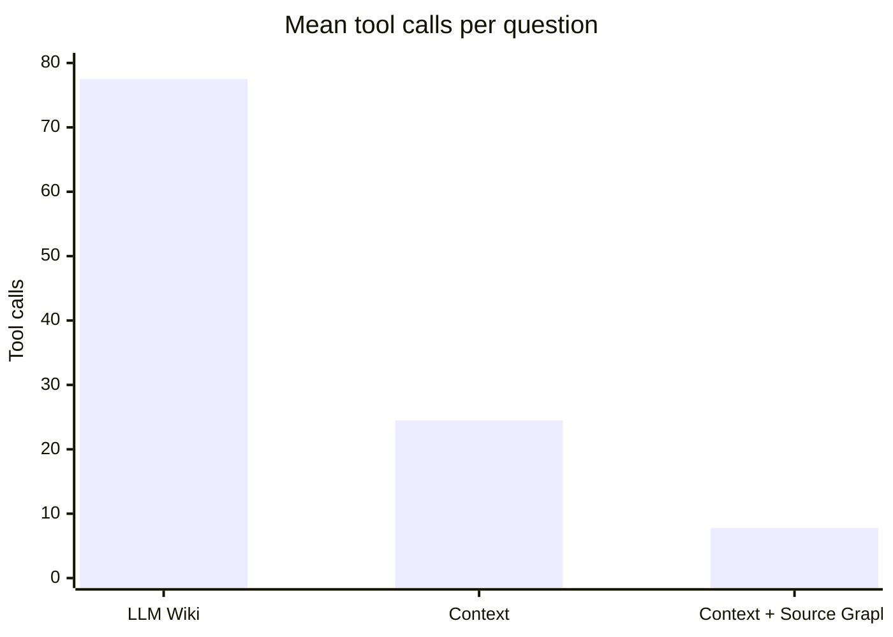

# Knowledge Retrieval Benchmark

<!-- context:section id="summary" -->
## Results at a glance

Can an Agent answer real developer questions better when it reads curated knowledge instead of searching raw material? To find out, we took 24 real questions about a large production full-stack monorepo and had Agents answer them in different setups, grading every answer against criteria written in advance.

The answer has three parts, and the rest of this page shows the evidence for each:

1. **Knowledge replaces blind exploration.** With the same model, an Agent reading Context knowledge fully solved 21 questions against 19 with an LLM Wiki, using about a third of the tool calls.
2. **Source Graph replaces local preparation.** Reading code remotely at a pinned version cut answer time by a third, at the same quality.
3. **On the same knowledge, models differ in speed and cost far more than in quality.** Seven runs with different models fully solved 21 to 24 questions; their mean time ranged from about one to five minutes.

Together, Context with Source Graph answered in less than half the time of the LLM Wiki, at about a ninth of the estimated cost:

| | LLM Wiki | Context | Context + Source Graph |
| --- | ---: | ---: | ---: |
| Answering model | GPT 5.6 SOL | GPT 5.6 SOL | Claude Opus 5.5 |
| Fully solved | 19 of 24 | 21 of 24 | 23 of 24 |
| Mean time | 223.2 s | 157.1 s | 93.2 s |
| Mean tool calls | 77.5 | 24.5 | 7.8 |
| Estimated cost per question | about \$2.45 | \$0.77 | \$0.27 |

The last column also uses a faster model. The next sections separate what the knowledge, Source Graph and the model each contribute.
<!-- /context:section -->

<!-- context:section id="setup" -->
## How the benchmark was run

The 24 questions came from real developer questions and were frozen before the first run:

| Question type | Count |
| --- | ---: |
| Locating interfaces and pages | 7 |
| Business interaction rules | 5 |
| Interfaces and parameters | 4 |
| Permissions and roles | 3 |
| Versions and call relationships | 3 |
| Debugging and environments | 2 |

Every run answered every question once, in a fresh session that received only the original question. A model grader (GPT-6 Astra Ultra), blind to the setup, graded each answer as fully solved, partly solved, substantively wrong or unanswered against the criteria; there was no human calibration. Time is end to end, until the caller saw the complete answer, reported as the mean, the median (P50) and P90. Tool calls count only the calls the Agent could see. Because questions differ in difficulty, every comparison is also checked on the questions that all of its runs fully solved.

No run has a complete bill per question, so cost is estimated. For GPT 5.6 SOL, Grok 4.7 and Claude Opus 5.5 with local reading, each model request was rebuilt from the trace and priced at the provider's standard API price without cache discounts; the LLM Wiki run and Claude Opus 5.5 with Source Graph were scaled from those runs by tool-call count. Muse Wonder and DeepSeek were priced from the tokens they actually used, Muse Wonder at a budget rate and DeepSeek at the average rate of a real bill. The self-hosted Qwen run had no API spend.

The benchmark measures **answering** with deployed knowledge. Producing and updating knowledge has not been benchmarked yet. To run a similar evaluation on your own questions, see [Evaluating Your Knowledge Base](../../sop/practices/evaluating-your-knowledge-base.md) and the [Scoring and Timing Standard](../../sop/practices/evaluation-standard.md).
<!-- /context:section -->

<!-- context:section id="retrieval" -->
## What knowledge and Source Graph each contribute

Read the table from left to right: each step changes one main thing, and only the third step changes the model.

| | LLM Wiki | Context | Context, new model | Context + Source Graph |
| --- | ---: | ---: | ---: | ---: |
| What changed | Starting point | LLM Wiki → Context | GPT 5.6 SOL → Claude Opus 5.5 | Local reading → Source Graph |
| Fully solved | 19 | 21 | 23 | 23 |
| Partly solved / substantively wrong | 2 / 3 | 2 / 1 | 0 / 1 | 0 / 1 |
| Mean / P50 / P90 time | 223.2 / 137.2 / 464.7 s | 157.1 / 136.8 / 256.2 s | 139.3 / 141.4 / 188.7 s | 93.2 / 89.0 / 123.0 s |
| Mean tool calls | 77.5 | 24.5 | 11.6 | 7.8 |

**From LLM Wiki to Context.** With the LLM Wiki, the Agent ran shell commands, searches and file reads about 1,800 times across the 24 questions; with Context it needed about 590, because the knowledge told it where to look. When the target address did not appear in the host repository at all, the knowledge gave the page → remote SDK → interface chain directly. For questions about differences between versions, it recorded which commits were being compared. On the 17 questions that the LLM Wiki, Context and Context + Source Graph all fully solved, mean time was 232.6 s, 160.7 s and 93.5 s, so the gap is not just a matter of which questions were easier.

**From local reading to Source Graph.** With Claude Opus 5.5 in both runs, Source Graph kept 23 questions fully solved and cut mean time by 33.1%. The 256 local calls for preparing repositories, running shell commands, searching and reading files gave way to 164 remote reads. Eight remote calls failed parameter validation, and the Agent recovered from all of them.

The model change in between also mattered: Claude Opus 5.5 solved two more questions than GPT 5.6 SOL on the same knowledge and used half the tool calls. The next section looks at models on their own.
<!-- /context:section -->

<!-- context:section id="models" -->
## How models compare on the same knowledge

Seven runs answered the 24 questions from the same Context knowledge. They differ in model, in how code was read and in where the Agent ran, so the table groups them by retrieval and runtime. New runs are added here as rows.

| Run | Date | Fully solved | Partly / wrong | Mean / P50 / P90 time | Tool calls | Cost per question |
| --- | --- | ---: | ---: | --- | ---: | ---: |
| **Local reading, managed Agent platform** | | | | | | |
| GPT 5.6 SOL | 2026-09-22 | 21 | 2 / 1 | 157.1 / 136.8 / 256.2 s | 24.5 | \$0.77 |
| Grok 4.7 | 2026-09-24 | 23 | 0 / 1 | 304.0 / 314.2 / 465.9 s | 40.3 | \$0.99 |
| Claude Opus 5.5 | 2026-09-24 | 23 | 0 / 1 | 139.3 / 141.4 / 188.7 s | 11.6 | \$0.40 |
| **Source Graph, managed Agent platform** | | | | | | |
| Claude Opus 5.5 | 2026-10-03 | 23 | 0 / 1 | 93.2 / 89.0 / 123.0 s | 7.8 | \$0.27 |
| Muse Wonder | 2026-10-21 | 24 | 0 / 0 | 106.9 / 99.6 / 135.0 s | 11.7 | \$0.21 |
| **Source Graph, local command-line Agent** | | | | | | |
| DeepSeek V4.1 Flash 1017 | 2026-10-17 | 23 | 1 / 0 | 64.9 / 53.9 / 128.7 s | 20.0 | \$0.026 |
| Qwen 3.8 Flash Next, self-hosted (IQ3_S) | 2026-10-17 | 22 | 0 / 2 | 71.6 / 69.2 / 106.0 s | 24.7 | no API spend |

Times on the managed platform include 20–40 s of waiting for the session to start, which the local command-line runs did not have. On the 18 questions that all seven fully solved, the picture stays the same:

| Run | Mean time | P90 | Tool calls |
| --- | ---: | ---: | ---: |
| GPT 5.6 SOL, local reading | 164.4 s | 258.8 s | 25.9 |
| Grok 4.7, local reading | 312.4 s | 493.7 s | 41.4 |
| Claude Opus 5.5, local reading | 144.1 s | 205.9 s | 12.1 |
| Claude Opus 5.5 + Source Graph | 90.0 s | 117.8 s | 7.8 |
| Muse Wonder + Source Graph | 101.9 s | 122.4 s | 10.8 |
| DeepSeek V4.1 Flash 1017 + Source Graph | 68.4 s | 130.9 s | 22.7 |
| Qwen 3.8 Flash Next + Source Graph | 69.0 s | 106.0 s | 24.7 |

Four conclusions follow:

- **Once the knowledge is good, quality converges.** Every run fully solved 21 to 24 questions, and Muse Wonder solved all 24. Grok 4.7 matched Claude Opus 5.5 at 23 but took about 2.2 times as long; its longer investigations did not solve more.
- **Low-cost and self-hosted models are viable for answering.** DeepSeek V4.1 Flash 1017 solved 23 questions at about a tenth of the cost of Claude Opus 5.5 with Source Graph. A quantized, self-hosted Qwen solved 22 with no API spend; hardware and running costs were not counted, and the same base model would cost about \$0.10 per question at a public hosted price.
- **More reasoning effort did not help.** Raising the same DeepSeek model from high to max effort solved one question fewer, took 20.8% longer and cost 66.7% more.
- **Equal counts are not equal answers.** Grok 4.7, Claude Opus 5.5 and DeepSeek each solved 23 questions but missed different ones, and the same correct answer can take very different paths: on one question, one model needed 493.7 s and 75 tool calls, another 176.4 s and 18.

Which model to use for which work is covered in [Choosing Models](../../sop/practices/choosing-models.md).
<!-- /context:section -->

<!-- context:section id="attribution" -->
## What went wrong, and what to improve

The few wrong answers had identifiable causes, and each points to a fix:

- **A search scope was misjudged.** In a sparse checkout, the caller's directory was not checked out, yet a local search was taken as proof that nothing in the repository used the target. Before concluding that something is unused, confirm what was checked out.
- **A condition was over-generalized.** The knowledge stated a region for direct calls and a field-based rule for dynamic forms; the answer applied the first rule to every request. When knowledge is merged or summarized, it must keep its branch conditions.
- **Targeted checks closed gaps.** Where the first run missed a parent page's branch condition, later runs traced the parent's component choice and corrected the conclusion.

Some time also went to work unrelated to the answer. Called directly, the Agent still prepared reply cards for a chat channel: 54 related calls in one run and 149 — 15.4% of all its tool calls — in another. Skipping this in sessions without a reply channel would save time, as would shortening the 20–40 s it took a managed session to start.
<!-- /context:section -->

<!-- context:section id="limits" -->
## What these results do not show

- **Stability.** Each question was answered once per run, and later runs used questions that were already known.
- **The effect of the model alone.** Each run is a whole setup: besides the model, runs differ in date, Context version, Agent environment, system prompt, concurrency and timeout. The local command-line runs were timed on the answer selected for each question, without failed attempts; one DeepSeek answer comes from a designated retest, and the Qwen run mixed 64K and 128K context windows.
- **Calibrated grading.** A single model grader graded every answer, without human calibration.
- **Actual spend.** Cost figures are estimates. At the same price (input \$4 and output \$20 per million tokens), tokens per question fell from about 567,000 with the LLM Wiki to about 63,000 with Context and Source Graph, a reduction of 88.9%.

Knowledge size is a separate measure: the knowledge is about 1/115 of its sources by volume, which says nothing about quality on its own. See [Knowledge for Agents](../knowledge/knowledge-for-agents.md).
<!-- /context:section -->
