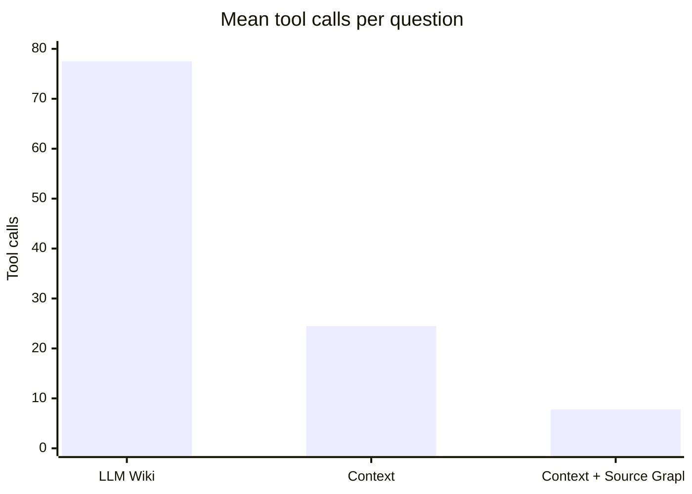

# Knowledge Retrieval Benchmark

<!-- context:section id="summary" -->
## Results at a glance

On 24 real developer questions from a large production full-stack monorepo, Agents answering from Context knowledge fully solved more questions, faster and with far fewer tool calls than Agents using an LLM Wiki. Adding Source Graph for remote code reading cut time and tool calls further.

The headline figures belong to **Context with Source Graph**: compared with the LLM Wiki, it answered in less than half the time (93.2 s against 223.2 s on average) at about a ninth of the estimated cost (about \$0.27 against \$2.45 per question; see "Estimated cost" below). Part of that gain comes from the model change noted below the table.

| Metric | LLM Wiki | Context | Context + Source Graph |
| --- | ---: | ---: | ---: |
| Answering model | GPT 5.6 SOL | GPT 5.6 SOL | Claude Opus 5.5 |
| Fully solved | 19 (79.2%) | 21 (87.5%) | 23 (95.8%) |
| Partly solved / substantively wrong | 2 / 3 | 2 / 1 | 0 / 1 |
| Mean end-to-end time | 223.2 s | 157.1 s | 93.2 s |
| P50 / P90 | 137.2 / 464.7 s | 136.8 / 256.2 s | 89.0 / 123.0 s |
| Mean tool calls | 77.5 | 24.5 | 7.8 |

LLM Wiki and Context used the same model and are directly comparable. The third configuration also changed the model; the same-model comparison below isolates Source Graph's effect.

The method follows [Evaluating Your Knowledge Base](../../sop/practices/evaluating-your-knowledge-base.md); the grading and timing rules are in [Scoring and Timing Standard](../../sop/practices/evaluation-standard.md).
<!-- /context:section -->

<!-- context:section id="setup" -->
## What was compared

Three configurations are compared in the main tables:

| Configuration | Knowledge and retrieval |
| --- | --- |
| LLM Wiki | A one-off generated LLM Wiki; the Agent searches and reads files locally |
| Context | A Context knowledge package; the Agent retrieves locally |
| Context + Source Graph | A Context knowledge package; code is read remotely at a pinned version through Source Graph |

Two further runs used the same Context knowledge with local retrieval and a different model: Claude Opus 5.5, which separates the effect of Source Graph from the model change (see "Source Graph with the same model" below), and Grok 4.7. With the first Context run, they make up the three-model comparison further down. That is five runs in all.

The benchmark measures **answering** with deployed knowledge. Knowledge production — quality, time, review effort and cost of producing and updating knowledge — has not been benchmarked yet.
<!-- /context:section -->

<!-- context:section id="questions" -->
## Questions and scoring

The 24 questions came from real developer questions and were frozen before any run. Each configuration answered each question once.

| Question type | Count |
| --- | ---: |
| Locating interfaces and pages | 7 |
| Business interaction rules | 5 |
| Interfaces and parameters | 4 |
| Permissions and roles | 3 |
| Versions and call relationships | 3 |
| Debugging and environments | 2 |

- Each question had criteria written in advance; answers were graded fully solved, partly solved, substantively wrong or unanswered.
- Grading was done by a model (GPT-6 Astra Ultra) blind to the configuration, without human calibration.
- Time is the end-to-end time until the caller saw the complete answer: mean, P50 and P90 (nearest-rank).
- Tool calls count only calls visible to the Agent.
<!-- /context:section -->

<!-- context:section id="common" -->
## On the 17 questions all three solved

To remove differences in question difficulty, the 17 questions that every configuration in the main tables fully solved were compared separately:

| Metric | LLM Wiki | Context | Context + Source Graph |
| --- | ---: | ---: | ---: |
| Mean end-to-end time | 232.6 s | 160.7 s | 93.5 s |
| P90 | 534.5 s | 258.8 s | 123.2 s |
| Mean tool calls | 78.3 | 24.9 | 8.0 |
<!-- /context:section -->

<!-- context:section id="same-model" -->
## Source Graph with the same model

With Claude Opus 5.5 in both runs, Context with local retrieval fully solved 23 of 24 questions with a mean of 139.3 s, P90 188.7 s and 11.6 tool calls. Adding Source Graph kept 23 of 24 and reduced mean time by 33.1%: 256 local calls for repository preparation, shell, search and file reads were replaced by 164 remote retrievals. Eight remote calls failed parameter validation and the Agent recovered from all of them.

Under the same knowledge and retrieval, another model (Grok 4.7) also fully solved 23 of 24 but took a mean of 304.0 s, about 2.2 times as long. At equal quality, model choice has a large effect on time.
<!-- /context:section -->

<!-- context:section id="models" -->
## Three models on the same knowledge setup

With the same Context knowledge package on a managed Agent platform, the same 24 questions, one run each and the same blind model grader:

| Metric | GPT 5.6 SOL (first run) | Grok 4.7 | Claude Opus 5.5 |
| --- | ---: | ---: | ---: |
| Fully solved | 21 (87.5%) | 23 (95.8%) | 23 (95.8%) |
| Partly solved / substantively wrong | 2 / 1 | 0 / 1 | 0 / 1 |
| Mean / P50 / P90 end-to-end | 157.1 / 136.8 / 256.2 s | 304.0 / 314.2 / 465.9 s | 139.3 / 141.4 / 188.7 s |
| Mean visible tool calls | 24.5 | 40.3 | 11.6 |
| Mean observed startup | 31.8 s | 34.4 s | 40.0 s |

- On the **20 questions all three fully solved**, mean end-to-end time was 162.8 s, 312.7 s and 142.3 s, with 25.4, 41.3 and 12.2 tool calls.
- Against the first run, Claude Opus 5.5 was faster on 18 of 24 questions, with P90 26.3% lower and 52.6% fewer tool calls. Grok 4.7 was slower on all 24 and made 64.0% more tool calls; the longer investigations did not raise the full-resolution rate.
- **Equal counts are not equal answers.** Each newer model fixed some of the first run's gaps and introduced a different error of its own.
- **The same conclusion can come by very different paths.** On one question both models were correct: one took 493.7 s and 75 calls, the other 176.4 s and 18.
<!-- /context:section -->

<!-- context:section id="observations" -->
## What the traces showed

- When the host repository did not contain the target address, the knowledge gave the page → remote SDK → interface chain directly, so the Agent did not search blindly across repositories.
- Questions about differences between versions first need "compared with which version"; the knowledge recorded the pinned commits and comparison range of its sources.
- The few errors came from knowledge that missed a component's branch condition and over-generalized. Such gaps should become revision tasks.
- Tool calls fell from 77.5 to 24.5 and then to 7.8: knowledge reduced blind exploration, and remote retrieval replaced local repository preparation and file reads.
<!-- /context:section -->

<!-- context:section id="attribution" -->
## Where the errors and overhead came from

- **Search scope misjudged.** In a sparse checkout the caller's directory was not checked out, yet a local search was taken as proof that nothing in the whole repository referred to the target. Having read source code is not the same as having searched all of it; confirm the checkout scope before any repository-wide negative conclusion.
- **A condition generalized.** The knowledge stated a region for direct calls and kept field-based calls for dynamic forms; the answer extended the first to every request, and a field for another region in the source was the counterexample. The grade fell because of the wrong claim, not because the process was not shown.
- **Targeted source checks worked.** On the question where the first run missed a parent-page branch condition, both later models traced the parent's component choice and the history data switch and corrected the conclusion.
- **Channel preparation.** Called directly, the configuration under test still ran the steps meant for a chat channel's reply cards: 54 visible related calls across the first run's 24 questions, and for another model — which resolved links and checked channel context on every question — 149 deduplicated calls, 15.4% of its tool calls. They do not mean a card was sent, and their time was not separated. Trimming reply-card preparation at the entry point would remove steps unrelated to answering.
- **Waiting for startup.** From submission to first observing "running" took about 32 s on the managed platform, including polling granularity.
<!-- /context:section -->

<!-- context:section id="startup-estimate" -->
## Conditional estimate: faster startup

This is a **conditional estimate**, not a measurement. Replace each first-run question's measured startup with an assumed target and keep every other stage unchanged:

estimated E2E = measured E2E − measured startup + assumed startup target

| Assumed startup | Mean | P50 | P90 |
| ---: | ---: | ---: | ---: |
| 5 s | 130.4 s | 105.5 s | 229.9 s |
| 10 s | 135.4 s | 110.5 s | 234.9 s |

Whether such a target is reachable has to be re-measured on the same questions and configuration.
<!-- /context:section -->

<!-- context:section id="priorities" -->
## What to improve next

- Verify the checkout scope before concluding that nothing in a repository uses something.
- Keep branch conditions when knowledge is merged or summarized.
- Skip reply-card preparation in direct sessions that have no reply channel.
<!-- /context:section -->

<!-- context:section id="cost" -->
## Estimated cost

Per question, tokens fell from about 567,000 with the LLM Wiki to about 63,000 with Context with Source Graph. At standard API prices (input \$4 and output \$20 per million tokens, no cache discount) that is about \$2.45 → \$0.27, a reduction of 88.9% — about a ninth of the cost. The first and model-switched runs were estimated by replaying requests; the LLM Wiki and latest runs were extrapolated from tool-call counts.
<!-- /context:section -->

<!-- context:section id="limits" -->
## Limits of this comparison

- Each question was run once, so stability cannot be inferred.
- These are whole configurations: LLM Wiki and Context ran in different Agent environments with different system prompts; Context + Source Graph also changed the model and Context version, the run date, concurrency and timeout limits, and is a regression on already-seen questions with a single grader.
- End-to-end time includes environment start-up and polling granularity, not quota queuing.
- Cost is an estimate, as described above.
- In the three-model comparison, the two later runs allowed up to four concurrent questions per model; the first allowed at most two and was partly serial. Dates, Skills, runtime and some read versions also differed, so not every difference belongs to the model.

Size reduction is a different measure: knowledge is about 1/115 of its sources by volume, which says nothing about quality on its own. See [Knowledge for Agents](../knowledge/knowledge-for-agents.md).
<!-- /context:section -->
