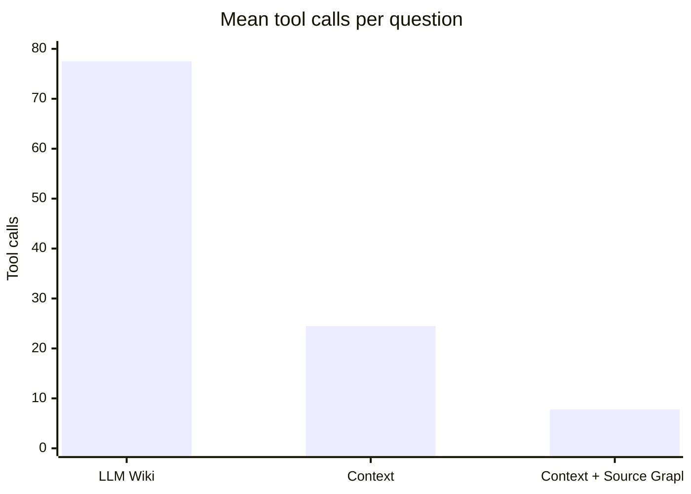

# Knowledge Retrieval Benchmark

<!-- context:section id="summary" -->
## Results at a glance

On 24 real developer questions from a large production full-stack monorepo, Agents answering from Context knowledge fully solved more questions, faster and with far fewer tool calls than Agents using an LLM Wiki. Adding Source Graph for remote code reading cut time and tool calls further.

| Metric | LLM Wiki | Context | Context + Source Graph |
| --- | ---: | ---: | ---: |
| Answering model | GPT 5.6 SOL | GPT 5.6 SOL | Claude Opus 5.5 |
| Fully solved | 19 (79.2%) | 21 (87.5%) | 23 (95.8%) |
| Partly solved / substantively wrong | 2 / 3 | 2 / 1 | 0 / 1 |
| Mean end-to-end time | 223.2 s | 157.1 s | 93.2 s |
| P50 / P90 | 137.2 / 464.7 s | 136.8 / 256.2 s | 89.0 / 123.0 s |
| Mean tool calls | 77.5 | 24.5 | 7.8 |

LLM Wiki and Context used the same model and are directly comparable. The third configuration also changed the model; the same-model comparison below isolates Source Graph's effect.
<!-- /context:section -->

<!-- context:section id="setup" -->
## What was compared

| Configuration | Knowledge and retrieval |
| --- | --- |
| LLM Wiki | A one-off generated LLM Wiki; the Agent searches and reads files locally |
| Context | A Context knowledge package; the Agent retrieves locally |
| Context + Source Graph | A Context knowledge package; code is read remotely at a pinned version through Source Graph |

The benchmark measures **answering** with deployed knowledge. Knowledge production — quality, time, review effort and cost of producing and updating knowledge — has not been benchmarked yet.
<!-- /context:section -->

<!-- context:section id="questions" -->
## Questions and scoring

The 24 questions came from real developer questions and were frozen before any run. Each configuration answered each question once.

| Question type | Count |
| --- | ---: |
| Locating interfaces and pages | 7 |
| Business interaction rules | 5 |
| Interfaces and parameters | 4 |
| Permissions and roles | 3 |
| Versions and call relationships | 3 |
| Debugging and environments | 2 |

- Each question had criteria written in advance; answers were graded fully solved, partly solved, substantively wrong or unanswered.
- Grading was done by a model (GPT-6 Astra Ultra) blind to the configuration, without human calibration.
- Time is the end-to-end time until the caller saw the complete answer: mean, P50 and P90 (nearest-rank).
- Tool calls count only calls visible to the Agent.
<!-- /context:section -->

<!-- context:section id="common" -->
## On the 17 questions all three solved

To remove differences in question difficulty, the 17 questions that every configuration fully solved were compared separately:

| Metric | LLM Wiki | Context | Context + Source Graph |
| --- | ---: | ---: | ---: |
| Mean end-to-end time | 232.6 s | 160.7 s | 93.5 s |
| P90 | 534.5 s | 258.8 s | 123.2 s |
| Mean tool calls | 78.3 | 24.9 | 8.0 |
<!-- /context:section -->

<!-- context:section id="same-model" -->
## Source Graph with the same model

With Claude Opus 5.5 in both runs, Context with local retrieval fully solved 23 of 24 questions with a mean of 139.3 s, P90 188.7 s and 11.6 tool calls. Adding Source Graph kept 23 of 24 and reduced mean time by 33.1%: 256 local calls for repository preparation, shell, search and file reads were replaced by 164 remote retrievals. Eight remote calls failed parameter validation and the Agent recovered from all of them.

Under the same knowledge and retrieval, another model (Grok 4.7) also fully solved 23 of 24 but took a mean of 304.0 s, about 2.2 times as long. At equal quality, model choice has a large effect on time.
<!-- /context:section -->

<!-- context:section id="observations" -->
## What the traces showed

- When the host repository did not contain the target address, the knowledge gave the page → remote SDK → interface chain directly, so the Agent did not search blindly across repositories.
- Questions about differences between versions first need "compared with which version"; the knowledge recorded the pinned commits and comparison range of its sources.
- The few errors came from knowledge that missed a component's branch condition and over-generalized. Such gaps should become revision tasks.
- Tool calls fell from 77.5 to 24.5 and then to 7.8: knowledge reduced blind exploration, and remote retrieval replaced local repository preparation and file reads.
<!-- /context:section -->

<!-- context:section id="cost" -->
## Estimated cost

Per question, tokens fell from about 567,000 to about 63,000. At standard API prices (input \$4 and output \$20 per million tokens, no cache discount) that is about \$2.45 → \$0.27, a reduction of 88.9%. The first and model-switched runs were estimated by replaying requests; the LLM Wiki and latest runs were extrapolated from tool-call counts.
<!-- /context:section -->

<!-- context:section id="limits" -->
## Limits of this comparison

- Each question was run once, so stability cannot be inferred.
- These are whole configurations: LLM Wiki and Context ran in different Agent environments with different system prompts; Context + Source Graph also changed the model and Context version, the run date, concurrency and timeout limits, and is a regression on already-seen questions with a single grader.
- End-to-end time includes environment start-up and polling granularity, not quota queuing.
- Cost is an estimate, as described above.

Size reduction is a different measure: knowledge is about 1/115 of its sources by volume, which says nothing about quality on its own. See [Knowledge for Agents](../knowledge/knowledge-for-agents.md).
<!-- /context:section -->
