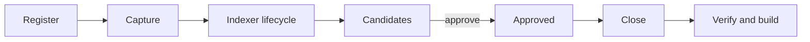

# Knowledge Lifecycle

<!-- context:section id="stages" -->
## From source to package

| Stage | What happens | What it protects |
| --- | --- | --- |
| Register | A repository module, document folder or online document is recorded as a source boundary | Source identity and permission boundary; registration does not grant permission to read beyond it |
| Capture | Document bodies and embedded resources are saved as snapshots; repositories are read at a pinned commit | Complete bodies, resources and fingerprints, so later checks can detect stale inputs |
| Indexer lifecycle | Requirements are confirmed, a plan and work-start report are approved, then Indexer skills write articles in stages | Every section is bound to exact source locations |
| Review | You see the whole current batch of Candidates and approve, reject or ask for revisions | Approval is applied atomically; rejected material keeps a minimal fingerprint so it is not proposed again |
| Close | `knowledge/structure.yaml` is rebuilt from approved pages and their edges | The knowledge map matches the approved pages, without rewriting prose |
| Verify and build | Source references, frontmatter, structure and assets are checked, then packages and sites are produced | Distributed files map back to approved knowledge through a build inventory |
<!-- /context:section -->

<!-- context:section id="indexer" -->
## Inside the Indexer lifecycle

The top-level workflow has a single production step, `run-indexer-lifecycle`, which hands over to the nested Indexer graph:

1. **Requirements.** The reader purpose, questions and authorized sources are recorded in `src/indexers.yaml`.
2. **Planning.** The Agent investigates and writes a plan of articles in batches.
3. **Work-start report.** The plan is presented for confirmation; managed authority does not waive a required decision.
4. **Stage writing.** Each task produces an article and its references; the CLI checks that every cited source is authorized for that task.
5. **Gaps and repair.** Missing evidence becomes further investigation or a repair, not an invented answer.

Code, Markdown, notes and session summaries all converge into one current Candidate batch, and one content Review admits it. See [The Indexer System](../knowledge/indexer-system.md).
<!-- /context:section -->

<!-- context:section id="state" -->
## Where state lives

| Location | Lifetime |
| --- | --- |
| `sources/` | Project state: registries and captured evidence |
| `.tmp/context-runtime/lifecycle/` | Disposable: structure drafts and the active Candidate ledger, removed after a successful close |
| `knowledge/` | Project state: approved pages and `structure.yaml` |
| `dist/` | Reproducible build output |

Candidate IDs are workflow state and never become the identity of approved knowledge; approved Markdown stores its stable identity in frontmatter and section metadata.
<!-- /context:section -->

<!-- context:section id="after" -->
## After the build

Building completes the currently approved state; it does not freeze the Context knowledge workspace. The workflow records a new knowledge workspace version when content changes, before building. Later, `context revise` corrects a selected page and `context update` handles a selected source change; both run through Review and delivery again and touch only what is affected. See [Keeping Knowledge Current](../knowledge/keeping-knowledge-current.md) and [Version-Aware Knowledge](../knowledge/version-aware-knowledge.md).
<!-- /context:section -->
