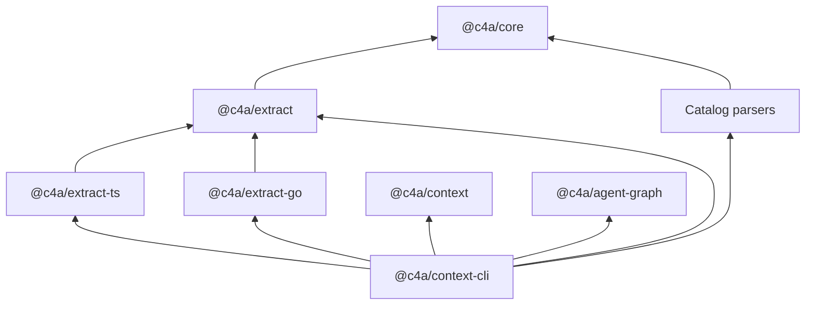

# Module Layout

<!-- context:section id="graph" -->
## Package dependencies

Arrows point from a package to what it depends on; catalog parsers are `extract-rush`, `-mdx`, `-proto`, `-thrift`, `-contract`, `-sql` and `-style`. `@c4a/context-cli` is the only package users install; the SDK, extractors and Agent Graph come with it.
<!-- /context:section -->

<!-- context:section id="packages" -->

## What each package does

| Package | Responsibility |
| --- | --- |
| `@c4a/context` | Declarative SDK for a Context knowledge workspace's `src/index.ts`: sources, phases and package outputs, plus the versioned Indexer contracts |
| `@c4a/context-cli` | The `context` command: knowledge workspace lifecycle, source capture, validation, review, close, build, the documentation website builder, the bundled workflow Provider and the Agent plugin |
| `@c4a/core` | Shared extraction types, schemas and utilities |
| `@c4a/extract` | Language-plugin framework and repository runner for code evidence |
| `@c4a/extract-ts`, `@c4a/extract-go` | TypeScript/JavaScript and Go extraction plugins: symbols, spans, imports and exports |
| `@c4a/extract-rush`, `-mdx`, `-proto`, `-thrift`, `-contract`, `-sql`, `-style` | Lightweight catalogs for Rush workspaces, MDX components, Protocol Buffers, Thrift, OpenAPI/GraphQL contracts, SQL and CSS/SCSS |
| `context-evidence-wasm` | Builds the optional `context-evidence.sourcegraph.wasm` plugin for Source Graph |
| `@c4a/agent-graph` | External, model-free workflow-contract runtime used only by the bundled Provider |

Readers install only `@c4a/context-cli`: it provides the `context` command and the Agent plugin and bundles the core and extractor packages, while the knowledge workspaces it creates depend on `@c4a/context`. Parser packages materialize structural facts; they never write approved knowledge. See [Code Extraction](../knowledge/code-extraction.md).

<!-- /context:section -->

<!-- context:section id="cli-inside" -->

## Inside the CLI package

| Path | Contents |
| --- | --- |
| `src/project/` | Knowledge workspace observation, sources, Indexer lifecycle, review, close, verify and package build |
| `src/project/workflow/` | Observes facts and binds the selected graph action to a revisioned command |
| `context-workflow/` | The Provider source: graphs, actions, resources, schemas and route tests |
| `plugins/context/` (repository root) | The only maintained source of the Agent plugin: four public entry Skills (`context`, `context-plan`, `context-inspect-search`, `context-repo-content`), four Indexer Provider Skills and `context-indexer-create`; host-specific entries are generated at build |

The build emits one bundle: the CLI binary, the immutable Provider under `dist/providers/context`, the plugin projections, the Indexer skills, the diagram viewer and the evidence plugin.

<!-- /context:section -->

<!-- context:section id="blast" -->

## Where a change lands

- `@c4a/context` changes affect knowledge workspace declarations and phase plans.
- `@c4a/context-cli` changes affect commands, Agent workflows, knowledge workspace file formats, review behavior and package output.
- `@c4a/extract` and the extractor and catalog packages (`extract-ts`, `extract-go`, `extract-rush`, `-mdx`, `-proto`, `-thrift`, `-contract`, `-sql`, `-style`) affect only the code facts of their languages and formats; see [Code Extraction](../knowledge/code-extraction.md).
- `context-evidence-wasm` changes affect only how Source Graph enriches remote code reads; local retrieval and knowledge production stay unchanged.
- Agent Graph is a pinned external dependency; Context owns its Provider and host bindings.

<!-- /context:section -->
