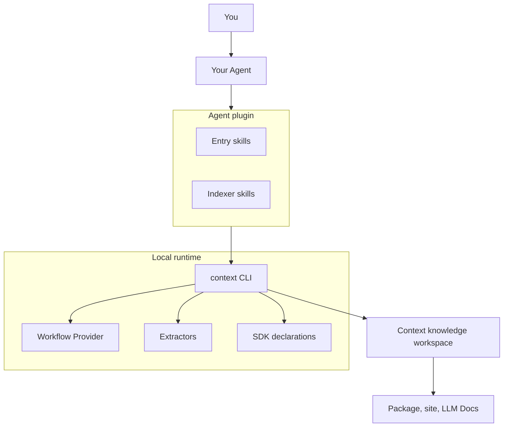

# Architecture Overview

<!-- context:section id="topology" -->
## The parts

| Part | Role |
| --- | --- |
| Agent entries | Thin skills that tell the Agent how to start or continue a Context knowledge workspace and how to follow the current step |
| Indexer skills | Provider skills that read one kind of source and write source-grounded articles |
| `context` CLI | Observes the knowledge workspace, captures sources, runs extractors, validates evidence, applies reviews and builds outputs |
| Workflow Provider | The work contract evaluated by Agent Graph: legal steps, Gates and required reading |
| SDK (`@c4a/context`) | The declaration surface for a knowledge workspace's `src/index.ts`: sources, phases and packages |
| Extractors | Parser packages that turn code and interface definitions into structural facts |
| Evidence plugin | An optional WebAssembly plugin that lets Source Graph attach knowledge sections to code reads |
<!-- /context:section -->

<!-- context:section id="local-first" -->
## Local-first by design

There is no server, daemon, database, hosted API or web frontend in Context. The CLI reads declared sources, writes knowledge workspace files, validates invariants and produces portable packages. Everything a team needs to inspect lives in the knowledge workspace and can be committed to Git; a hosted Agent or Bot runs the same CLI.
<!-- /context:section -->

<!-- context:section id="division" -->
## Who does what

The Agent performs semantic work: reading evidence, proposing structure and content, explaining decisions. The CLI performs deterministic work and never calls an LLM. The user owns the goal, source permissions, structure choices and review decisions. Keeping these apart is what makes a long workflow repeatable — see [Why a Workflow](why-a-workflow.md).
<!-- /context:section -->

<!-- context:section id="flow" -->
## How a request travels

1. The Agent entry runs `context entry`, which resolves initialization, relocation or the current workflow.
2. The CLI observes knowledge workspace facts and asks the Provider for the current Route: the step, its reading list, any Gate and the exact commands.
3. The Agent reads, decides and runs one selected action.
4. The knowledge workspace changes, and the CLI evaluates again.

Details are in [Workflow Execution](workflow-execution.md); the stages a source passes through are in [Knowledge Lifecycle](knowledge-lifecycle.md); package boundaries are in [Module Layout](module-layout.md).
<!-- /context:section -->
