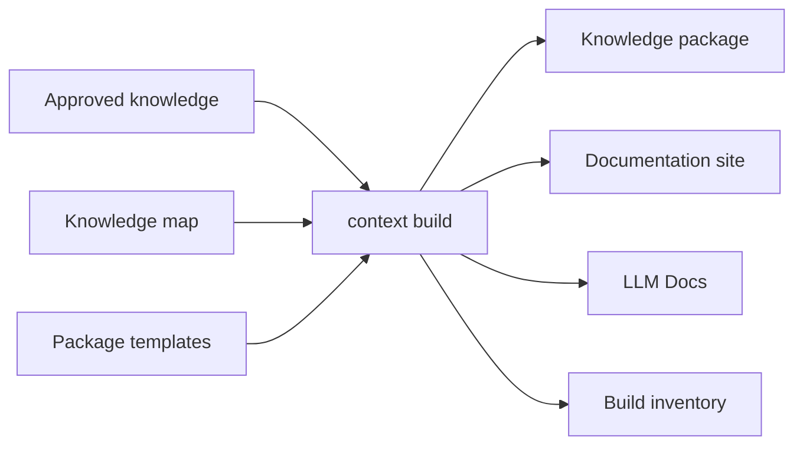

# Packages and Sites

<!-- context:section id="outputs" -->
## One body of knowledge, several outputs



Build consumes only approved and closed knowledge. Output channels can be combined; for a new knowledge workspace the Agent proposes a knowledge package plus a website by default, and LLM text is an additional choice. Every build emits an inventory that maps distributed files back to approved knowledge in the knowledge workspace.
<!-- /context:section -->

<!-- context:section id="kb" -->

## Agent knowledge packages

A knowledge package uses flat roots:

| Root | Internal collections |
| --- | --- |
| `wikis/` | `codegraph`, `business`, `product` |
| `guides/` | `architecture`, `sop`, `faq`, `decision`, `incident` |
| `rules/` | `standards`, `test` |
| `feats/` | `feats` |

The default `context-knowledge-query` skill is the Agent-facing entry, and it is the same in every Context package, so one installed copy serves all the packages a project can reach. It starts from directory indexes, follows edge records in the inventory, reads candidate pages and cites their headings, and reports gaps when the package does not cover a fact. Package-specific terms, synonyms and entry pages live in each package's `others/context/search-guide.md`, which the skill reads first. When indexes do not narrow the scope, its bundled `scripts/search.mjs` ranks Markdown chunks locally. Consumer pages omit `sources` and section metadata; exact attribution stays in the workspace and is reached through the inventory.

<!-- /context:section -->

<!-- context:section id="site" -->

## Documentation sites

Enabling `site` on a package also produces `dist/<base>-site/`: a static site with article pages, local search, scripts and styles, built in a sibling staging directory so a failed site build keeps the previous output.

- **Navigation** comes from the accepted `src/knowledge-map.yaml`. Entries bind to article identity, so labels and groups do not change URLs, and one article can appear in several places.
- **Homepage** uses the first-level knowledge map as a complete site map.
- **Theme** opens in light mode until the reader switches it; the choice is remembered in the browser.
- **Diagrams** written in Mermaid render in the browser with the site theme and offer fit, zoom, full-screen and source controls.
- **Source map** ends each article: its sections in the middle and the documents they cite around them, grouped by where each document comes from, with a list view of the same documents and their cited lines. Repositories link at their recorded revision and documents at their registered URL. `site.sourceMap: false` shows the plain source list instead.
- **Languages** can be added with `site.locales`; untranslated pages show the original with a notice.

Context does not deploy. Preview with any static HTTP server and deploy the contents of `dist/<base>-site/` with your own hosting.

<!-- /context:section -->

<!-- context:section id="llms" -->
## LLM Docs

`llmsPackage()` produces a text bundle for model context, offline evaluation or downstream ingestion:

```text
llms.txt                   # knowledge-map index
llms-full.txt              # consolidated approved text
llms/pages/<identity>.txt  # individual articles
```
<!-- /context:section -->

<!-- context:section id="custom" -->
## Customizing without forking the knowledge

Package templates shape distribution — extra Agent instructions, static files, query helpers — but never replace approved knowledge as the source of truth. Presentation sources for a site, such as homepage slots, custom pages and theme components, live under `src/site/`, separate from generated knowledge.
<!-- /context:section -->
