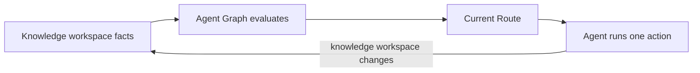

# Workflow Execution

<!-- context:section id="loop" -->
## The evaluation loop

Context does not run a fixed script. Every time the Agent asks what to do, the CLI observes the Context knowledge workspace, turns what it sees into **Facts**, and asks the workflow Provider for the current **Route**.

A Route carries the selected step, a reason code, the resources the Agent must read before acting, any unresolved Gate and the exact commands to run. Only `workflow.current` chooses the next lifecycle step; a command that finishes returns control to a fresh evaluation instead of choosing the next step itself.
<!-- /context:section -->

<!-- context:section id="graphs" -->
## Two graphs

The Provider in `packages/context-cli/context-workflow/` contains two static graphs:

| Graph | Covers |
| --- | --- |
| `workspace` | The top-level lifecycle: repair, source boundary, capture, Indexer lifecycle, review, close, package output, translation, version recording, build and completion, plus rollback |
| `indexer` | Requirements, planning, the work-start report, stage writing, gap handling, source updates and approved-page revisions |

The top-level order is fixed by the graph's edges: source boundary → capture → `run-indexer-lifecycle` → review → close → package output → version → build. Nodes describe stable task categories such as "a capture target remains"; source names, dates and modules are runtime facts and never become graph nodes. That is why one graph serves every knowledge workspace.
<!-- /context:section -->

<!-- context:section id="gates" -->
## Gates

Some nodes are **Gates**: they wait for a decision. Examples are choosing the source boundary, authorizing document capture, approving the work-start report, reviewing the current batch and choosing the package output.

Each Gate declares whether it is delegatable. In ordinary mode a person decides. When you explicitly authorize fully managed operation for the current conversation, the Agent may resolve delegatable Gates — for example applying a review it has checked — but never those marked non-delegatable, such as the work-start report when a scope decision is required. Managed authority is scoped to the conversation and cannot authorize new source boundaries, failed validation or failed verification.
<!-- /context:section -->

<!-- context:section id="revision" -->
## Revisions and stale commands

Every write command is bound to the revision of the observation that produced it. If the knowledge workspace changed since then — another action ran, a file was edited — the command is rejected instead of being applied to newer state. Required resources are acknowledged by digest; dynamic views are tied to the revision that selected them. A receipt proves the Agent received a resource; it does not claim the task is done.
<!-- /context:section -->

<!-- context:section id="resume" -->
## Resuming

With the same Provider, the same observed Facts and the same recorded outcomes, Agent Graph selects the same Route. Work already satisfied by knowledge workspace facts is skipped or advances. So an interruption, a retry or a new conversation converges from observable state, not from conversation memory. The CLI keeps each filesystem effect atomic, guarded or a proven no-op; Agent Graph keeps evaluation repeatable.
<!-- /context:section -->

<!-- context:section id="improve" -->
## How the workflow improves

Route selection is tested without a model: `context-workflow/tests/` holds fact-to-Route scenarios. With debug mode on, Context records CLI invocations and graph evaluations; a replay shows which Route was chosen at each fact change, where a loop advanced and where a Gate paused. Inefficient loops, repeated reads or misleading priorities found in traces become new route tests and graph changes. Long procedures live in separate resources, so they can be improved without touching the entry skill.
<!-- /context:section -->
