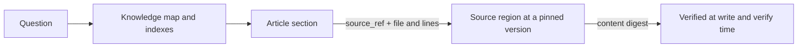

# Evidence Chains and Index First

<!-- context:section id="chain" -->
## The chain

An answer starts from the knowledge map, lands on an article section, and from there follows a reference to an exact region of a registered source. Each step is checkable: the reference names the source and the lines; the source is pinned; the region's content is fingerprinted.
<!-- /context:section -->

<!-- context:section id="sections" -->
## Sections carry their own evidence

Approved articles are divided into sections. Each written fragment cites at most three source positions, each a `source_ref` plus a file and line `locator`. When an article is submitted, the CLI checks that each cited source is authorized for that task, reads the current captured text and computes the region's content digest. Unknown or unauthorized paths and source-version drift are errors, not warnings. There is no separate fact table or claim ledger to maintain — the references are the evidence.

`source_ref` values are opaque, verified identities. Agents copy them exactly; they are not file-system paths.
<!-- /context:section -->

<!-- context:section id="verify" -->
## Checked again before delivery

`context verify` re-checks approved pages before close and build: source references for freshness and verbatim match, frontmatter identity, section blocks, assets and the derived structure. Verification errors block close and build. Approved Markdown keeps a stable identity in frontmatter and section metadata, so a page can be revised without losing its history.
<!-- /context:section -->

<!-- context:section id="index-first" -->
## Index first, then the original

Agents answering from a knowledge package start from directory indexes and the edge records in the build inventory, read the candidate pages, and cite their headings and passages. When the package does not cover a requested fact, they report the gap instead of guessing. Consumer packages omit section metadata to stay small; a maintainer can map any page back to the Context knowledge workspace through the inventory to see its full evidence.

With Source Graph, the chain reaches the code without a clone: the optional evidence plugin joins section markers, `knowledge/structure.yaml` and source registrations, so an Agent reading code at a pinned revision also receives the knowledge sections that cite it. The plugin is read-only; it does not verify source contents or modify knowledge.
<!-- /context:section -->

<!-- context:section id="site" -->
## Visible to readers

On a documentation site, each article ends with a source footer built from its recorded references: repository entries link to the recorded revision and module, and document entries link to their registered URL. Links are never inferred from prose.
<!-- /context:section -->
