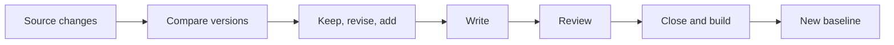

# Keeping Knowledge Current

<!-- context:section id="flow" -->
## The update loop

Building completes the currently approved state; it does not freeze the Context knowledge workspace. When a source moves on, `context update` opens a new round for the selected change. The workflow hands the Agent the fixed old and new source versions and the confirmed requirement scope, plus a list of pages that cite the changed material.
<!-- /context:section -->

<!-- context:section id="decide" -->
## Deciding what to change

The listed pages are candidates to inspect, not an instruction to rewrite all of them. For each page the Agent reads its current approved Markdown and the change, then submits one decision: no change, or a concrete correction. Unrelated content and readers' earlier improvements are preserved.

Existing references cannot discover every new topic, so the Agent also inspects additions and shared dependencies and lists necessary **new pages**, each with a path, title, registered sources and instruction. New pages go through the same writing and review as revisions. A renamed subject is revised in place rather than given a new identity; a retirement explains what disappeared and which readers are affected instead of silently deleting pages.
<!-- /context:section -->

<!-- context:section id="baseline" -->

## Moving the baseline

The CLI keeps the previous processed version until every requested page has been approved, closed and built. If temporary progress is lost, the next inspection starts again from that version and keeps pages already approved. A saved report or acquisition receipt does not prove the update was completed.

When the update settles, pages that were kept as they are are brought up to date with the new version:

- Citations whose text only moved are relocated. This also works on a fresh clone or another machine without the local region cache: for repository sources the cited region is read from the previously settled commit and used only when it still matches the recorded digest.
- Citations whose text changed or cannot be confirmed keep their previous locations, and the completion result lists them in `reference_warnings`.
- Same-repository (`repo-content:`) citations are re-signed to the current repository text, so `verify` will not report them later; when their text changed they are listed in `reference_warnings` as well, which makes the receipt the place to check those pages.
- The structure's input hash is recomputed with the rewritten references, so `verify` is not left reporting a stale structure after settlement.

A warning is a receipt for the accepted decision, not a request to resubmit it: after the update finishes, revise each listed page that needs a correction. See [Version-Aware Knowledge](version-aware-knowledge.md).

<!-- /context:section -->

<!-- context:section id="scope" -->
## Keep the update local

For one or two documents or a clearly bounded module, the update stays local: which articles to add or revise, and where readers expect them. It does not turn into a taxonomy for the whole knowledge workspace or a navigation redesign. Only the sources needed for the current change are restored; missing material stays a gap rather than being treated as investigated.
<!-- /context:section -->

<!-- context:section id="triggers" -->
## Ways an update starts

| Trigger | How |
| --- | --- |
| A source changed | Tell `/c4a:context` the new version; it runs `context update` for the selected scope |
| A page is wrong or incomplete | `context revise "<page>" --instruction "<correction>"` continues through Review and delivery, with no recapture for wording-only changes |
| Unattended or scheduled runs | An authorized task can pass `CONTEXT_RUN_POLICY` with `plan_review` and `knowledge_review` set to `ask` or `delegate`; human-only Gates still stop |

Gaps found while answering questions are handled the same way: they become revision tasks for the affected pages.
<!-- /context:section -->
