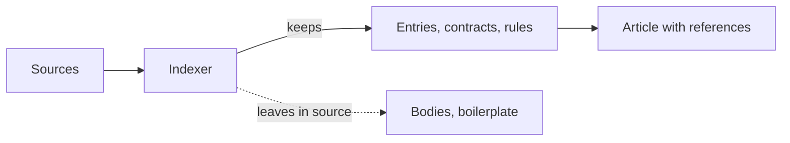

# Knowledge for Agents

<!-- context:section id="principle" -->
## An index, not a copy

An Agent that has to answer a question needs to know **where to look** and **what is true**, quickly. It does not need a second copy of the codebase, and it does not need long, polished prose that restates every function.

Context therefore treats knowledge as an index with explanations:

- each article answers specific reader questions agreed in the requirements;
- each statement points to the exact source region it came from;
- the source itself stays where it is, readable at a pinned version when more detail is needed.

<!-- /context:section -->

<!-- context:section id="on-demand" -->
## Extract on demand

Indexers do not start with a full symbol scan or a complete relationship graph. During planning they expose a useful skeleton — directories, manifests, registration points, public entries — and propose reader topics. Detailed reading happens while writing each topic, bounded to what that topic needs. Signals such as public exports, registered interfaces, scheduled jobs, storage interfaces or generated clients suggest reader questions, not mandatory pages; one page per symbol is explicitly avoided.

Symbol count is not a quality measure. Internal or out-of-scope items can be left out with a reason; Review checks whether the pages actually answer the reader's questions.
<!-- /context:section -->

<!-- context:section id="ratio" -->
## How much smaller

In a large production full-stack monorepo, the two repositories that could be counted locally held about 33,700 code files and 5.84 million lines (about 200 MB); together with about 1,130 document snapshots (about 1.77 MB), they became 220 reviewed articles totalling about 1.75 MB — roughly **1/115** of the source volume.

Two limits apply to that figure:

- only part of the registered sources was counted, so the real ratio is higher;
- the ratio measures size, not coverage or quality. Quality is measured separately in the [Knowledge Retrieval benchmark](../benchmark/knowledge-retrieval.md).

The knowledge is not lossless and does not "cover all code". It keeps the facts needed to answer questions, each with a pointer back to the code line or document section. See [Evidence Chains and Index First](evidence-chains.md).
<!-- /context:section -->
