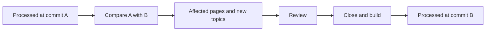

# Version-Aware Knowledge

<!-- context:section id="pinned" -->
## Every source has a fixed version

Knowledge is only checkable if you know which version of the source it describes. Context records that for every input:

| Source | Fixed by |
| --- | --- |
| Repository module | The registered commit; restoring a Context knowledge workspace checks out that commit and never substitutes a newer one |
| Online or local document | A captured snapshot with a fingerprint |
| Note or session summary | The saved file; a session's related commits and merge requests stay in its frontmatter |

References store the real repository path at the cited commit, even if the module is later registered under a different path.
<!-- /context:section -->

<!-- context:section id="processed" -->
## What has been processed

`knowledge/structure.yaml` keeps compact `processed_scopes`: for each requirement, source and module range, the version that knowledge has been brought up to. A source update starts from that version, and the processed version only advances after every requested page in the range has been approved, closed and built — a partial update or failed build leaves it where it was. If temporary progress is lost, the next inspection starts again from the recorded version and keeps already approved pages.

<!-- /context:section -->

<!-- context:section id="workspace-version" -->
## The knowledge workspace has its own version

Besides source versions, the knowledge workspace itself carries a SemVer in `package.json`. At the end of each completed delivery — after Review, close and package configuration, before the final build — the workflow asks the Agent to inspect formal changes and record the next version with a concise changelog:

- **minor** for added modules or expanded material coverage;
- **patch** for corrections, updates to existing modules and navigation changes;
- **major** only on explicit instruction.

The CLI updates `package.json`, `changelog.yaml` and `CHANGELOG.md` together. Knowledge packages and LLM Docs carry the same version and changelog, and a documentation site shows the history on its Changelog page. Temporary progress never increases the version, and intermediate batches do not each get one.
<!-- /context:section -->

<!-- context:section id="restore" -->
## Going back

Because the knowledge workspace is in Git, a historical version can be restored: the Agent resolves the target to a concrete commit and path scope, compares it with current files and restores the selected knowledge workspace files and usable sources. It does not reset the whole repository or rewind source repositories.
<!-- /context:section -->
