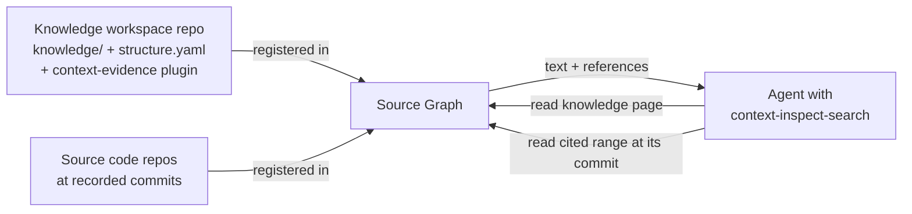

# Evidence for Context

<!-- context:section id="goal" -->
Context knowledge records, for every section, which source files and line ranges it was written from, each pinned to a commit. Source Graph can read any registered repository at any eligible commit. Together they let an Agent go from an answer to the exact code behind it without cloning anything: read the knowledge page, receive its recorded sources alongside the text, then read those sources at their recorded commits.



Two pieces make this work: a WebAssembly plugin that Context places in the knowledge workspace repository, and the query Skill's access policy for using Source Graph.
<!-- /context:section -->

<!-- context:section id="plugin" -->
## The evidence plugin

Source Graph lets a repository ship plugins named `<name>.sourcegraph.wasm`. When it serves a `read` or `read_many`, it discovers plugins in that repository at the same commit being read and runs them after the ordinary read has succeeded; their output is appended to the returned text. Plugins have no network, filesystem or process access — the host binds every file they read to the same repository, commit and readable scope.

Context's plugin is `context-evidence.sourcegraph.wasm`. For each returned file under `knowledge/` that ends in `.md`, it:

1. Reads the full article at that commit only to locate its `<!-- context:section -->` markers, then selects the sections that overlap the lines actually returned.
2. Looks up those sections in `knowledge/structure.yaml`, the approved structure that records each section's references.
3. Appends a YAML `references:` list for the item, deduplicated. Repository references with a full commit and a supported remote become commit-pinned web URLs with line anchors; other references keep their structured fields.

If anything fails, the ordinary text is still returned and the plugin adds diagnostics instead of references. A reference is recorded metadata, not proof that the source was reread during this query.
<!-- /context:section -->

<!-- context:section id="install" -->
## Getting the plugin into the repository

`context init` writes the plugin when the workspace is the repository root, or when it has no enclosing Git repository. For an existing workspace run:

```bash
context evidence install --format json
```

A workspace nested inside a larger repository needs an explicit choice: `--repository-root <git-root>` when Source Graph hosts the whole repository, or `--plugin-root <registered-content-root>` when it hosts only a registered path; the workspace directory relative to that root is then passed to the plugin as `workspace_root`. The installer upgrades only files it recognizes as earlier versions of the plugin, preserves unknown or modified files with the same name, and never commits or pushes — commit the file and let Source Graph synchronize before relying on it remotely.
<!-- /context:section -->

<!-- context:section id="query" -->
## How the query Skill uses Source Graph

The `context-inspect-search` Skill reads Source Graph through a read-only MCP server the host names `context-sourcegraph`. `CONTEXT_QUERY_ACCESS_MODE` decides when:

| Mode | Behavior |
| --- | --- |
| `auto` (default) | Reuse suitable local material first, then prefer the authorized read-only service before local retrieval |
| `remote` | Read knowledge and original code only through the service; never clone automatically, and on failure use only material that already carries a version |
| `local` | Local retrieval only; no MCP required |

For remote knowledge, the Skill resolves a branch once and pins the returned full commit for every knowledge read in that answer. It searches within `knowledge/**`, reads the matching sections, and consumes the references the plugin already attached rather than rereading to request them; when a host does not enable plugins by default it asks for `plugins: [{"name":"context-evidence"}]` once.
<!-- /context:section -->

<!-- context:section id="code" -->
## Reading the cited code

For code, the Skill passes the exact repository from the source registration, the recorded full commit as the revision, and a repository-root-relative path that already includes any registered subpath. It reads directly when the file is known and searches that repository and commit when it is not, without a discovery pass before every query. It never replaces a missing baseline with the default branch.

Each piece of evidence keeps four things together: the repository, the returned full commit, the path and the returned line range. Multi-step reads stay on the same commit, follow the continuation range the service returns, and treat `Partial`, `Truncated` and coverage as limits rather than proof of absence. With `read_many`, every item's content and error are checked separately.
<!-- /context:section -->

<!-- context:section id="next" -->
## Related pages

- [Reading Code Evidence Remotely](../../sop/querying-knowledge/reading-code-evidence-remotely.md) — turning this on for an Agent.
- [Evidence Chains and Index First](../knowledge/evidence-chains.md) — why every section records its sources.
- [Pinned Search and Reads](pinned-search-and-reads.md) — how Source Graph resolves commits and bounds reads.
<!-- /context:section -->
