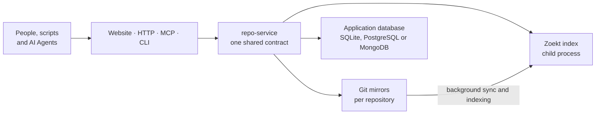

# Architecture Overview

<!-- context:section id="goal" -->
This page describes how **Context Source Graph** works: the operations it shares across its four surfaces, how one instance is put together and who can do what. It is a self-hosted Go application built on Git and the Zoekt trigram index; every request resolves to one exact commit before anything is read. For why it exists, what it is good for and how to start, read [What Is Source Graph](../../sop/source-graph/introduction.md).

The source code is at [github.com/context4ai/sourcegraph](https://github.com/context4ai/sourcegraph). The name does not imply any affiliation with the Sourcegraph platform.
<!-- /context:section -->

<!-- context:section id="surfaces" -->

## One contract, four surfaces

All four entry points share these operations; `read_many` is available through MCP only:

| Operation | What it does |
| --- | --- |
| `repositories` | List registered repositories and their observed branches |
| `availability` | Show a repository's retained versions and indexing status |
| `resolve` | Turn a branch, or an eligible full SHA, into the fixed commit to use next |
| `search` | Search file contents at one commit, shaped like `rg` |
| `read` | Read a line range of one file at one commit |
| `read_many` | Read up to ten known ranges from one repository at one commit in a single MCP call |
| `list` | List one directory at one commit |
| `diff` | Compare two eligible commits |
| `prepare` | Ask for a commit to be synchronized and indexed (authorized callers only) |

The website lives under `/sourcegraph/`, the MCP endpoint at `/sourcegraph/mcp`, and the HTTP API under `/sourcegraph/v1/` and `/sourcegraph/api/`. The command-line client `sourcegraph-cli` calls the same HTTP routes. Exact routes, tool inputs and limits are in the [HTTP and MCP](../../product/reference/source-graph/http-and-mcp.md) and [CLI](../../product/reference/source-graph/cli.md) references.

<!-- /context:section -->

<!-- context:section id="components" -->
## How an instance is put together

A Source Graph instance is a single `repo-service` process. It starts the Zoekt search server as a child process listening only on the loopback interface, keeps a bare Git mirror for each registered repository on its data volume, and runs background workers that synchronize monitored branches and index new branch heads.

The application database stores repositories, jobs, identities and settings. SQLite is the default; PostgreSQL and MongoDB are supported for larger or sharded deployments. Git mirrors and indexes always stay on the instance's local disk — search speed comes from that locality — so capacity is planned around disk rather than CPU. To grow, run several instances that each own a disjoint set of repositories; never run two instances over the same repositories or data directory. [Self-Hosting](../../sop/source-graph/self-hosting.md) covers both topologies.

Repositories can also ship WebAssembly plugins named `<name>.sourcegraph.wasm` that add text to `read` and `read_many` results. Context uses this to attach each knowledge section's sources, described in [Evidence for Context](evidence-for-context.md).
<!-- /context:section -->

<!-- context:section id="access" -->
## Who can do what

Without any sign-in provider configured, an instance is an anonymous, read-only site: visitors can search and read repositories marked public, subject to per-minute rate limits. Adding Google or GitHub sign-in enables administration, and the first verified user becomes the administrator. Signed-in users can create personal API keys for scripts and Agents, and a service token covers automation. Registering repositories, indexing older commits and other changes require an administrator or the service token. [Authentication and Access Control](../../sop/source-graph/authentication-and-access-control.md) lists the full matrix.
<!-- /context:section -->

<!-- context:section id="next" -->
## Where to go next

| To… | Read |
| --- | --- |
| Learn why Source Graph exists and how to start | [What Is Source Graph](../../sop/source-graph/introduction.md) |
| Understand pinned search and the speed comparison | [Pinned Search and Reads](pinned-search-and-reads.md) |
| See how Context knowledge and Source Graph combine | [Evidence for Context](evidence-for-context.md) |
| Connect a browser, MCP client, script or the CLI | [Connecting](../../sop/source-graph/connecting.md) |
| Add repositories and monorepo path groups | [Registering Repositories](../../sop/source-graph/registering-repositories.md) |
| Deploy your own instance | [Self-Hosting](../../sop/source-graph/self-hosting.md) |
| Configure sign-in and API keys | [Authentication and Access Control](../../sop/source-graph/authentication-and-access-control.md) |
| Run, monitor and troubleshoot it | [Operations](../../sop/source-graph/operations.md) |
| Look up routes, tools, flags and settings | [HTTP and MCP](../../product/reference/source-graph/http-and-mcp.md), [CLI](../../product/reference/source-graph/cli.md), [Query Syntax](../../product/reference/source-graph/query-syntax.md), [Configuration](../../product/reference/source-graph/configuration.md) |
<!-- /context:section -->
