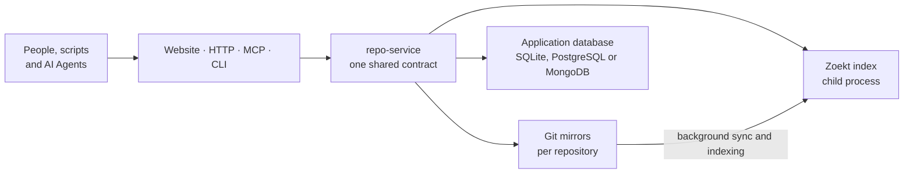

# Source Graph Overview

<!-- context:section id="goal" -->
**Context Source Graph** is a self-hosted service for searching and reading code at pinned Git revisions. It is built on Go, Git and the Zoekt trigram index, and it exists for the workload AI coding Agents create: many small, precise *search, then read* round trips against code the Agent has not checked out.

Every request resolves to one exact commit before anything is read, so a search hit, the file it points to and a later diff all describe the same snapshot. The same operations are available in a browser, over HTTP, as an MCP server and from a command-line client.

Source Graph is part of the Context project. The name does not imply any affiliation with the Sourcegraph platform.
<!-- /context:section -->

<!-- context:section id="why" -->
## Why it exists

An Agent answering a question about code usually needs a handful of exact lines, not a whole repository. Cloning every repository into every Agent sandbox at the right revision is slow, and running `rg` or `git grep` over a checkout repeats the same scan on each call. Source Graph keeps an index per repository and answers instead:

- **Fast.** Indexed search typically completes in a few milliseconds on the server. With the service in the same region as its callers, a full request including the network stays well under 100 ms. [Pinned Search and Reads](pinned-search-and-reads.md) explains where the speed comes from and shows the measured comparison.
- **Reproducible.** Branches resolve to a commit first, and full commit SHAs are accepted only inside the repository's retention window, so answers never drift to a different snapshot mid-conversation.
- **Agent-ready.** The MCP endpoint is stateless Streamable HTTP and works with any MCP client. Anonymous access is read-only and limited to public repositories.
- **Small footprint.** One process manages the Git mirrors, the search engine and background indexing; SQLite is the default database.
<!-- /context:section -->

<!-- context:section id="surfaces" -->
## One contract, four surfaces

All four entry points expose the same operations:

| Operation | What it does |
| --- | --- |
| `repositories` | List registered repositories and their observed branches |
| `availability` | Show a repository's retained versions and indexing status |
| `resolve` | Turn a branch, or an eligible full SHA, into the fixed commit to use next |
| `search` | Search file contents at one commit, shaped like `rg` |
| `read` | Read a line range of one file at one commit |
| `read_many` | Read up to ten known ranges at one commit in a single MCP call |
| `list` | List one directory at one commit |
| `diff` | Compare two eligible commits |
| `prepare` | Ask for a commit to be synchronized and indexed (authorized callers only) |

The website lives under `/sourcegraph/`, the MCP endpoint at `/sourcegraph/mcp`, and the HTTP API under `/sourcegraph/v1/` and `/sourcegraph/api/`. The command-line client `sourcegraph-cli` calls the same HTTP routes. Exact routes, tool inputs and limits are in the [HTTP and MCP](../../product/reference/source-graph/http-and-mcp.md) and [CLI](../../product/reference/source-graph/cli.md) references.
<!-- /context:section -->

<!-- context:section id="components" -->
## How an instance is put together

A Source Graph instance is a single `repo-service` process. It starts the Zoekt search server as a child process listening only on the loopback interface, keeps a bare Git mirror for each registered repository on its data volume, and runs background workers that synchronize monitored branches and index new branch heads.

The application database stores repositories, jobs, identities and settings. SQLite is the default; PostgreSQL and MongoDB are supported for larger or sharded deployments. Git mirrors and indexes always stay on the instance's local disk — search speed comes from that locality — so capacity is planned around disk rather than CPU. To grow, run several instances that each own a disjoint set of repositories; never run two instances over the same repositories or data directory. [Self-Hosting](../../sop/source-graph/self-hosting.md) covers both topologies.

Repositories can also ship WebAssembly plugins named `<name>.sourcegraph.wasm` that add text to `read` and `read_many` results. Context uses this to attach each knowledge section's sources, described in [Evidence for Context](evidence-for-context.md).
<!-- /context:section -->

<!-- context:section id="access" -->
## Who can do what

Without any sign-in provider configured, an instance is an anonymous, read-only site: visitors can search and read repositories marked public, subject to per-minute rate limits. Adding Google or GitHub sign-in enables administration, and the first verified user becomes the administrator. Signed-in users can create personal API keys for scripts and Agents, and a service token covers automation. Registering repositories, indexing older commits and other changes require an administrator or the service token. [Authentication and Access Control](../../sop/source-graph/authentication-and-access-control.md) lists the full matrix.
<!-- /context:section -->

<!-- context:section id="next" -->
## Where to go next

A public demo instance at [context4ai.org/sourcegraph](https://context4ai.org/sourcegraph/) indexes the Context and Source Graph repositories and allows anonymous reading.

| To… | Read |
| --- | --- |
| Understand pinned search and the speed comparison | [Pinned Search and Reads](pinned-search-and-reads.md) |
| See how Context knowledge and Source Graph combine | [Evidence for Context](evidence-for-context.md) |
| Connect a browser, MCP client, script or the CLI | [Connecting](../../sop/source-graph/connecting.md) |
| Add repositories and monorepo path groups | [Registering Repositories](../../sop/source-graph/registering-repositories.md) |
| Deploy your own instance | [Self-Hosting](../../sop/source-graph/self-hosting.md) |
| Configure sign-in and API keys | [Authentication and Access Control](../../sop/source-graph/authentication-and-access-control.md) |
| Run, monitor and troubleshoot it | [Operations](../../sop/source-graph/operations.md) |
| Look up routes, tools, flags and settings | [HTTP and MCP](../../product/reference/source-graph/http-and-mcp.md), [CLI](../../product/reference/source-graph/cli.md), [Query Syntax](../../product/reference/source-graph/query-syntax.md), [Configuration](../../product/reference/source-graph/configuration.md) |
<!-- /context:section -->
