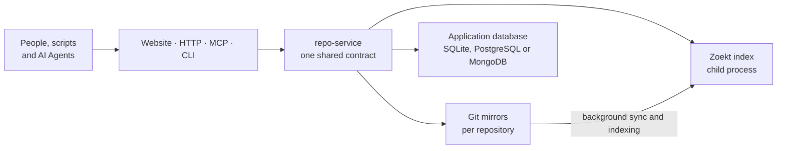

# Architecture Overview

<!-- context:section id="goal" -->
This page describes how **Context Source Graph** works: the operations it shares across its four surfaces, how one instance is put together and who can do what. It is a self-hosted Go application built on Git and the Zoekt trigram index; every request resolves to one exact commit before anything is read. For why it exists, what it is good for and how to start, read [What Is Source Graph](../../sop/source-graph/introduction.md).

The source code is at [github.com/context4ai/sourcegraph](https://github.com/context4ai/sourcegraph). The name does not imply any affiliation with the Sourcegraph platform.
<!-- /context:section -->

<!-- context:section id="surfaces" -->

## One contract, four surfaces

The website, HTTP, MCP and the CLI share these operations; `read_many` is available through MCP only, and `refs` through MCP and HTTP:

| Operation | What it does |
| --- | --- |
| `repositories` | List registered repositories and their observed branches |
| `availability` | Show a repository's retained versions and indexing status |
| `refs` | Find a repository's branches and tags, with each one's commit, time, author and title and whether that commit is indexed |
| `resolve` | Turn a branch, a tag or an eligible full SHA into the fixed commit to use next, without downloading code |
| `search` | Search file contents at one commit, shaped like `rg` |
| `read` | Read a line range of one file at one commit |
| `read_many` | Read up to ten known ranges from one repository at one commit in a single MCP call |
| `list` | List one directory at one commit |
| `diff` | Compare two eligible commits |
| `prepare` | Ask for a commit to be synchronized and indexed (authorized callers only) |

Operations that read code take a monitored branch or a full SHA; only `resolve` also accepts other branches and tags, so a caller working from one of those resolves it first and carries the returned SHA. The website lives under `/sourcegraph/`, the MCP endpoint at `/sourcegraph/mcp`, and the HTTP API under `/sourcegraph/v1/` and `/sourcegraph/api/`. The command-line client `sourcegraph-cli` calls the same HTTP routes. Exact routes, tool inputs and limits are in the [HTTP and MCP](../../product/reference/source-graph/http-and-mcp.md) and [CLI](../../product/reference/source-graph/cli.md) references.

<!-- /context:section -->

<!-- context:section id="components" -->

## How an instance is put together

A Source Graph instance is a single `repo-service` process. It starts the Zoekt search server as a child process listening only on the loopback interface, keeps a bare Git mirror for each registered repository on its data volume, and runs background workers that synchronize snapshots of monitored branch heads, index new heads and collect expired indexes. Each repository has a storage budget for its Git objects and indexes; when it fills, the oldest snapshots that are not branch heads, pins or in use by a job are released rather than new work being refused. A separate background pass finishes the Git collection of released snapshots, so space is recovered even after an interrupted job.

Branches and tags beyond the monitored ones are discovered without touching the mirrors. For `refs` and `resolve`, the service keeps an in-memory catalog of each repository's branches and tags, built by listing the remote and downloading only commit and tag objects, without file trees, into a scratch directory that is deleted as soon as it is parsed. A single name that is not in a fresh, complete catalog is looked up on the remote the same way. Discovery never indexes or adds versions; a commit becomes searchable only when it is prepared.

The application database stores repositories, jobs, identities and settings, and also the instance's application secrets: code-source tokens with their encryption key, the service API credential and the Google/GitHub sign-in configuration, all encrypted. The data volume therefore holds only Git mirrors and indexes, and a replacement host needs the database rather than an old key file. SQLite is the default; PostgreSQL and MongoDB are supported for larger or sharded deployments. Git mirrors and indexes always stay on the instance's local disk — search speed comes from that locality — so capacity is planned around disk rather than CPU. To grow, run several instances that each own a disjoint set of repositories; never run two instances over the same repositories or data directory. [Ops: Self-Hosting Source Graph](../../sop/source-graph/self-hosting.md) covers both topologies.

Repositories can also ship WebAssembly plugins named `<name>.sourcegraph.wasm` that add text to `read` and `read_many` results. Context uses this to attach each knowledge section's sources, described in [Evidence for Context](evidence-for-context.md).

<!-- /context:section -->

<!-- context:section id="access" -->

## Who can do what

Without any sign-in provider configured, an instance is an anonymous, read-only site: visitors can search and read public repositories, subject to per-minute rate limits. Adding Google or GitHub sign-in enables administration, and the first verified user becomes the administrator. Each repository is public or private: a private repository is visible only to its creator, its managers, administrators signed in on the website and the service token, and to everyone else it looks unregistered. Signed-in users can create personal API keys for scripts and Agents, which read as their owner, and a service token covers automation. Registering repositories, indexing older commits and other changes require an administrator or the service token, unless the site lets signed-in users register repositories: each such user then manages the repositories they register and can add other managers. [Ops: Sign-in and Permissions](../../sop/source-graph/authentication-and-access-control.md) lists the full matrix.

<!-- /context:section -->

<!-- context:section id="next" -->
## Where to go next

| To… | Read |
| --- | --- |
| Learn why Source Graph exists and how to start | [What Is Source Graph](../../sop/source-graph/introduction.md) |
| Understand pinned search and the speed comparison | [Pinned Search and Reads](pinned-search-and-reads.md) |
| See how Context knowledge and Source Graph combine | [Evidence for Context](evidence-for-context.md) |
| Connect a browser, MCP client, script or the CLI | [Connecting Agents, Scripts and the CLI to Source Graph](../../sop/source-graph/connecting.md) |
| Add repositories and monorepo path groups | [Registering and Managing Repositories](../../sop/source-graph/registering-repositories.md) |
| Deploy your own instance | [Ops: Self-Hosting Source Graph](../../sop/source-graph/self-hosting.md) |
| Configure sign-in and API keys | [Ops: Sign-in and Permissions](../../sop/source-graph/authentication-and-access-control.md) |
| Run, monitor and troubleshoot it | [Ops: Day-to-Day Operations](../../sop/source-graph/operations.md) |
| Look up routes, tools, flags and settings | [HTTP and MCP](../../product/reference/source-graph/http-and-mcp.md), [CLI](../../product/reference/source-graph/cli.md), [Query Syntax](../../product/reference/source-graph/query-syntax.md), [Configuration](../../product/reference/source-graph/configuration.md) |
<!-- /context:section -->
