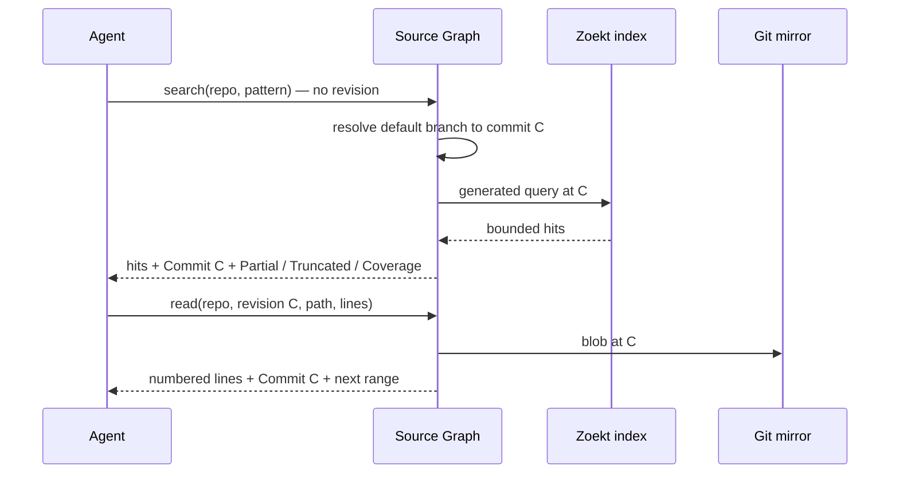

# Pinned Search and Reads

<!-- context:section id="goal" -->
Source Graph answers each request at exactly one Git commit. It first turns the requested revision into a commit inside the repository's retention window, then searches the index or reads Git at that commit, and returns the commit with the result so the caller can keep using it. This page explains how revisions resolve, how versions are kept and indexed, what bounds a search or read, and why the approach is faster than running `rg` over a checkout.

<!-- /context:section -->

<!-- context:section id="resolve" -->

## How a revision resolves

Every operation that reads code — `search`, `read`, `read_many`, `list` and `diff` — accepts a revision and turns it into one commit with the same rules. `resolve` applies the same rules and also accepts any other branch or tag, so it is the way in for a revision the other operations refuse:

| You pass | Source Graph uses | Accepted by |
| --- | --- | --- |
| Nothing | The repository's discovered default branch when the policy follows it; otherwise the single configured `main` or `master` branch, at its last synchronized head | Every operation |
| A monitored branch, by name or as `refs/heads/<name>` | That branch's last synchronized head; the remote is not asked, so the answer can lag behind the remote's latest commit | Every operation |
| A full 40-character lowercase commit SHA | That commit, if it is one of the repository's observed or retained versions; otherwise `REVISION_NOT_ELIGIBLE` | Every operation |
| Any other branch or tag, by name or as `refs/heads/<name>` or `refs/tags/<name>` | The commit the ref currently points to on the remote | `resolve` only; the others return `BRANCH_NOT_MONITORED` or `INVALID_REVISION` |
| A short SHA, `HEAD`, a revision expression or a name with characters the service does not accept | Rejected (`SHORT_SHA_UNSUPPORTED`, `INVALID_REVISION`) | — |

For a branch or tag outside the monitored set, `resolve` first consults the repository's ref catalog — the in-memory list of branches and tags that `refs` pages through — but trusts it only when it is fresh and complete. A stale catalog, a truncated one or a names-only one never proves that a name is absent; in those cases `resolve` asks the remote for exactly that name. The lookup downloads only the matching ref's commit and tag objects, without file trees, into a scratch directory, reads the object type and commit details from what was actually downloaded and deletes the directory. A branch that moves between listing and download therefore resolves to the downloaded commit, a tag that ends at a tree or blob returns `REF_NOT_COMMIT`, and an object that cannot be verified returns a retryable `REMOTE_UNAVAILABLE` rather than a guess. A bare name shared by a branch and a tag returns `REF_AMBIGUOUS`, and an unknown name `REF_NOT_FOUND`. The answer reports `source` (`observed`, `catalog` or `remote`), the full `ref`, and whether the commit is `indexed`. Resolving never downloads code, adds a version or builds an index.

`REVISION_NOT_ELIGIBLE` means the commit is not among the versions Source Graph currently keeps for that repository. A commit can be missing because retention or capacity released it, but also because it was never a synchronized branch head — commits pushed between two syncs are not recorded — because it comes from an unmonitored branch or a tag and was never prepared, or because the SHA belongs to a different repository; check the repository and full SHA together before assuming it expired. To use such a commit, prepare its full SHA. Source Graph never silently replaces a requested baseline with another commit, so a caller that pins the returned commit gets the same snapshot on every later call for as long as that version is kept.

<!-- /context:section -->

<!-- context:section id="versions" -->

## Which versions exist

A repository's versions come from two places. Background synchronization fetches depth-one snapshots of one to eight monitored branch heads (optionally including the remote's default branch) — never tags, and without their parent history — on the repository's sync interval, and records each head; commits pushed between two syncs are not recorded. Preparing a full SHA adds any other commit: Source Graph fetches that snapshot directly from the code source without deepening the history, typically after `resolve` has turned a branch or tag into that SHA. Many versions of one repository can therefore coexist.

Every version is either protected or ordinary. Current branch heads, pinned snapshots and the commits of queued or running jobs are protected and never released. Pins are set only in the repository's settings; preparing a SHA does not pin it, so a prepared snapshot is ordinary like any other. Ordinary snapshots leave in two ways:

- **Retention** keeps them by **days** since first observation (1–365) or by a **count** of the most recently observed ones (1–4096). It runs after each successful sync and again as soon as a preparation publishes its index.
- **Capacity** releases the oldest unprotected snapshots, by first observation, instead of refusing new work: when a path group reaches 4096 snapshots, and when the repository's storage budget is reached at a safe point before or after a fetch or index build, in batches of at most 64.

A released version answers `REVISION_NOT_ELIGIBLE` until it is prepared again. Only when protected versions alone fill the 4096 slots or the budget does work fail, with `SNAPSHOT_LIMIT` or `REPOSITORY_STORAGE_LIMIT`.

Indexing is separate from eligibility. After a successful sync, the service queues an index job for each branch head that is not yet indexed, and stops retrying a head after three failures. Older retained snapshots stay readable from Git but are searchable only after someone with permission asks for them with `prepare`; searching an unindexed commit returns `INDEX_NOT_READY`, and `resolve` reports `indexed: false` with a hint about who can prepare it. Each index is stored as a separate generation. Generations that no retained snapshot references are collected in background rounds that work repository by repository, and a separate background pass finishes the Git collection of released snapshots, so their space is recovered even if the job that released them was interrupted.

<!-- /context:section -->

<!-- context:section id="search" -->
## What bounds a search

Callers never send engine syntax. A search is a set of structured, `rg`-like fields — a line-oriented regular expression or literal, case folding, globs and directory paths — that the service compiles into an engine query at the resolved commit. The [Query Syntax](../../product/reference/source-graph/query-syntax.md) reference lists every field.

Results are a bounded first page. The first attempt returns up to 100 files and 1,000 matches with two lines of context; if the response would exceed its 2 MiB budget, the service retries with smaller pages and finally a file-only listing, all within a five-second deadline. The response metadata tells the caller what it got:

- `Commit` and `Repository` identify the snapshot.
- `Partial` means the engine stopped early, for example at its 10,000-match cap.
- `Truncated` means more files or matches existed than were displayed.
- `Coverage` describes what was indexed — text only, no symbol index, the registered paths and groups — so a zero-hit result is not proof that something is absent from the repository.
<!-- /context:section -->

<!-- context:section id="read" -->

## What bounds a read

A `read` returns an inclusive line range of one file at one commit, at most 500 lines and 256 KiB per call; `end_line` is the absolute number of the last line, not a line count. When no range is given over MCP it starts at line 1 and covers up to 500 lines. The response says which lines were returned and where to continue, and flags truncation, binary content, unsupported encodings and Git LFS pointers instead of guessing.

In a full-repository registration, reads go straight to Git and do not wait for indexing. In a monorepo registration, the path group must already be prepared at that commit (`CONTENT_NOT_READY` otherwise). `read_many` reads one to ten known ranges from one repository at one full commit SHA in a single MCP call, sharing a budget of 1,000 lines, 256 KiB and 30 seconds; each item reports its own content and error.

<!-- /context:section -->

<!-- context:section id="speed" -->
## Why it is faster than a checkout

`rg` and `git grep` scan files on every call; the trigram index does that work once per commit. The project's README reports this comparison against the public demo repository (`context4ai/context`, 2,359 indexed files) and a local checkout of the same commit:

| Query | Source Graph (server) | `rg` (local) | `git grep` (local) | `grep -r` (local) |
| --- | ---: | ---: | ---: | ---: |
| Literal, 13 matching files | 0.7–0.9 ms | 61 ms | — | — |
| Literal, ~100+ matching files | 3.6–5.2 ms | 61 ms | 39 ms | 3.6 s |
| Regex, no matches | 0.4 ms | 62 ms | — | — |

Server time is the search duration the engine reports. The local tools ran on an Apple M4 Pro with a warm page cache. Add the network round trip — a few milliseconds within one region — for end-to-end latency. The gap widens as repositories grow, and the service also removes the need to check out every repository at the right revision.

Speed depends on locality: each instance keeps its Git mirrors and indexes on its own disk, so deploy instances in the same region as the Agents that call them. How Context's own measurements compare answering with and without Source Graph is covered in [Knowledge Retrieval](../benchmark/knowledge-retrieval.md).
<!-- /context:section -->
