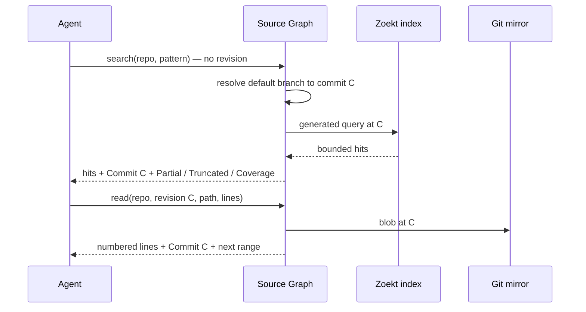

# Pinned Search and Reads

<!-- context:section id="goal" -->
Source Graph answers each request at exactly one Git commit. It first turns the requested revision into a commit inside the repository's retention window, then searches the index or reads Git at that commit, and returns the commit with the result so the caller can keep using it. This page explains how revisions resolve, how versions are kept and indexed, what bounds a search or read, and why the approach is faster than running `rg` over a checkout.

<!-- /context:section -->

<!-- context:section id="resolve" -->

## How a revision resolves

Every operation accepts an optional revision and resolves it with the same rules:

| You pass | Source Graph uses |
| --- | --- |
| Nothing | The repository's discovered default branch when the policy follows it; otherwise the single configured `main` or `master` branch, at its last synchronized head |
| A monitored branch name | That branch's last synchronized head |
| A full 40-character lowercase commit SHA | That commit, if it is inside the retention window |
| A short SHA, a tag, `HEAD` or another ref | Rejected (`SHORT_SHA_UNSUPPORTED`, `INVALID_REVISION`) |
| An unmonitored branch | Rejected (`BRANCH_NOT_MONITORED`) |

`REVISION_NOT_ELIGIBLE` means the commit is not among the versions Source Graph currently observes for that repository. A commit can be missing because it aged out of the retention window, but also because it belongs to a branch that is not monitored, the repository has not synchronized it yet, or the SHA belongs to a different repository; check the repository and full SHA together before assuming it expired. Source Graph never silently replaces a requested baseline with another commit, so a caller that pins the returned commit gets the same snapshot on every later call.

<!-- /context:section -->

<!-- context:section id="versions" -->
## Which versions exist

Each repository has a retention policy: one to eight monitored branches (optionally including the remote's default branch) and a window defined either by **days** (1–365) or by **count** (1–4096 first-parent commits per branch). Background synchronization fetches only the monitored branches — never tags — on the repository's sync interval, records each branch head and builds the set of eligible versions from the window. Many versions of one repository can therefore coexist.

Indexing is separate from eligibility. After a successful sync, the service queues an index job for each branch head that is not yet indexed, and stops retrying a head after three failures. Older commits in the window stay readable from Git but are searchable only after someone with permission asks for them with `prepare`; searching an unindexed commit returns `INDEX_NOT_READY`. Each index is stored as a separate generation, and generations no longer referenced by any retained version are removed in the background, at most one per collection pass.
<!-- /context:section -->

<!-- context:section id="search" -->
## What bounds a search

Callers never send engine syntax. A search is a set of structured, `rg`-like fields — a line-oriented regular expression or literal, case folding, globs and directory paths — that the service compiles into an engine query at the resolved commit. The [Query Syntax](../../product/reference/source-graph/query-syntax.md) reference lists every field.

Results are a bounded first page. The first attempt returns up to 100 files and 1,000 matches with two lines of context; if the response would exceed its 2 MiB budget, the service retries with smaller pages and finally a file-only listing, all within a five-second deadline. The response metadata tells the caller what it got:

- `Commit` and `Repository` identify the snapshot.
- `Partial` means the engine stopped early, for example at its 10,000-match cap.
- `Truncated` means more files or matches existed than were displayed.
- `Coverage` describes what was indexed — text only, no symbol index, the registered paths and groups — so a zero-hit result is not proof that something is absent from the repository.
<!-- /context:section -->

<!-- context:section id="read" -->

## What bounds a read

A `read` returns an inclusive line range of one file at one commit, at most 500 lines and 256 KiB per call; `end_line` is the absolute number of the last line, not a line count. When no range is given over MCP it starts at line 1 and covers up to 500 lines. The response says which lines were returned and where to continue, and flags truncation, binary content, unsupported encodings and Git LFS pointers instead of guessing.

In a full-repository registration, reads go straight to Git and do not wait for indexing. In a monorepo registration, the path group must already be prepared at that commit (`CONTENT_NOT_READY` otherwise). `read_many` reads one to ten known ranges from one repository at one full commit SHA in a single MCP call, sharing a budget of 1,000 lines, 256 KiB and 30 seconds; each item reports its own content and error.

<!-- /context:section -->

<!-- context:section id="speed" -->
## Why it is faster than a checkout

`rg` and `git grep` scan files on every call; the trigram index does that work once per commit. The project's README reports this comparison against the public demo repository (`context4ai/context`, 2,359 indexed files) and a local checkout of the same commit:

| Query | Source Graph (server) | `rg` (local) | `git grep` (local) | `grep -r` (local) |
| --- | ---: | ---: | ---: | ---: |
| Literal, 13 matching files | 0.7–0.9 ms | 61 ms | — | — |
| Literal, ~100+ matching files | 3.6–5.2 ms | 61 ms | 39 ms | 3.6 s |
| Regex, no matches | 0.4 ms | 62 ms | — | — |

Server time is the search duration the engine reports. The local tools ran on an Apple M4 Pro with a warm page cache. Add the network round trip — a few milliseconds within one region — for end-to-end latency. The gap widens as repositories grow, and the service also removes the need to check out every repository at the right revision.

Speed depends on locality: each instance keeps its Git mirrors and indexes on its own disk, so deploy instances in the same region as the Agents that call them. How Context's own measurements compare answering with and without Source Graph is covered in [Knowledge Retrieval](../benchmark/knowledge-retrieval.md).
<!-- /context:section -->
