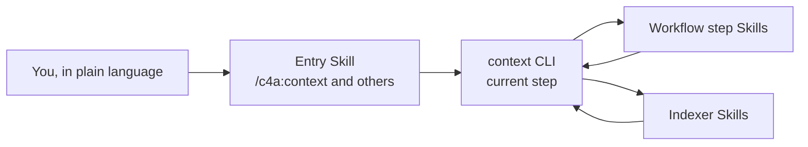

# Commands and Skills

<!-- context:section id="goal" -->
You work with Context through a handful of conversational entries. Everything else, from the lifecycle CLI commands to the Indexers and the workflow's own step Skills, runs behind them, chosen by the workflow for the current step rather than typed by you.

<!-- /context:section -->

<!-- context:section id="invoke" -->
## Entries you invoke

| Entry | Use it to | Example |
| --- | --- | --- |
| `/c4a:context` | Create a Context knowledge workspace, continue one, and run production, review, update and build | *"Build reviewed knowledge for ../billing-service for on-call engineers."* |
| `/c4a:context-plan` | Plan a large project or a broad update in stages before production | *"Plan knowledge for these three repositories and the design folder."* |
| `/c4a:context-inspect-search` | Ask questions against knowledge packages or approved knowledge, with sources | *"How are refunds retried? Cite the code."* |
| `/c4a:context-repo-content` | Let Context reference docs and authored Skills your project already maintains in the same repository, instead of producing them again | *"Register docs/ and .agents/skills as repository content."* |

`/c4a:context` is the production entry for new and existing knowledge workspaces. The other three entries do not drive production themselves: a plan, an answer that points to a gap, or registered repository content is handed back to `/c4a:context` when knowledge should be produced. Repository content keeps evolving with the project, and the knowledge links to it; see [Linking Existing Docs and Skills](../../sop/registering-sources/same-repository-docs.md). A conversation where Context is already active continues without invoking it again; ordinary coding or design conversations never start it on their own.

To create a new Indexer, ask in plain language: *"Create an Indexer Skill for our RPC framework in ./skills"*. The `context-indexer-create` Skill picks this up; it is not a menu command.
<!-- /context:section -->

<!-- context:section id="hosts" -->
## How each host spells them

| Host | How entries appear |
| --- | --- |
| Claude Code | Plugin commands `/c4a:context`, `/c4a:context-plan`, `/c4a:context-inspect-search`, `/c4a:context-repo-content` |
| Cursor | Commands `/c4a-context`, `/c4a-context-plan`, `/c4a-context-inspect-search`, `/c4a-context-repo-content` |
| Codex | Skills invoked by name: `context`, `context-plan`, `context-inspect-search`, `context-repo-content` |
| Local install into one repository (`context plugin install --local`) | The same entries without the `c4a` plugin namespace |

Restart or refresh the host after installing or updating the plugin so it loads the current entries. See [Installation](installation.md).
<!-- /context:section -->

<!-- context:section id="requests" -->
## Requests you will use often

| You want to | Say something like | Read more |
| --- | --- | --- |
| Start | *"Create a Context knowledge workspace in ./kb for …; readers are …"* | [Quick Start](quick-start.md) |
| Add material | *"Add ../docs/refunds to the sources and re-plan the affected part."* | [Choosing How to Add Material](../../sop/registering-sources/source-batches.md) |
| Fix a page | *"Revise the retry page: the limit is five, not three."* | [Revising a Page](../../sop/review-and-revision/revising-a-page.md) |
| Follow a change | *"The billing repository moved to a new release; update the affected pages."* | [Updating Knowledge](../../sop/updates-and-versions/updating-knowledge.md) |
| Let an Agent review one task for you | Explicitly authorize fully managed mode for that task; without it, the run asks you | [Fully Managed Mode](../../sop/planning-and-production/managed-mode-and-review-policy.md) |
<!-- /context:section -->

<!-- context:section id="more-requests" -->
### More example requests

Replace the placeholders in angle brackets. Each request is a starting point: the Agent researches, asks back where needed, and stops at the decisions that are yours.

| You want to | Say something like | What happens |
| --- | --- | --- |
| Plan a large project | *"Plan a knowledge project for `<repositories and documents>`."* | The Agent researches and writes a PLAN for you to review; see [Planning Large Projects in Stages](../../sop/planning-and-production/planning-large-projects.md) |
| Cold-start from many sources of mixed quality | *"Explore `<repositories>` first, then screen every document under `<wiki range>` against the code. Skip documents not updated since `<date>` except top-level designs; `<document>` is the baseline. Give me a PLAN with each document's decision and a three-level structure before any production."* | Read-only exploration, source screening and a PLAN for review; see [Cold-Starting a Knowledge Base](../../sop/practices/cold-start.md) |
| Reorganize | *"Research the approved knowledge again and propose a more intuitive directory and title structure. Revise after I confirm."* | A structure proposal, then revisions; see [Reorganizing at Scale](../../sop/review-and-revision/reorganizing-at-scale.md) |
| Update after a source release | *"The sources have moved to `<version>`. Find the affected knowledge and review the updates."* | An impact assessment, targeted revisions and a review report |
| Evaluate | *"Evaluate the current knowledge base with `<question set>`, grade each answer on the four grades and give me P50/P90."* | An evaluation run with grades and timings; see [Evaluating Your Knowledge Base](../../sop/practices/evaluating-your-knowledge-base.md) |
| Migrate | *"Research what Context can do, then migrate the current knowledge base …"* | See [Migrating an Existing Knowledge Base](../../sop/practices/migrating-a-knowledge-base.md) for the full request |
| Build and preview | *"Build the knowledge package and documentation site, and give me a local preview."* | A build, then a local preview whose address is checked before it is shared; publishing to hosting needs your separate authorization |

Terms used above:

- **PLAN**: the research report the Agent writes for a large or cold-start project, through `/c4a:context-plan`, for you to review before production.
- **Baseline document** (in a cold start): the current, authoritative document you name for a domain. Within its scope it takes precedence; when other material or the code disagrees with it, the decision and its reason are recorded.
- **Review report**: the readable report of written or changed pages that you approve or send back; see [Reading Review Reports](../../sop/review-and-revision/reading-review-reports.md).
- **Four grades** and **P50/P90**: the grading scale for answers and the median and 90th-percentile answer times; both are defined in [Scoring and Timing Standard](../../sop/practices/evaluation-standard.md).
<!-- /context:section -->

<!-- context:section id="automatic" -->
## Skills that run on their own

Some Skills are never invoked by name. The Indexer Skills (`context-code-indexer`, `context-markdown-indexer`, `context-note-indexer`, `context-sessions-indexer`) are chosen for the current sources and requirements during planning and writing; installing one makes it available, not enabled for every workspace. `context-inspect-search` also runs when a host configuration routes knowledge questions to it. The workflow's own step Skills, such as writing a production stage, translating the site, recording a version or recovering a stuck task, each run when the workflow reaches that step.

Indexer Skills are installed without a plugin namespace, so they keep the same names in every host. Every Skill, with its trigger and hand-off, is listed in the [Skills reference](../reference/context/skills.md); the Indexers are described in [Built-in Indexers](../../sop/custom-indexers/community-indexers.md).
<!-- /context:section -->

<!-- context:section id="never" -->
## What you never need to type

The lifecycle commands, such as `context source add`, `context review …` and `context build`, are run by the Agent for the step the workflow returns. You will see them in progress messages, but you describe goals instead. When the Agent starts, it observes the knowledge workspace and works out the next step itself. The full command list is in the [CLI Commands reference](../reference/context/cli-commands.md).
<!-- /context:section -->
