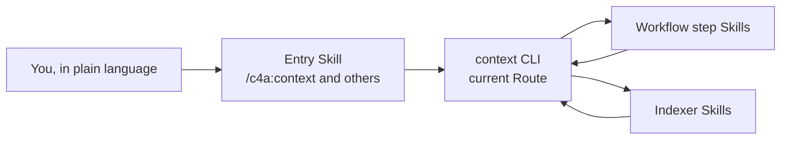

# Commands and Skills

<!-- context:section id="goal" -->
You work with Context through a handful of conversational entries. Everything else — the lifecycle CLI commands, the Indexers and the workflow's own step Skills — runs behind them, chosen by the current Route rather than typed by you.

<!-- /context:section -->

<!-- context:section id="invoke" -->

## Entries you invoke

| Entry | Use it to | Example |
| --- | --- | --- |
| `/c4a:context` | Create a Context knowledge workspace, continue one, and run production, review, update and build | *"Build reviewed knowledge for ../billing-service for on-call engineers."* |
| `/c4a:context-plan` | Plan a large project or a broad update in stages before production | *"Plan knowledge for these three repositories and the design folder."* |
| `/c4a:context-inspect-search` | Ask questions against knowledge packages or approved knowledge, with sources | *"How are refunds retried? Cite the code."* |
| `/c4a:context-repo-content` | Register or edit documentation and authored Skills in the same repository, without starting production | *"Register docs/ and .agents/skills as repository content."* |

`/c4a:context` is the production entry for new and existing knowledge workspaces. The other three entries do not drive production themselves: a plan, an answer that points to a gap, or registered repository content is handed back to `/c4a:context` when knowledge should be produced. A conversation where Context is already active continues without invoking it again; ordinary coding or design conversations never start it on their own.

To create a new Indexer, ask in plain language — *"Create an Indexer Skill for our RPC framework in ./skills"*. The `context-indexer-create` Skill picks this up; it is not a menu command.

<!-- /context:section -->

<!-- context:section id="hosts" -->
## How each host spells them

| Host | How entries appear |
| --- | --- |
| Claude Code | Plugin commands `/c4a:context`, `/c4a:context-plan`, `/c4a:context-inspect-search`, `/c4a:context-repo-content` |
| Cursor | Commands `/c4a-context`, `/c4a-context-plan`, `/c4a-context-inspect-search`, `/c4a-context-repo-content` |
| Codex | Skills invoked by name: `context`, `context-plan`, `context-inspect-search`, `context-repo-content` |
| Local install into one repository (`context plugin install --local`) | The same entries without the `c4a` plugin namespace |

Restart or refresh the host after installing or updating the plugin so it loads the current entries. See [Installation](installation.md).
<!-- /context:section -->

<!-- context:section id="automatic" -->

## Skills that run on their own

| Skill | When it runs |
| --- | --- |
| `context-code-indexer`, `context-markdown-indexer`, `context-note-indexer`, `context-sessions-indexer` | The Agent selects them for the current sources and requirements during planning and writing. Installing one makes it available; it is not enabled for every knowledge workspace. See [Community Indexers](../../sop/custom-indexers/community-indexers.md). |
| `context-inspect-search` | Also when a host or Bot configuration routes knowledge questions to it. |
| Workflow step Skills: `work-production-stage`, `translate-site-locales`, `record-workspace-version`, the Indexer lifecycle steps, and `recover-workspace` | Each runs when the current Route selects its step — writing a production stage, translating the site, recording a version, or recovering a stuck task. |

Indexer Skills are installed without a plugin namespace, so they keep the same names in every host.

Every Skill in the Agent plugin, with its trigger and hand-off, is listed in the [Skills reference](../reference/context/skills.md).

<!-- /context:section -->

<!-- context:section id="never" -->

## What you never need to type

The lifecycle commands — `context source add`, `context review …`, `context build` and the rest — are run by the Agent with the exact revision the Route returns. You will see them in progress messages, but you describe goals instead. There is no `context continue` command: when the Agent starts, `context entry` and `context status` observe the knowledge workspace and return the next step. The full command list is in the [CLI Commands reference](../reference/context/cli-commands.md).

<!-- /context:section -->

<!-- context:section id="requests" -->
## Requests you will use often

| You want to | Say something like | Read more |
| --- | --- | --- |
| Start | *"Create a Context knowledge workspace in ./kb for …; readers are …"* | [Quick Start](quick-start.md) |
| Add material | *"Add ../docs/refunds to the sources and re-plan the affected part."* | [Working with Agents](../../sop/planning-and-production/working-with-agents.md) |
| Fix a page | *"Revise the retry page: the limit is five, not three."* | [Revising a Page](../../sop/review-and-revision/revising-a-page.md) |
| Follow a change | *"The billing repository moved to a new release; update the affected pages."* | [Updating Knowledge](../../sop/updates-and-versions/updating-knowledge.md) |
| Hand off review | Add a `CONTEXT_RUN_POLICY` block to the task | [Managed Mode and Review Policy](../../sop/planning-and-production/managed-mode-and-review-policy.md) |
<!-- /context:section -->
