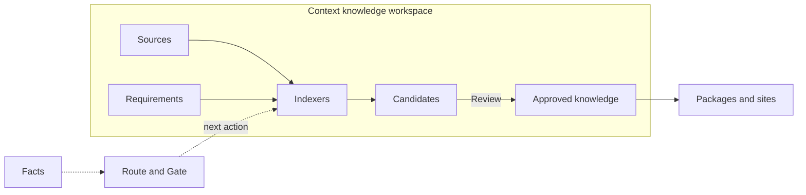

# Core Concepts

<!-- context:section id="map" -->
## How the concepts relate

Everything lives in one **Context knowledge workspace**. **Sources** and **requirements** go in; **Indexers** turn them into **Candidates**; **Review** admits Candidates into **approved knowledge**; builds turn that knowledge into **packages and sites**. Throughout, the workflow reads **Facts** about the knowledge workspace and selects the next **Route**, pausing at **Gates** for human decisions.
<!-- /context:section -->

<!-- context:section id="workspace" -->
## Context knowledge workspace

A local directory, usually committed to Git, that holds everything about one body of knowledge:

| Directory | Holds |
| --- | --- |
| `src/` | Source, phase and package declarations, plus `indexers.yaml` requirements |
| `sources/` | Registered sources and captured evidence |
| `knowledge/` | Approved knowledge and durable decisions |
| `dist/` | Built packages (reproducible, ignored by Git) |
| `.tmp/` | Disposable runtime state and reports (ignored) |

The CLI owns writes under `sources/`, `knowledge/`, `dist/` and the runtime state; the Agent edits project configuration only when the current Route asks for it. Every directory and file is described in [The Context Knowledge Workspace](knowledge-workspace.md).
<!-- /context:section -->

<!-- context:section id="sources" -->
## Sources, capture, notes and sessions

A **source** is a registered boundary: a repository module, a local document directory or an online document. Registering a source records its identity and permission boundary; it does not decide what knowledge to write and does not grant permission to read beyond it. **Capture** preserves document bodies and resources as auditable snapshots; repositories are read at a pinned commit and need no capture.

**Notes** are curated excerpts and observations; **sessions** are saved conversation summaries. Both are imported directly with `context source import` and become evidence like any other source.
<!-- /context:section -->

<!-- context:section id="indexers" -->
## Requirements and Indexers

**Requirements** in `src/indexers.yaml` record who the knowledge is for, the questions it must answer and which sources are authorized. **Indexers** are Agent skills that read one kind of source and write source-grounded articles: Code, Markdown, Note and Sessions Indexers are built in, and teams can create their own. The Agent picks the relevant Indexers for each task during planning. See [Community Indexers](../../sop/custom-indexers/community-indexers.md) and [The Indexer System](../../architecture/knowledge/indexer-system.md).
<!-- /context:section -->

<!-- context:section id="candidates" -->

## Candidates, Review and approved knowledge

Articles the Agent writes are submitted as **Candidates**: drafts bound to source evidence and checked for coverage and stale inputs. **Review** shows readable titles, paths, summaries and content; approval applies the pages to `knowledge/` as durable Markdown, while rejection sends them back to writing. A rejected Candidate's status lives only in the temporary lifecycle ledger; `knowledge/` holds approved pages alone.

Each section of approved knowledge keeps its **evidence**: references to exact source locations. Together they form the [evidence chain](../../architecture/knowledge/evidence-chains.md) that lets readers and Agents verify a statement. The **knowledge map** (`knowledge/structure.yaml`) is the closed projection of collections, articles and sections that sites and packages navigate by.

<!-- /context:section -->

<!-- context:section id="packages" -->

## Packages and sites

A **build** turns approved knowledge into an output: an Agent knowledge package, a documentation site or LLM documents. Every build emits an inventory that maps distributed files back to the knowledge workspace. See [Packages and Sites](../../architecture/context/packages-and-sites.md).

<!-- /context:section -->

<!-- context:section id="route" -->
## Route, Gate and Facts

**Facts** are what the CLI observes in the knowledge workspace and records as outcomes; conversation claims are not completion evidence. From the Facts, the workflow selects one **Route**: the current action, the resources to read for it and its completion contract. A **Gate** pauses a Route for a decision that needs a person or additional authority, such as approving the work-start report or the review. See [Workflow Execution](../../architecture/context/workflow-execution.md).
<!-- /context:section -->
