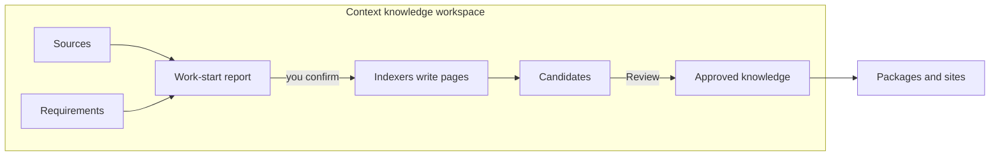

# Core Concepts

<!-- context:section id="map" -->
## How the concepts relate

Everything lives in one **Context knowledge workspace**. You register **sources** and describe **requirements**; the Agent proposes what to write in a **work-start report**; after you confirm it, **Indexers** write pages that arrive as **Candidates**; **Review** admits them into **approved knowledge**; builds turn that knowledge into **packages and sites**. The terms below follow the same order. How the workflow decides each next step is explained at the end, and you only need it when something stops unexpectedly.
<!-- /context:section -->

<!-- context:section id="workspace" -->
## Context knowledge workspace

A local directory, usually committed to Git, that holds everything about one body of knowledge:

| Directory | Holds |
| --- | --- |
| `src/` | Source, phase and package declarations, plus `indexers.yaml` requirements |
| `sources/` | Registered sources and captured evidence |
| `knowledge/` | Approved knowledge and durable decisions |
| `dist/` | Built packages (reproducible, ignored by Git) |
| `.tmp/` | Disposable runtime state and reports (ignored) |

The CLI owns writes under `sources/`, `knowledge/`, `dist/` and the runtime state; the Agent edits project configuration only when the current Route asks for it. Every directory and file is described in [The Context Knowledge Workspace](knowledge-workspace.md).
<!-- /context:section -->

<!-- context:section id="sources" -->
## Sources, capture, notes and sessions

A **source** is a registered boundary: a repository module, a local document directory or an online document. Registering a source records its identity and permission boundary; it does not decide what knowledge to write and does not grant permission to read beyond it. **Capture** preserves document bodies and resources as auditable snapshots; repositories are read at a pinned commit and need no capture.

**Notes** are curated excerpts and observations; **sessions** are saved conversation summaries. Both are imported directly with `context source import` and become evidence like any other source.
<!-- /context:section -->

<!-- context:section id="indexers" -->
## Requirements and Indexers

**Requirements** in `src/indexers.yaml` record who the knowledge is for, the questions it must answer and which sources are authorized. **Indexers** are Agent skills that read one kind of source and write source-grounded articles: Code, Markdown, Note and Sessions Indexers are built in, and teams can create their own. The Agent picks the relevant Indexers for each task during planning. See [Community Indexers](../../sop/custom-indexers/community-indexers.md) and [The Indexer System](../../architecture/knowledge/indexer-system.md).
<!-- /context:section -->

<!-- context:section id="start-report" -->
## Work-start report and managed mode

Before substantial new work, the Agent researches representative material and writes a **work-start report** under `.tmp/`: the scope, the Skills it will use and the first pages to expect. Writing starts only after you confirm it. Missing information that would change the scope is asked, not guessed.

In ordinary mode you also review the proposed structure and the Candidate pages. If you explicitly authorize **fully managed mode**, the Agent performs the review decisions that can be delegated and reports the results; human-only decisions still stop for you, and the work-start report still needs your confirmation. See [Managed Mode and Review Policy](../../sop/planning-and-production/managed-mode-and-review-policy.md).
<!-- /context:section -->

<!-- context:section id="candidates" -->

## Candidates, Review and approved knowledge

Articles the Agent writes are submitted as **Candidates**: drafts bound to source evidence and checked for coverage and stale inputs. **Review** shows readable titles, paths, summaries and content; approval applies the pages to `knowledge/` as durable Markdown, while rejection sends them back to writing. A rejected Candidate's status lives only in the temporary lifecycle ledger; `knowledge/` holds approved pages alone.

Each section of approved knowledge keeps its **evidence**: references to exact source locations. Together they form the [evidence chain](../../architecture/knowledge/evidence-chains.md) that lets readers and Agents verify a statement. Which articles and sections exist, and what each section cites, is recorded in `knowledge/structure.yaml`, rebuilt when a delivery closes. Navigation is separate: the **knowledge map** in `src/knowledge-map.yaml` decides how sites group and order pages. Moving a page in the knowledge map does not change its URL.

<!-- /context:section -->

<!-- context:section id="packages" -->

## Packages and sites

A **build** turns approved knowledge into an output: an Agent knowledge package, a documentation site or LLM documents. Every build emits an inventory that maps distributed files back to the knowledge workspace. See [Packages and Sites](../../architecture/context/packages-and-sites.md).

<!-- /context:section -->

<!-- context:section id="route" -->
## How the workflow chooses the next step

You can skip this until something stops unexpectedly. The CLI observes the knowledge workspace and records outcomes as **Facts**; conversation claims are not completion evidence. From the Facts, the workflow selects one **Route**: the current action, the resources to read for it and its completion contract. A **Gate** pauses a Route for a decision that needs a person or additional authority, such as confirming the work-start report or a review. That is why a task can be interrupted and resumed: the next step is recomputed from the workspace, not remembered by the Agent. See [Workflow Execution](../../architecture/context/workflow-execution.md).
<!-- /context:section -->
