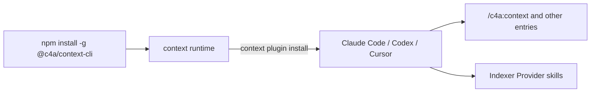

# Installation

<!-- context:section id="prerequisites" -->

## Before you start

You install Context once per machine (or remote Agent environment), not once per task. You need:

- Node.js 20 or later with npm;
- [Bun](https://bun.sh): a new knowledge workspace installs its dependencies with `bun install` right after initialization;
- at least one Agent host: Claude Code, Codex or Cursor;
- read access to the repositories and documents you plan to turn into knowledge.

Context runs on your machine. The CLI never calls an LLM itself: the Agent in your host does the reading and writing, and the CLI performs deterministic work such as observing the Context knowledge workspace, capturing sources, indexing code, validating evidence, applying reviews and building packages.

<!-- /context:section -->

<!-- context:section id="install" -->

## Install the CLI and the plugin

```bash
npm install -g @c4a/context-cli@latest
context plugin install
```

The first command installs the `context` runtime. The second installs the Agent integration into every supported host it finds. Restart or refresh your Agent host afterwards so it loads the new entries.



A global installation creates the namespaced Context entries and also projects the four Indexer Provider skills — `context-code-indexer`, `context-markdown-indexer`, `context-note-indexer` and `context-sessions-indexer` — without a namespace, so every host can find them. Installing a Provider only makes it discoverable; the workflow selects Providers per task.

### Or install the plugin from the plugin marketplace

The [context4ai/context](https://github.com/context4ai/context) repository is itself a plugin marketplace. In Claude Code or Codex you can add it and install the `c4a` plugin through the host instead of running `context plugin install`:

```bash
claude plugin marketplace add context4ai/context && claude plugin install c4a@c4a
codex plugin marketplace add context4ai/context && codex plugin add c4a@c4a
```

The CLI is still required: install it with `npm install -g @c4a/context-cli@latest` first, because the plugin hands the workflow and the bundled Indexers to it. Choose one method per host — both provide the same `c4a` plugin — and use `context plugin install` for Cursor.

<!-- /context:section -->

<!-- context:section id="entries" -->

## What you get

| Entry | Use it to |
| --- | --- |
| `/c4a:context` | Create a knowledge workspace, continue one, and run production, review, update and build |
| `/c4a:context-plan` | Plan a large project in stages before production |
| `/c4a:context-inspect-search` | Ask questions against knowledge packages or approved knowledge in a knowledge workspace, with sources |
| `/c4a:context-repo-content` | Register docs and Skills already maintained in the same repository, so Context references them instead of producing them again |

`/c4a:context` is the production entry for both new and existing knowledge workspaces; the other three entries plan, answer or register content and hand production back to it. You do not need to learn lifecycle commands; describe the knowledge goal in normal language. Ordinary coding or design conversations do not start Context on their own — invoke it explicitly or continue an active Context conversation. [Commands and Skills](commands-and-skills.md) lists every entry, how each host spells it, and the Skills that run without being invoked.

<!-- /context:section -->

<!-- context:section id="local" -->
## Install into one repository only

If you prefer not to change global configuration, install the entries into a single repository:

```bash
context plugin install --local /path/to/repo --agent auto-detect
```

`--local` needs an explicit `--agent`:

- `claude`, `cursor` or `codex` install into that repository's `.claude`, `.cursor` or `.agents` directory;
- `all` installs all three layouts;
- `auto-detect` uses whichever of those directories already exist and falls back to `.agents/skills`;
- `standalone` writes all skills directly to `<path>/skills`, without commands.

Every mode supports `--dry-run`. A refresh replaces only unmodified managed files; customized entries are kept and reported as conflicts. Local entries have no plugin namespace.
<!-- /context:section -->

<!-- context:section id="verify" -->
## Check the installation

```bash
context --version
context plugin status
```

`context plugin status` inspects the global hosts. Then open your Agent and invoke `/c4a:context`. If the entry is present but the `context` executable is missing, the entry reports the exact installation step and stops rather than partially initializing a knowledge workspace.

Next: [Quick Start](quick-start.md).
<!-- /context:section -->
