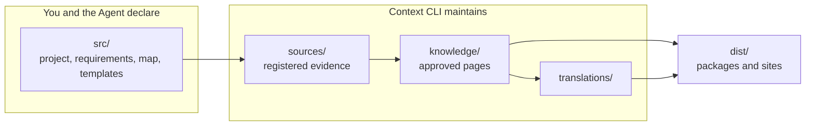

# The Context Knowledge Workspace

<!-- context:section id="goal" -->
A **Context knowledge workspace** is the directory where Context keeps one body of knowledge: its declarations, its registered sources, the approved pages and the outputs built from them. `context init` creates it, and its `package.json` marks it as a Context project. It is usually a Git repository of its own, or a directory inside a project repository.

Everything about the knowledge lives here, not in the conversation. Run Context commands from this directory: Route paths and `.tmp/` belong to this knowledge workspace, not to the surrounding repository or a parent directory.


<!-- /context:section -->

<!-- context:section id="tree" -->
## The layout

Right after `context init`, and after the first deliveries, a knowledge workspace looks like this:

```text
my-knowledge/
├── package.json            # version and context.project marker
├── AGENTS.md               # rules for Agents working here
├── README.md
├── .gitignore
├── src/
│   ├── index.ts            # sources, capture phases and packages
│   ├── indexers.yaml       # reader purpose and authorized sources
│   ├── knowledge-map.yaml  # navigation for sites and LLM Docs
│   ├── package-templates/  # templates for each package kind
│   └── site/               # optional website customization
├── sources/
│   ├── repo/index.yaml     # repository sources: remote, commit, modules
│   ├── file/               # local document sources and snapshots
│   ├── lark/               # Lark document sources and snapshots
│   ├── note/YYYYMMDD/      # saved notes
│   └── sessions/YYYYMMDD/  # saved conversation summaries
├── knowledge/
│   ├── <collection>/…      # approved Markdown pages
│   └── structure.yaml      # page identities, sections and source references
├── translations/<locale>/  # translated pages and navigation titles
├── changelog.yaml          # knowledge version history
├── CHANGELOG.md            # generated from changelog.yaml
├── dist/                   # built packages and sites
└── .tmp/                   # runtime state, reports, Agent scratch
```

Some files appear only when you use the feature they belong to: `imports.yaml`, `repo-content.yaml` with its `repo-content/` view, `context-evidence.sourcegraph.wasm`, and a `PLAN-*.md` during a planned project. They are described below.
<!-- /context:section -->

<!-- context:section id="ownership" -->
## Who writes what, and what Git keeps

| Path | Written by | In Git |
| --- | --- | --- |
| `package.json`, `AGENTS.md`, `README.md` | Created by `context init`; the version is updated by the CLI | Yes |
| `src/index.ts`, `src/indexers.yaml`, `src/package-templates/`, `src/site/` | You or the Agent, only when the current Route asks for a configuration change | Yes |
| `src/knowledge-map.yaml` | The CLI, through navigation adjustments the Agent submits | Yes |
| `sources/` registries, snapshots, notes and summaries | The CLI | Yes — except repository checkouts under `sources/repo/`, which are recovered from `index.yaml` |
| `knowledge/` | The CLI, when you approve a Review | Yes |
| `translations/`, `changelog.yaml`, `CHANGELOG.md` | The CLI, from Agent-written translations and change notes | Yes |
| `dist/` | `context build` | No — reproducible |
| `.tmp/` | The CLI and the Agent | No — runtime only |

`sources/` and `knowledge/` are the durable state of the knowledge; `dist/` can always be rebuilt from them. Commit the knowledge workspace only when Git operations are authorized for your task.
<!-- /context:section -->

<!-- context:section id="growing" -->
## Files that appear as the knowledge grows

- **`src/knowledge-map.yaml`** is the persistent knowledge map. It organizes website navigation and LLM Docs without changing page identities, and stays after each delivery. See [Reorganizing at Scale](../../sop/review-and-revision/reorganizing-at-scale.md).
- **`translations/<locale>/`** holds one translated file per approved page plus a `knowledge-map.yaml` of translated navigation titles. Translations are formal content: they count toward versions and are packaged with the site.
- **`changelog.yaml` and `CHANGELOG.md`** are updated together with `package.json.version` each time a delivery records a version. See [Versions and Changelog](../../sop/updates-and-versions/versions-and-changelog.md).
<!-- /context:section -->

<!-- context:section id="linked" -->
## Files for linked content

- **`imports.yaml`** at the root declares external entrances — content elsewhere that pages may link to — without downloading or capturing it. See [External Entrances](../../sop/registering-sources/external-entrances.md).
- **`repo-content.yaml`** registers documentation and authored Skills that live in the same repository; **`repo-content/`** is a symlink view of them, and the originals stay where they are. See [Same-Repository Docs](../../sop/registering-sources/same-repository-docs.md).
- **`context-evidence.sourcegraph.wasm`** is an optional plugin for reading code evidence remotely. `context evidence install` maintains it; queries never install it on their own. See [Reading Code Evidence Remotely](../../sop/querying-knowledge/reading-code-evidence-remotely.md).
<!-- /context:section -->

<!-- context:section id="runtime" -->
## Runtime and scratch space

| Path | Holds |
| --- | --- |
| `.tmp/context-runtime/` | Unfinished workflow state: production stages, candidates, review reports, routes |
| `.tmp/agent-payloads/` | Command inputs the Agent prepares, such as translations |
| `.tmp/install/` | Temporary files used while installing dependencies |
| `.tmp/context-plans/<date-slug>/` | Research for a planned project: `repos/`, `documents/`, `research/`, `stage-inputs/` |

`.tmp/context-runtime/` is not the only record of progress. After a successful delivery the CLI removes completed task state, and approved knowledge with `structure.yaml` keeps what later updates need. Its absence never means accepted work may be replayed. A planned project also keeps `PLAN-YYYYMMDD-slug.md` at the Git root, committed so work can resume; see [Planning a Large Project](../../sop/planning-and-production/planning-large-projects.md).
<!-- /context:section -->

<!-- context:section id="rules" -->
## Rules that keep it healthy

- **Do not edit CLI-owned state by hand.** `sources/`, `knowledge/`, `dist/` and `.tmp/context-runtime/` change only through Context commands. To change a page, ask for a [revision](../../sop/review-and-revision/revising-a-page.md).
- **One knowledge workspace per directory.** Do not create a hidden second workspace, and do not mix revisions, tasks or `.tmp/` files with a parent directory that is also a knowledge workspace.
- **Repair through the Route.** When something looks broken, follow the recovery action the current Route returns instead of deleting runtime files.

Next: [Commands and Skills](commands-and-skills.md) lists what you can invoke in this knowledge workspace, and [Core Concepts](core-concepts.md) explains how its parts relate.
<!-- /context:section -->
