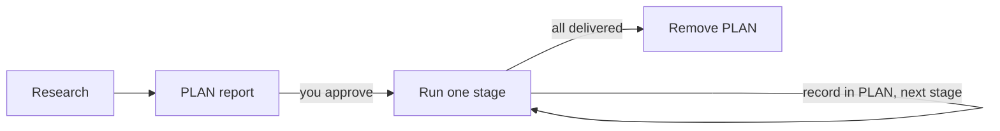

# Large Projects

<!-- context:section id="threshold" -->
## When a task is large

Plan a task in stages when its scope has **more than 30 source documents, or at least two repositories that need real investigation**. Use `/c4a:context-plan` explicitly, or let the `/c4a:context` entry hand over to it when an authorized task crosses that threshold. Starting a new knowledge project whose scope still needs research is also a good reason to plan first.

A very large multi-domain monorepo may be better served by one Context knowledge workspace per direction than by a single knowledge workspace.
<!-- /context:section -->

<!-- context:section id="plan" -->
## The PLAN report

Planning produces a `PLAN-YYYYMMDD-slug.md` report at the project's Git root. It inventories sources, maps overlaps with knowledge you already have, and divides the work into stages. You review the first report before any production starts.

Approving the PLAN does not approve any article. Each stage still runs the normal workflow with its own work-start report and content review. [Planning a Large Project](../../sop/planning-and-production/planning-large-projects.md) walks through every part of the report, its review and how to resume.
<!-- /context:section -->

<!-- context:section id="limits" -->
## Stage size

| Boundary | Recommendation |
| --- | --- |
| Source documents per stage | 30, at most 50 (groups above 30 are explained in the PLAN) |
| New repositories investigated per stage | 1 |
| Target articles in a revision stage | 30 |
| Scope above 100 documents | The Agent checks with you whether bounded research gives a useful scope |
| Scope above 500 documents | The whole task pauses until a person confirms the scope |

These are planning boundaries, not CLI gates. After each stage the Agent records the actual research, production, review and delivery results in the PLAN and commits it before the next stage begins.
<!-- /context:section -->

<!-- context:section id="steer" -->
## Steer early

On a large task, preview the work-start report and the first changed pages as soon as they exist. If the wording, examples or style are off, say so with counter-examples. Corrections made in the first stage carry into every later stage; the earlier you correct, the higher the final quality.

If a session is interrupted, the PLAN records the exact position and next action, so a new conversation can continue the same stage.
<!-- /context:section -->
