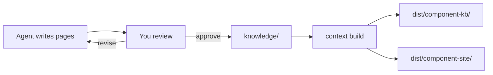

# Quick Start

<!-- context:section id="goal" -->

This walkthrough turns one code module and one local documentation folder into a reviewed knowledge package with a browsable site. You give instructions in plain language; the Agent runs the commands the workflow returns. The commands shown below are what the Agent runs on your behalf, so you can recognize them in its progress messages.

Make sure [Installation](installation.md) is done and you have restarted the Agent session so the plugin is loaded.

<!-- /context:section -->

<!-- context:section id="init" -->
## 1. Create the knowledge workspace

Tell the Agent where the Context knowledge workspace should live and what it is for:

```text
/c4a:context Create a Context knowledge workspace in ./context for our component library
and its product docs. Readers are frontend developers new to the library.
```

The Agent initializes the directory and installs its dependencies:

```bash
context init ./context
cd ./context
bun install
context status --format json
```

You get this layout:

```text
context/
├── AGENTS.md       # guidance for the Agent
├── src/            # source, phase and package declarations
├── sources/        # registered sources and captured evidence
├── knowledge/      # approved knowledge (empty for now)
├── dist/           # built packages (ignored by Git)
└── .tmp/           # runtime state and reports (ignored by Git)
```
<!-- /context:section -->

<!-- context:section id="register" -->
## 2. Point it at your sources

Name the material and anything the Agent should skip:

```text
Use ../component-lib for code and ../docs for product documents.
Skip the deprecated v1 folder.
```

The Agent registers each boundary. Registration records what is in scope; it does not decide what to write.

```bash
context source add repo 20260901 --module component-lib --local ../component-lib --configure
context source add file 20260901 --module product-docs --local ../docs --configure
```

For a monorepo, pick the package or service your readers need. Unneeded material costs reading time and tokens, but do not exclude something just because its filename looks old.
<!-- /context:section -->

<!-- context:section id="plan" -->
## 3. Confirm the work-start report

The Agent reads representative material, asks about anything that would change the scope, records the reader purpose in `src/indexers.yaml`, and presents a **work-start report** with:

- the confirmed sources and scope;
- the Indexer skills it will use;
- the first pages you should expect and where they will sit in the site.

Nothing is written until you approve the report. If the plan is off, say what to change — for example "merge the two API pages" or "add a troubleshooting page" — and the Agent revises it.
<!-- /context:section -->

<!-- context:section id="produce" -->

## 4. Let it write, then review

After approval, the Agent writes each page with references to exact source lines and submits them for checks on coverage and stale inputs.

When writing finishes, you receive a review report showing each page's title, path, summary and content. Approve it, reject pages, or ask for revisions. Approved pages land in `knowledge/` as Markdown; rejected or revised pages go back to writing.



<!-- /context:section -->

<!-- context:section id="build" -->
## 5. Build the package and site

For a new knowledge workspace, the Agent proposes a knowledge package plus a website by default. The package declaration in `src/index.ts` looks like this:

```ts
kbPackage({
  name: "component-kb",
  template: "src/package-templates/kb",
  site: { title: "Component knowledge", lang: "en-US", base: "/" },
});
```

`context build` then produces `dist/component-kb/` for Agents and `dist/component-site/` — a static site with article pages and local search — for people. Commit the knowledge workspace to Git so the result can be inspected, versioned and refreshed later.
<!-- /context:section -->

<!-- context:section id="next" -->
## Next steps

- Ask a question against the new package with `/c4a:context-inspect-search`.
- When the code or docs change, tell `/c4a:context` what changed; it reopens only the affected pages.
- For larger scopes, read [Large Projects](large-projects.md).
- See every entry you can invoke, and the Skills that run on their own, in [Commands and Skills](commands-and-skills.md).
<!-- /context:section -->
