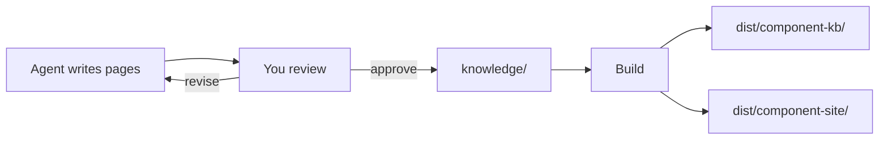

# Quick Start

<!-- context:section id="goal" -->
This walkthrough turns one code module and one local documentation folder into a reviewed knowledge package with a browsable site. You give instructions in plain language and the Agent runs the commands the workflow returns, so the examples below show only what you say.

Make sure [Installation](installation.md) is done, including Node.js 20 and Bun, which installs the new knowledge workspace's dependencies, and that you have restarted the Agent session so the plugin is loaded.
<!-- /context:section -->

<!-- context:section id="init" -->
## 1. Create the knowledge workspace

Tell the Agent where the Context knowledge workspace should live and what it is for:

```text
/c4a:context Create a Context knowledge workspace in ./context for our component library
and its product docs. Readers are frontend developers new to the library.
```

The Agent creates the directory and installs its dependencies. You get this layout:

```text
context/
├── AGENTS.md       # guidance for the Agent
├── src/            # source, phase and package declarations
├── sources/        # registered sources and captured evidence
├── knowledge/      # approved knowledge (empty for now)
├── dist/           # built packages (ignored by Git)
└── .tmp/           # runtime state and reports (ignored by Git)
```
<!-- /context:section -->

<!-- context:section id="register" -->
## 2. Point it at your sources

Name the material and anything the Agent should skip:

```text
Use ../component-lib for code and ../docs for product documents.
Skip the deprecated v1 folder.
```

The Agent registers each boundary. Registration records what is in scope; it does not decide what to write.

For a monorepo, pick the package or service your readers need. Unneeded material costs reading time and tokens, but do not exclude something just because its filename looks old.

> To start building a complex knowledge base for a whole domain or business, see [Planning Large Projects in Stages](../../sop/planning-and-production/planning-large-projects.md).
<!-- /context:section -->

<!-- context:section id="plan" -->
## 3. Confirm the work-start report

The Agent reads representative material, asks about anything that would change the scope, records the reader purpose, and presents a **work-start report** with:

- the confirmed sources and scope;
- the Indexer skills it will use;
- the first pages you should expect and where they will sit in the site.

Nothing is written until you approve the report. If the plan is off, say what to change, for example "merge the two API pages" or "add a troubleshooting page", and the Agent revises it. See [Confirming the Work-Start Report](../../sop/planning-and-production/start-reports.md).
<!-- /context:section -->

<!-- context:section id="produce" -->
## 4. Let it write, then review

After approval, the Agent writes each page with references to exact source lines and submits them for checks on coverage and stale inputs. Expect roughly a minute per writing task; the Agent reports progress and the total number of tasks, and you can ask for a local preview at any time.

When writing finishes, you receive a review report showing each page's title, path, summary and content. Approve it, reject pages, or ask for revisions. Approved pages land in `knowledge/` as Markdown; rejected or revised pages go back to writing. See [Reading Review Reports](../../sop/review-and-revision/reading-review-reports.md).



**If you are interrupted**, close the conversation and come back later: invoke `/c4a:context` in the knowledge workspace again. It resumes from the workspace's recorded state, not from the conversation, so nothing is redone.
<!-- /context:section -->

<!-- context:section id="build" -->
## 5. Build the package and site

For a new knowledge workspace, the Agent proposes two outputs by default and the build produces both:

- `dist/component-kb/`: the knowledge package that Agents install and query;
- `dist/component-site/`: a static documentation site with article pages and local search, for people.

To look at the site, ask *"Preview the site locally."* The output declarations live in `src/index.ts`; see [Knowledge Packages](../../sop/outputs-and-sites/knowledge-packages.md) if you need a different output. When the round ends, the Agent commits the knowledge workspace to Git, so the result can be inspected, versioned and refreshed later.
<!-- /context:section -->

<!-- context:section id="ask" -->
## 6. Ask your first question

Try the new knowledge right away:

```text
/c4a:context-inspect-search How does the Button component handle loading state? Cite the code.
```

The answer cites approved pages and the source lines behind them. A gap in the answer is a good candidate for the next round: tell `/c4a:context` what is missing.
<!-- /context:section -->

<!-- context:section id="next" -->
## Next steps

- To go further, start the Guides with [Working with Agents](../../sop/planning-and-production/working-with-agents.md): it explains who does what and how the Guides are organized.
- When the code or docs change, tell `/c4a:context` what changed; it reopens only the affected pages. See [Updating Knowledge](../../sop/updates-and-versions/updating-knowledge.md).
- Once the knowledge base has some size, ask the Agent to propose a clearer structure; see [Reorganizing at Scale](../../sop/review-and-revision/reorganizing-at-scale.md).
- For larger scopes, read [Planning Large Projects in Stages](../../sop/planning-and-production/planning-large-projects.md); for every entry and Skill, see [Commands and Skills](commands-and-skills.md).
<!-- /context:section -->
