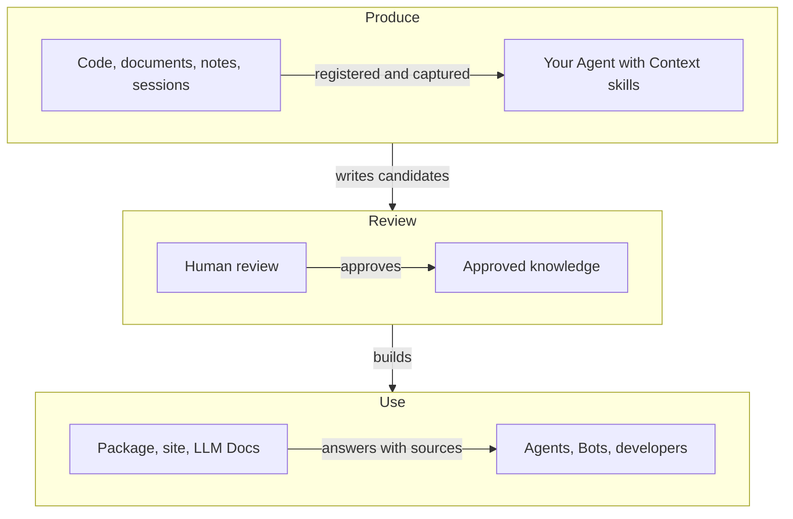

# What is Context

<!-- context:section id="definition" -->

Context is a knowledge workflow for engineering teams and their AI agents. It turns code repositories, documents, notes and conversations into reviewed, versioned knowledge in which every claim leads back to its source, then builds that knowledge into Agent knowledge packages, documentation sites and LLM documents.

You describe what knowledge you need and where the material lives. Then your Agent reads the evidence, proposes a structure and explains its decisions. Context constrains the Agent to follow, step by step, the process and standards described in the skills — recording source boundaries, checking evidence coverage, staging reviewable candidates, preserving provenance, verifying the approved result and finally building the output you chose. When answering questions, agents read this knowledge first and follow its evidence chain to the original only when they need exact detail.

<!-- /context:section -->

<!-- context:section id="overview" -->
## How it fits together

The diagram shows the path from material to the people and Agents who ask questions.

Context is not a one-shot summarizer. Source snapshots, review state, approved knowledge and package inventories stay in a local Context knowledge workspace, so the result can be inspected, versioned and refreshed when sources change.
<!-- /context:section -->

<!-- context:section id="pillars" -->
## What makes it different

- **An index with evidence chains, not copied prose.** Indexers keep only what answers a reader's questions and record where each statement came from. In one large production monorepo, about 202 MB of code and documents became about 1.75 MB of reviewed knowledge, roughly 1/115 of the source volume. See [Knowledge for Agents](../../architecture/knowledge/knowledge-for-agents.md) and [Evidence Chains and Index First](../../architecture/knowledge/evidence-chains.md).
- **Skills and a CLI inside the Agents you already use.** Context does not call an LLM and is not a hosted platform. Its skills run in Claude Code, Codex, Cursor or a managed Agent, and the local CLI performs the deterministic work. See [Why a Workflow](../../architecture/context/why-a-workflow.md).
- **Review before anything is published.** People own the goal, source permission, structure and review decisions; drafts become approved Markdown only after review. See [Knowledge Lifecycle](../../architecture/context/knowledge-lifecycle.md).
- **Knowledge that follows its sources.** Sources are pinned, and a later change reopens only the affected pages. See [Keeping Knowledge Current](../../architecture/knowledge/keeping-knowledge-current.md).
- **One body of knowledge, several outputs.** The same approved pages build an Agent knowledge package, a documentation site and LLM Docs, each mapped back to the knowledge workspace through a build inventory. See [Packages and Sites](../../architecture/context/packages-and-sites.md).
<!-- /context:section -->

<!-- context:section id="who" -->
## Who it is for

Context helps when knowledge exists but is not yet ready for an Agent to use. Its main strength is helping a team build systematic knowledge step by step from the documents and repository code it already has, taking it from nothing to a complete knowledge base; it suits knowledge that has to keep evolving with the code over a long time. Typical requests:

- turn product, architecture, operations or FAQ documents into a navigable knowledge base;
- connect code structure with explanatory documents while keeping exact source evidence;
- combine several repositories and document sets into one reviewed knowledge package;
- update an existing knowledge workspace when its sources change, without rebuilding everything.

On 24 real developer questions from a large production monorepo, Agents using Context knowledge together with Source Graph fully solved more questions than Agents reading an LLM Wiki (a wiki an LLM generated once, which the Agent searches and reads locally), in less than half the time and at about a ninth of the estimated cost. Context alone, with local retrieval, also solved more questions with far fewer tool calls. See [Knowledge Retrieval Benchmark](../../architecture/benchmark/knowledge-retrieval.md).
<!-- /context:section -->

<!-- context:section id="companions" -->
## Source Graph and Agent Graph

Two companion projects carry parts of the workflow. You do not need either to get started.

- **Source Graph** searches and reads repositories at a pinned commit over the web, MCP, HTTP and a CLI. Context ships an optional evidence plugin so that an Agent reading code through Source Graph also receives the sources of the knowledge sections it reads, without cloning the repository. See the [Source Graph overview](../../architecture/source-graph/overview.md) and [Reading Code Evidence Remotely](../../sop/querying-knowledge/reading-code-evidence-remotely.md).
- **Agent Graph** is the layer under the Context workflow that picks each next step from the facts Context observes in the knowledge workspace, which keeps a long workflow resumable and testable. See [Why Graph Engineering](../../architecture/agent-graph/why-graph-engineering.md) and [Workflow Execution](../../architecture/context/workflow-execution.md).
<!-- /context:section -->

<!-- context:section id="delivery" -->
## How you get it

Context is delivered as an npm CLI, `context` from `@c4a/context-cli`, plus an Agent plugin. Install both once, restart the Agent session, then describe the knowledge goal to the `/c4a:context` entry in plain language. At the end of a round you have reviewed Markdown pages in a knowledge workspace that the Agent commits to Git, plus the package and site built from them.

Read [The Workflow at a Glance](workflow-at-a-glance.md) next, then [Installation](installation.md) and [Quick Start](quick-start.md).
<!-- /context:section -->
