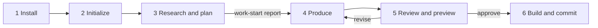

# The Workflow at a Glance

<!-- context:section id="steps" -->
## Six steps

A Context task follows the same six steps whether it covers one document set or several repositories. You talk to the Agent; the Agent follows the workflow the CLI returns.

| Step | What you do | What happens |
| --- | --- | --- |
| 1 Install | Install the CLI and plugin once | Entries appear in your Agent host; see [Installation](installation.md) |
| 2 Initialize | Ask `/c4a:context` to create a Context knowledge workspace in a directory | The CLI creates `src/`, `sources/`, `knowledge/` and the guidance in `AGENTS.md` |
| 3 Research and plan | Describe the knowledge, its sources and its intended form, then answer the Agent's questions | The Agent registers sources, investigates them and presents a **work-start report**: confirmed configuration and scope, the planned content, and the expected package or site layout |
| 4 Produce | Wait, or ask for a local preview at any time | The Agent writes articles bound to source evidence and reports progress against the task count |
| 5 Review and preview | Read the review report and approve, reject or ask for revisions | Approved candidates become durable Markdown under `knowledge/` |
| 6 Build and commit | Confirm the package and other outputs | Context verifies and builds; the Agent commits the knowledge workspace to Git |
<!-- /context:section -->

<!-- context:section id="durations" -->
## What to expect

Production is the longest step: on average each writing task takes about a minute. Ask for a preview whenever you want to see pages in a browser. The work-start report and the review report are the two moments where your judgment shapes the result most; the Guides section on review explains what to look for.
<!-- /context:section -->

<!-- context:section id="lanes" -->
## Production, updates and questions

The six steps describe a first production round. Two other paths reuse the same knowledge workspace:

- **Updates.** Building completes the currently approved state; it does not freeze the knowledge workspace. When sources change, a new round reopens only the affected knowledge. See [Keeping Knowledge Current](../../architecture/knowledge/keeping-knowledge-current.md).
- **Questions.** `/c4a:context-inspect-search` answers questions from knowledge packages or approved knowledge in the knowledge workspace and traces each answer back to its sources.
<!-- /context:section -->

<!-- context:section id="loop" -->
## Why you can stop and resume

Each step is chosen from the knowledge workspace's actual state, not from the conversation. After every action the CLI observes the knowledge workspace again and returns the current step, its required reading and the exact commands. If you close the conversation and invoke `/c4a:context` later, it resumes where the work actually is. See [Workflow Execution](../../architecture/context/workflow-execution.md).
<!-- /context:section -->
