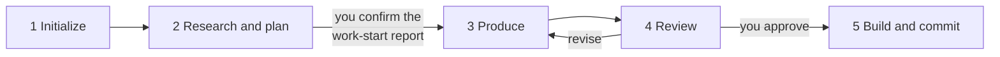

# The Workflow at a Glance

<!-- context:section id="steps" -->
## Five steps

Read this page before installing to know what a Context task looks like. Installation happens once per machine beforehand ([Installation](installation.md)); after that, every task — one document set or several repositories — follows the same five steps. You talk to the Agent; the Agent follows the workflow the CLI returns.

| Step | What you do | What happens |
| --- | --- | --- |
| 1 Initialize | Ask `/c4a:context` to create a Context knowledge workspace in a directory | The CLI creates the workspace and the guidance in `AGENTS.md` |
| 2 Research and plan | Describe the knowledge, its sources and its intended form, then answer the Agent's questions | The Agent registers sources, investigates them and presents a **work-start report**: confirmed configuration and scope, the planned content, and the expected package or site layout — **your first decision** |
| 3 Produce | Wait, or ask for a local preview at any time | The Agent writes articles bound to source evidence and reports progress against the task count |
| 4 Review | Read the review report and approve, reject or ask for revisions — **your second decision** | Approved pages become durable Markdown under `knowledge/` |
| 5 Build and commit | Confirm the package and other outputs | Context verifies and builds; the Agent commits the knowledge workspace to Git |

[Quick Start](quick-start.md) walks through each step with example requests.
<!-- /context:section -->

<!-- context:section id="loop" -->
## You can stop and resume at any time

Each step is chosen from the knowledge workspace's actual state, not from the conversation. After every action the CLI observes the knowledge workspace again and returns the current step, its required reading and the exact commands. If you close the conversation and invoke `/c4a:context` later, it resumes where the work actually is. See [Workflow Execution](../../architecture/context/workflow-execution.md).
<!-- /context:section -->

<!-- context:section id="durations" -->
## Expected time and token cost

Production is the longest step: on average each writing task takes about a minute. Ask for a preview whenever you want to see pages in a browser. The work-start report and the review report are the two moments where your judgment shapes the result most; the Guides section on review explains what to look for.

Token cost, from experience: a knowledge base of about 200 documents used roughly 600M input tokens (about 97% served from cache) and 6M output tokens. At Opus 5.5 API prices that averages $1–2 per document. This is the estimated cost of the first build; with a subscription quota (for example a Claude or GPT Max 20 plan) it drops to about 20%. In practice, you can do the first build locally and push the knowledge repository, then run later additions and iterations remotely. Once the knowledge base exists, updating a page costs about $0.1–0.2 each time, and answering a question averages $0.2–0.3; the [Knowledge Retrieval benchmark](../../architecture/benchmark/knowledge-retrieval.md) shows how answering cost compares.
<!-- /context:section -->

<!-- context:section id="lanes" -->
## Production, updates and questions

The five steps describe a first production round. Two other paths reuse the same knowledge workspace:

- **Updates.** Building completes the currently approved state; it does not freeze the knowledge workspace. When sources change, a new round reopens only the affected knowledge. See [Keeping Knowledge Current](../../architecture/knowledge/keeping-knowledge-current.md).
- **Questions.** `/c4a:context-inspect-search` answers questions from knowledge packages or approved knowledge in the knowledge workspace and traces each answer back to its sources.

Next: [Installation](installation.md).
<!-- /context:section -->
