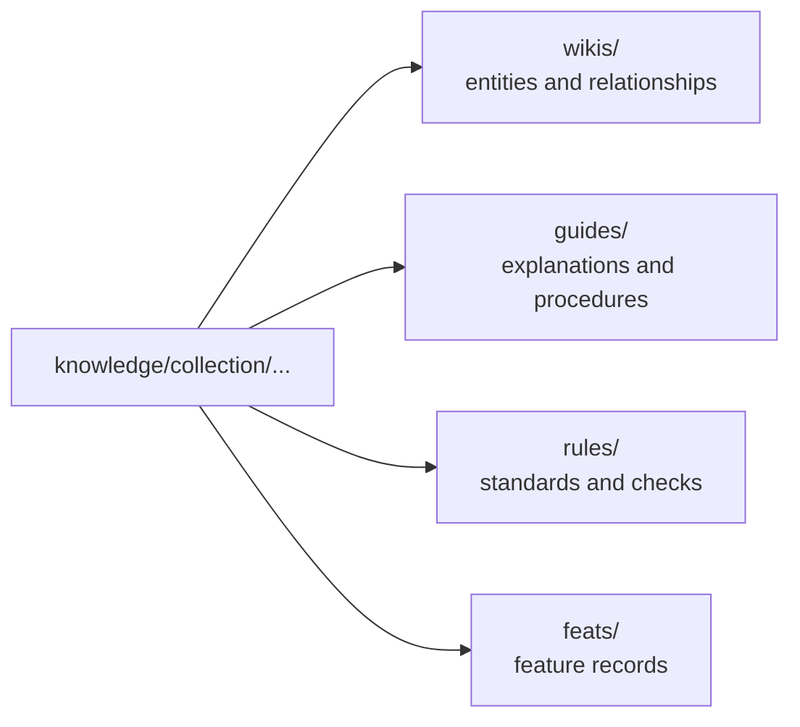

# Knowledge Collections

<!-- context:section id="goal" -->
Every approved article in `knowledge/` lives under a **collection** — the first directory of its path, such as `knowledge/sop/…`. The collection says what kind of reading the article serves. At build time it decides which package root the article goes to, and package `select.collections` filters by it.

<!-- /context:section -->

<!-- context:section id="table" -->
## The collections

| Collection | Holds | Package path | OKF type |
| --- | --- | --- | --- |
| `codeindex` | Source-backed code indexes, with optional structured relationships | `wikis/codeindex/` | Wiki |
| `business` | Structured business entities and relationships | `wikis/business/` | Wiki |
| `product` | Structured product entities, behavior and relationships | `wikis/product/` | Wiki |
| `architecture` | Architecture explanations and design narratives | `guides/architecture/` | Guide |
| `sop` | Procedures and runbooks | `guides/sop/` | Guide |
| `faq` | Question-oriented explanations and troubleshooting | `guides/faq/` | Guide |
| `decision` | Decision records and trade-off narratives | `guides/decision/` | Guide |
| `incident` | Incident timelines, response and follow-up | `guides/incident/` | Guide |
| `standards` | Normative standards and constraints | `rules/standards/` | Rule |
| `test` | Validation rules, scenarios and acceptance checks | `rules/test/` | Rule |
| `feats` | Feature capability records | `feats/` | Feature |

`codegraph` is still accepted as the legacy name of the code index collection and maps to `wikis/` like `codeindex`.
<!-- /context:section -->

<!-- context:section id="roots" -->
## What the package roots mean

- **`wikis/`** is the structured entity-and-relationship layer and the required default entry of a knowledge package, starting at `wikis/index.md`.
- **`guides/`** and **`rules/`** explain, operationalize or constrain that knowledge. Placing an article there does not create a relationship to anything; only a typed edge recorded by Context does.
- **`feats/`** holds feature records.

A package can choose roots with `select.okfRoots` as well as collections; see [Package Templates](./package-templates.md).
<!-- /context:section -->

<!-- context:section id="choose" -->
## Choosing a collection

The Indexer proposes a collection from the reader's need, not from the source type: a document can become a runbook in `sop`, a decision record in `decision` or a standard in `standards`. Typical pairings:

| Reader need | Useful form |
| --- | --- |
| Understand a term, boundary or business rule | Domain explanation with scope and examples |
| Understand architecture or integration | Technical explanation, contracts and limitations |
| Complete a repeatable task | Guide with prerequisites, actions and checks |
| Diagnose or recover | Runbook with symptoms, safe actions and verification |
| Understand a choice | Decision, alternatives, rationale and consequences |
| Learn from an incident | Impact, observations, causes and response |
| Interpret a test | Method, scope and what the result establishes |

You can move an approved article to another collection later with `context revise <target> --move-to <path>`, which keeps its identity.
<!-- /context:section -->

<!-- context:section id="reserved" -->
## Reserved names

`index.md` is reserved for package bundle and directory indexes. A source document may be called `index.md`, but an article must use another name such as `index-page.md`; `context build` rejects copied knowledge that would occupy `wikis/**/index.md`.
<!-- /context:section -->
