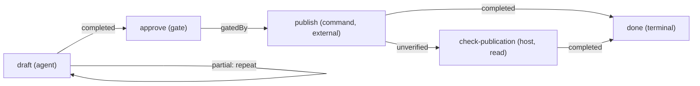

# Authoring Graphs

<!-- context:section id="design" -->
Start from the stable work model, not from a list of commands:

1. Identify the Facts the host can actually observe.
2. Define the legal Actions and their effects.
3. State what proves each Action complete.
4. Add user Gates where authority matters.
5. Make failure, partial work, verification and recovery explicit.
6. Attach long instructions only to the Routes that need them.
7. Write graph tests for the important states and choices.
8. Bind one or more thin Skills to the Graph and Entry.

Do not turn every paragraph of an old Skill into a node. A node is a state transition that is independently actionable, gated, recoverable or testable; supporting explanation stays a Resource. Module names, document IDs, dates and queue entries stay Facts — a stable Host Action resolves the current target instead of the Provider generating a node per item.
<!-- /context:section -->

<!-- context:section id="layout" -->
## Project layout

Directory names are conventions, not protocol. All references are relative to the Provider manifest, and the loader rejects any path that escapes the Provider root.

```text
provider.yaml   Provider ID, version, Graph list, optional Code Catalog
graphs/         Graph definitions
actions/        Action contracts
skills/         Agent Skills used by agent Actions
resources/      Procedures, templates, schemas, dynamic view descriptors
schemas/        Action input and output schemas
tests/          Graph tests (not shipped in the bundle)
```
<!-- /context:section -->

<!-- context:section id="example" -->
## Worked example: a weekly report

The example drafts a report, asks for approval, publishes it and checks the publication when the publish step claims success without evidence. It validates and its seven tests pass with `@c4a/agent-graph@0.3.0`.



```yaml
schema: agent-graph.graph.v1
id: report
entrypoints:
  default: draft
nodes:
  - id: draft
    kind: action
    reasonCode: route.report.draft
    action: actions/draft.yaml
    resources:
      required: [resources/procedure.md]
    satisfiedBy:
      - path: report.digest
        exists: true
  - id: approve
    kind: gate
    reasonCode: route.report.approval-required
    gate:
      id: report-approval
      prompt: Publish this report?
      authority: report.publish
      delegatable: true
    satisfiedBy:
      - path: report.approved
        equals: true
  - id: publish
    kind: action
    reasonCode: route.report.publish
    action: actions/publish.yaml
    satisfiedBy:
      - path: publication.url
        exists: true
  - id: check-publication
    kind: action
    reasonCode: route.report.check-publication
    action: actions/check-publication.yaml
  - id: done
    kind: terminal
    join: any
    terminalOutcome: completed
edges:
  - { from: draft, to: draft, kind: repeat, outcomes: [partial] }
  - { from: draft, to: approve }
  - { from: approve, to: publish, kind: gatedBy }
  - { from: publish, to: done }
  - { from: publish, to: check-publication, outcomes: [unverified] }
  - { from: check-publication, to: done }
```

Every Action and Gate has a `reasonCode` beginning with `route.`; because the Provider declares a Code Catalog, each of those codes must also appear in `codes.yaml`, or validation fails with `route-reason-code-missing`. `done` uses `join: any` because two alternative paths reach it.
<!-- /context:section -->

<!-- context:section id="actions" -->
## Actions

```yaml
# actions/publish.yaml
schema: agent-graph.action.v1
id: publish
runner: command
effect: external
command: ./scripts/publish-report.sh
```

| Runner | Required field | What the Route returns |
| --- | --- | --- |
| `command` | `command` | The exact shell command |
| `script` | `entry`, `runtime`, optional `args` | The runtime and the absolute installed entry path |
| `agent` | `skill` | The Skill as a required file resource |
| `host` | `handler` | A host-defined handler identity |

Runner fields are mutually exclusive, so a host cannot read the same Action two ways. `effect` is mandatory: `read` (should not change lifecycle Facts), `write` (local mutation) or `external` (outside state may change — normally behind a Gate). `cwd` is `workspace` by default or `provider`; `inputSchema`, `outputSchema` and `files` are packaged with the Action. Agent Graph resolves Actions but does not execute them automatically; the host does, then refreshes Facts and evaluates again.
<!-- /context:section -->

<!-- context:section id="facts" -->
## Facts, not history

`satisfiedBy` is how a node is proven complete. Checks are a restricted data model: a dotted `path` (numeric segments index arrays, as in `artifacts.0.digest`) and exactly one of `exists` or `equals` with a scalar value. There is no expression language.

- Matching Facts complete a node even with no Run record — the example's `draft` is skipped when `report.digest` already exists.
- A recorded `completed` without matching Facts becomes `unverified`; the example routes that to `check-publication`.
- `requiresFacts` makes a node legal only under current external state; use it, not `priority`, to decide which option applies.

When evidence has a lifecycle, keep it in ordinary nested Facts such as `{digest, sourceRevision, available, fresh}` and check only the fields that make it trustworthy. Every Fact feeds the Evaluation revision, so the host should publish stable states such as `fresh: false` after applying its own clock or lease — not a constantly changing poll timestamp. Keep `missing`, `unavailable`, `stale` and an explicit `false` distinct when they need different recovery Routes.

To stop a producer from verifying its own work, add a separate `effect: read` host Action whose `satisfiedBy` requires a verification receipt; the host binds it to an independently authorized verifier.
<!-- /context:section -->

<!-- context:section id="edges" -->
## Edges and loops

An edge matches explicit Outcomes; omitting `outcomes` means `[completed]`. The edge kind records intent and does not change reachability:

| Kind | Use it when |
| --- | --- |
| `flow` | An ordinary transition (the default) |
| `consumes` | The target consumes something the source produced |
| `requires` | The source is a prerequisite of the target |
| `gatedBy` | A Gate resolves the target's policy boundary; must start at a Gate |
| `repeat` | A matching Outcome rearms an Action or Gate |

Edges carry no data. Persist outputs through the host and publish references, digests or receipts as Facts. Ordinary edges must be acyclic: adding `publish → draft` on `failed` to the example is rejected with `graph-flow-cycle` and the message "use a repeat edge". A `repeat` edge is the explicit loop — the Agent does one round, records `partial`, evaluates again and gets the same Action until it records something else. Fan-out and fan-in describe reachability only; nothing runs in parallel.
<!-- /context:section -->

<!-- context:section id="gates" -->
## Gates and delegation

Without the named authority, a Gate Route is `waiting-user` with an empty `commandPlan`. With a `delegatable` authority in the current input or Run, it becomes actionable with `resolution: session-authority`. Authority never satisfies Facts; in the example, `report.approved` must still be observed before `publish` becomes legal.

A Gate can add three optional contracts:

```yaml
inspectionAction: actions/inspect-review.yaml   # effect: read; prepares evidence, safe before confirmation
resolutionAction: actions/apply-review.yaml     # effect: write or external; persists the decision after confirmation
delegated:
  inspection: skip                              # only with a delegatable authority and an inspection Action
  resolutionAction: actions/accept-review.yaml  # replaces resolution on the delegated Route only
  resources: { required: [], recommended: [] }  # replaces the Gate's resources on the delegated Route
```

Keep the Gate prompt short and put structured decision input on the resolution Action's `inputSchema`. A host must not run the resolution while the Route still requires the user. The repository's `examples/review-gate` shows both the waiting and delegated cases.
<!-- /context:section -->

<!-- context:section id="resources" -->
## Resources

Put long instructions in Markdown with frontmatter, and declare them on the node that needs them:

```yaml
---
id: procedure.prepare
kind: procedure
media-type: text/markdown
---
```

Non-Markdown files such as JSON Schemas use an `agent-graph.resource.file.v1` descriptor with `id`, `kind`, `mediaType` and `path`. Dynamic context views use `agent-graph.resource.graph-action.v1` with a read-only command or script materializer, and host-produced content uses `agent-graph.resource.host-action.v1`. An agent Action's Skill is loaded only at the Action that uses it; a Gate's inspection or resolution Skill stays on that nested Action until that phase is selected. Details are in [Skills and Providers](../../architecture/agent-graph/skills-and-providers.md).
<!-- /context:section -->

<!-- context:section id="subgraphs" -->
## Subgraphs and ranking

A `subgraph` node calls a named entry of another Graph in the same Provider. The child Route keeps its own Graph and node identity plus the parent call path, and the child's terminal Outcome flows back to the parent edge. Recursion into an ancestor is rejected statically and at runtime, and cross-Provider Subgraphs are not supported in version 1.

When several Routes are legal at once, `priority` ranks them within an availability class; it never decides which option is semantically right. Every Graph needs at least one Terminal, and reaching Terminals with conflicting Outcomes is an error (`terminal-outcome-ambiguous`), never resolved by declaration order.

Next, pin each of these behaviours with a test: [Testing and Publishing](testing-and-publishing.md).
<!-- /context:section -->
