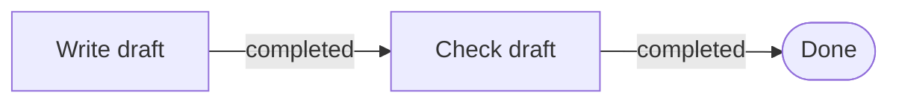

# What Is Agent Graph

<!-- context:section id="purpose" -->
**Agent Graph keeps Agents on stable workflows.** Each step comes with the knowledge and skills it needs, so running the same task again reaches a consistent result instead of depending on how one conversation happened to go.

**It makes the process observable and testable, which drives the workflow's own improvement.** Every step, choice and result can be inspected, replayed and checked by tests, so the people who own a workflow can see where it goes wrong and improve it iteration after iteration.
<!-- /context:section -->

<!-- context:section id="what" -->
## What it is

Agent Graph is a work-contract layer for Agent Skills. You describe a workflow as a small graph of legal steps. At runtime it reads the current **Facts** and tells an Agent what to do next, which files to read for that step and what proves the step is done.

It coordinates the work, not the Agents: it never calls a model, assigns Agent identities, moves shared state or schedules workers. Your existing Agent or host carries out each step and keeps the execution boundary. Agent Graph ships as the `@c4a/agent-graph` package — file specifications, a Node.js SDK and an `agent-graph` CLI — and is developed at [github.com/context4ai/agent-graph](https://github.com/context4ai/agent-graph).
<!-- /context:section -->

<!-- context:section id="problem" -->
## The problem with long Skills

Agents usually know enough. The harder problem in a long task is knowing which part applies **now**, which action is legal next, what proves that action is complete and where to resume after an interruption. Making the prompt longer does not solve this reliably: when a complex Skill is one document, every rule sits next to every other and is often loaded together, the Agent has to infer the current phase from the conversation, and the workflow is hard to test without running the whole model behavior.

> Context should be discovered, not accumulated. The plan is explicit; the path is selected from current reality.
<!-- /context:section -->

<!-- context:section id="example" -->
## A small example

An Agent has one job: write a draft, check it, finish.

The host can observe two facts: `draft.saved = true` and `review.passed = false`. The draft exists but has not passed the check, so Agent Graph returns **Check draft** as the current Route. Nothing is guessed from the conversation: when `review.passed` becomes `true` the next evaluation reaches **Done**; while it stays `false` the Route stays **Check draft**.

Four ideas carry the example: the **Graph** describes the legal sequence, **Facts** describe what is true now, the **Route** is the next legal step selected from those Facts and the **Action** tells the Agent or host how to perform it. Real workflows add required files, human Gates, explicit Outcomes, choices and recovery paths without changing this loop.
<!-- /context:section -->

<!-- context:section id="benefits" -->
## What you get

| Goal | How Agent Graph supports it |
| --- | --- |
| Consistent results | The Graph fixes the legal choices and stop conditions; current evidence picks the path. The same Facts select the same Route, so a retry or a new session continues the same way. |
| The right knowledge per step | Procedures, schemas and manuals stay files and are loaded only when the selected Route needs them, instead of one giant prompt. |
| Work that survives interruptions | Facts and explicit Outcomes reconstruct where the work is; an optional Run adds events, checkpoints and resumable state. |
| An observable process | Routes, events and diagnostics show which step ran, why it was chosen and what came back. |
| Testing before model behavior | Authors validate references, cycles, resource boundaries and expected Routes without asking a model to run the workflow. |

Feedback works at two levels. At runtime, results change the next Route: success advances the goal, missing evidence leads to verification and failure leads to recovery. Over time, events, diagnostics and route tests reveal problems in instructions, fact definitions or the graph itself. Agent Graph never rewrites its own plan — people improve the Graph from what they observe.
<!-- /context:section -->

<!-- context:section id="context" -->
## A real-world case: Context

Context runs its whole knowledge workflow on Agent Graph behind one thin Agent entry. The entry starts a new workspace or resumes an existing one; each evaluation hands the Agent only the procedures and resources the selected Route requires, and the Agent proves it read them. Re-entering with unchanged Facts selects the same Route, and revision-bound commands reject stale writes, so retries and new sessions are safe. [Agent Graph in Context](../../architecture/agent-graph/agent-graph-in-context.md) walks through the integration.
<!-- /context:section -->

<!-- context:section id="when" -->
## When to use it

Not every Skill needs a Graph. Keep a short, single-session task in `SKILL.md`. Adopt Agent Graph when a host can supply trustworthy external facts and the work truly needs verifiable completion, recovery across sessions, or testable routing and human Gates.

Installing the CLI alone does not change how any Agent works. An integration has three parts: a Provider defines the work contract, a Skill makes it discoverable, and a host — your Agent or product — supplies Facts, presents Routes, enforces Gates and records Outcomes.
<!-- /context:section -->

<!-- context:section id="start" -->
## Where to start

| Your situation | Start with |
| --- | --- |
| A Skill works but has grown long, repeats context every turn, loses its place across sessions, or describes Gates and recovery in prose | [Migration](../../product/reference/agent-graph/migration.md) |
| The capability does not exist yet and its operating contract can be designed with the Skill | [Quick Start](getting-started.md), then [Authoring Graphs](authoring-graphs.md) |
| A product already owns Agent discovery, command execution, UI or workspace state | [Skills and Providers](../../architecture/agent-graph/skills-and-providers.md) and [CLI and SDK](../../product/reference/agent-graph/cli-and-sdk.md) |
| You only use a capability someone has already integrated, such as Context | Invoke that Skill normally; you usually do not install or configure anything |

To understand the design behind it, read [Graph Engineering Principles](../../architecture/agent-graph/why-graph-engineering.md), then [Core Model](../../architecture/agent-graph/core-model.md) and [Runs and Recovery](../../architecture/agent-graph/runs-and-recovery.md).
<!-- /context:section -->
