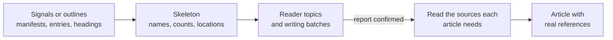

# Writing Indexer Guidance

<!-- context:section id="goal" -->
Read this page when you are writing or reviewing your own Indexer, usually after asking the creator for a first version in [Creating an Indexer](creating-an-indexer.md). An Indexer teaches the Agent how to read one technology or one family of documents: what to look at cheaply during planning, what to read in full before explaining it, and how to write articles organized around reader questions. It guides investigation and writing; the Context workflow still decides what happens next.

Both kinds follow the same rhythm: a cheap skeleton or outline first, reader topics that you confirm in the work-start report, then full reading of the sources each article needs. The two sections below follow the shipped `context-code-indexer` and `context-markdown-indexer`.


<!-- /context:section -->

<!-- context:section id="responsibilities" -->
## Code Indexers

A code Indexer teaches the Agent how to read one technology: where its features are declared, how to find them cheaply during planning, and what to read in full before explaining them.

### What the Skill is responsible for

Describe the supported technology, the signals that activate it, the reader questions it can help answer and how to investigate an authorized module. A module may use several Skills for different concerns — say, one for the web framework and another for its message consumers. Which Skills a task uses is planning guidance for that task, not article metadata.

Keep `SKILL.md` focused on discovery and decisions. Put detailed writing guidance and reusable scripts beside it, linked by relative path with a clear note on when to read them.
<!-- /context:section -->

<!-- context:section id="skeleton" -->
### Skeleton first

During planning the Indexer should point the Agent at directories, manifests, registration points and bounded search — either for direct inspection or through a fast helper suited to the stack — and report matching names, known counts and file locations. It must not require complete symbol extraction, call graphs or reading every implementation before articles are proposed.

Typical signals and the questions they suggest:

| Signal | Suggests |
| --- | --- |
| Public exports or component declarations | How to consume a capability |
| Inbound registrations or interface definitions | Which operations are served |
| Event or scheduled registrations | What triggers work and how it completes |
| Storage interfaces | Data ownership and transaction boundaries |
| Adapters and generated clients | Contracts at an external handoff |
| Package and workspace entry points | Responsibility and consumption boundaries |

Signals suggest topics; they do not prove meaning. A route registration can suggest an API topic, but not its error behavior. File counts are not feature counts, and a stopped scan is never a full total.
<!-- /context:section -->

<!-- context:section id="helpers" -->
### Bounded helpers

Scripts are optional and serve one concrete, repeated task. A good helper takes explicit authorized paths and bounded options, keeps source files read-only, returns concise output or writes a file in the supplied temporary area, and stops within its budget. It reports inspected and uninspected scope, returns a continuation when it can, and labels partial counts.

It must not execute repository code, read credentials, traverse unrelated directories or contact external services. Unsupported syntax and incomplete traversal are reported separately from zero matches. Full parsing belongs to the writing of selected articles; where a structural fact needs a real parser, use the built-in extractors described in [Code Extraction](../../architecture/knowledge/code-extraction.md).
<!-- /context:section -->

<!-- context:section id="writing" -->
### Writing guidance

Once the work-start report is confirmed (see [Confirming the Work-Start Report](../planning-and-production/start-reports.md)), the Agent reads the source each article needs. Guide it to explain contracts, state changes, failure behavior and integration points — what the module is responsible for, how to enter it, what it hands off. Parsing can locate declarations; it is not proof of runtime behavior. Preserve expressions without executing project code, keep declared defaults apart from implemented defaults, and state unknowns.

An Indexer may suggest a recurring outline for a feature family such as route groups or components, but not a fixed page count: a component manual may need component-by-component reading, while one page per symbol or a catch-all page for a large module are both wrong. Each section cites real source regions from at most three distinct files, up to eight regions in total; split an explanation when it needs separate evidence.
<!-- /context:section -->

<!-- context:section id="example" -->
### Example outline

A minimal Indexer for a hypothetical Acme RPC framework:

```text
acme-rpc-indexer/
  SKILL.md
  references/
    investigate.md   # where services, methods and middleware are declared
    writing.md       # integration and maintenance guide outlines
  scripts/
    list-services.mjs  # bounded: given paths, prints service and method names with locations
  tests/fixtures/
    orders-service/  # anonymous sample module
```

```markdown
---
name: acme-rpc-indexer
description: Investigate services built on Acme RPC and write integration and maintenance articles. Use when selected for a Context planning or writing task on such a module.
---

# Acme RPC Indexer

During planning, read `service.yaml` files and `@Method` registrations in the
authorized module. Report service names, method counts and file locations;
mark partial counts as partial. For large modules run
`scripts/list-services.mjs <paths> --max-files 2000`.

During writing, read [writing guidance](references/writing.md). For each
method, explain the request contract, errors and middleware actually applied.
A generated client is outbound, not proof that this module serves the method.
```
<!-- /context:section -->

<!-- context:section id="tests" -->
### Testing

Test the supported technology with anonymous fixtures: feature discovery, bounded stopping, unsupported input, repeated names in different paths, and the references in the final article. For generated API explanations, check defaults, shared types and unresolved cross-file links in the final page as well as the helper output. Use fixtures relevant to the technology, not a matrix of unrelated stacks.

Verify packaged relative links and executable helpers, and keep examples free of organization-specific services; organization knowledge belongs in its own Skills.
<!-- /context:section -->

<!-- context:section id="documents" -->
## Document Indexers

A document Indexer helps the Agent interpret one family of captured documents — design reviews, runbooks, API specifications, product requirements — and turn them into articles organized around reader questions rather than around the source files. Notes and session summaries have their own Indexers but can support the same reader topics.
<!-- /context:section -->

<!-- context:section id="sources" -->
### Start from captured sources

The Indexer works on authorized captured documents. Capture proves which content is available, not what it means; titles, headings and file names are navigation aids, not proof that the body has been read.

It must not fetch new documents, follow external links or widen source authorization on its own. Missing material is requested through the current task, and an unavailable source is kept distinct from an irrelevant one.
<!-- /context:section -->

<!-- context:section id="planning" -->
### Planning from outlines

For each document the Agent gets its title, a short introduction and the complete H2/H3 outline, plus existing article titles, descriptions and references. It reads more — a section or the whole document — only where the reader question, grouping or authority is unclear. Full reading of every document is not required before a plan can be proposed.

Guide the grouping:

- Reuse an existing article, including a topic first discovered from code, when it answers the same question for the same audience.
- Let business definitions in documents correct a mechanical code-topic name, rather than forcing a document under a code directory.
- Split distinct reader tasks or lifecycles; combine sources that answer the same task. A broad shared label such as "operations" does not make all its procedures one summary.
- Neither file count nor heading count decides article count. One document may support several articles, and several documents one article.

Age, archive location and polished language prove neither authority nor irrelevance; compare substance, audience and applicability. The first plan is shown in the work-start report and waits for your feedback before bulk writing, also in fully managed mode; see [Confirming the Work-Start Report](../planning-and-production/start-reports.md).
<!-- /context:section -->

<!-- context:section id="doc-writing" -->
### Writing and repairs

Before writing, the Agent reads the actual passages each article needs, and keeps authoritative rules, examples, decisions and proposals distinct — a suggestion in a meeting summary is not implemented behavior. Each section cites real source regions from at most three distinct files, up to eight regions in total; the Agent judges whether the evidence supports the explanation. A local problem is repaired at the affected section, and finished articles can be submitted without waiting for the rest of a batch.

Revisions keep stable article and section identities and preserve useful steps, examples, images and limitations. Do not inflate page counts, write one page per heading or turn missing evidence into speculative prose.
<!-- /context:section -->

<!-- context:section id="visuals" -->
### Images, tables and diagrams

The Agent reads only the authorized images that came with a document, prefers structured whiteboard or table data when available, and converts a clear flow, sequence, state or relationship diagram to Mermaid, or a table to Markdown, only when every label, value and footnote survives. Screenshots, photos and designs where the appearance is the information are kept as originals, and so is anything it cannot read reliably. It never guesses relationships or numbers. A document Indexer can add guidance for diagrams typical of its family.
<!-- /context:section -->

<!-- context:section id="doc-example" -->
### Example outline

A minimal Indexer for design-review documents:

```text
design-review-indexer/
  SKILL.md
  references/
    writing.md     # decision record and architecture guide outlines
  tests/fixtures/
    reviews/       # three anonymous design reviews, one superseded
```

```markdown
---
name: design-review-indexer
description: Interpret design-review documents and write decision records and architecture guides. Use when selected for a Context planning or writing task on such documents.
---

# Design Review Indexer

During planning, use the title, "Context", "Decision" and "Alternatives"
headings to group reviews by the system they change. A superseded review
still explains history; link it from the current decision instead of
dropping it.

During writing, read [writing guidance](references/writing.md). State the
decision, its rationale and limits; mark open questions as open. A proposal
without a recorded decision is not adopted behavior.
```
<!-- /context:section -->

<!-- context:section id="doc-tests" -->
### Testing

Cover the document forms the Skill claims to support: an ordinary one-to-one article, a synthesis from several documents, reuse of an existing topic, a section repair, source line changes, links and images, and missing material. Check both fidelity to the source and the final page, keep examples anonymous and verify packaged links.

See [Creating an Indexer](creating-an-indexer.md) for the creation flow and [Choosing, Replacing and Disabling Indexers](providers-and-customization.md) for using several Skills together.
<!-- /context:section -->
