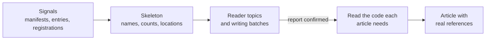

# Code Indexers

<!-- context:section id="goal" -->
A code Indexer teaches the Agent how to read one technology: where its features are declared, how to find them cheaply during planning, and what to read in full before explaining them. It exposes the module's skeleton and guides source-grounded writing; it does not recreate the workflow's routing. This page covers what to put in one, following the shipped `context-code-indexer`.


<!-- /context:section -->

<!-- context:section id="responsibilities" -->
## What the Skill is responsible for

Describe the supported technology, the signals that activate it, the reader questions it can help answer and how to investigate an authorized module. A module may use several Skills for different concerns — say, one for the web framework and another for its message consumers. There is no exclusive primary owner, version pin, integrity receipt or registration step before production; Skill names and usage choices are temporary planning guidance, not article metadata.

Keep `SKILL.md` focused on discovery and decisions. Put detailed writing guidance and reusable scripts beside it, linked by relative path with a clear note on when to read them.
<!-- /context:section -->

<!-- context:section id="skeleton" -->
## Skeleton first

During planning the Indexer should point the Agent at directories, manifests, registration points and bounded search — either for direct inspection or through a fast helper suited to the stack — and report matching names, known counts and file locations. It must not require complete symbol extraction, call graphs or reading every implementation before articles are proposed.

Typical signals and the questions they suggest:

| Signal | Suggests |
| --- | --- |
| Public exports or component declarations | How to consume a capability |
| Inbound registrations or interface definitions | Which operations are served |
| Event or scheduled registrations | What triggers work and how it completes |
| Storage interfaces | Data ownership and transaction boundaries |
| Adapters and generated clients | Contracts at an external handoff |
| Package and workspace entry points | Responsibility and consumption boundaries |

Signals suggest topics; they do not prove meaning. A route registration can suggest an API topic, but not its error behavior. File counts are not feature counts, and a stopped scan is never a full total.
<!-- /context:section -->

<!-- context:section id="helpers" -->
## Bounded helpers

Scripts are optional and serve one concrete, repeated task. A good helper takes explicit authorized paths and bounded options, keeps source files read-only, returns concise output or writes a file in the supplied temporary area, and stops within its budget. It reports inspected and uninspected scope, returns a continuation when it can, and labels partial counts.

It must not execute repository code, read credentials, traverse unrelated directories or contact external services. Unsupported syntax and incomplete traversal are reported separately from zero matches. Full parsing belongs to selected writing tasks; where a structural fact needs a real parser, use the built-in extractors described in [Code Extraction](../../architecture/knowledge/code-extraction.md).
<!-- /context:section -->

<!-- context:section id="writing" -->
## Writing guidance

Once the work-start report is confirmed, the Agent reads the source each article needs. Guide it to explain contracts, state changes, failure behavior and integration points — what the module is responsible for, how to enter it, what it hands off. Parsing can locate declarations; it is not proof of runtime behavior. Preserve expressions without executing project code, keep declared defaults apart from implemented defaults, and state unknowns.

An Indexer may suggest a recurring outline for a feature family such as route groups or components, but not a fixed page count: a component manual may need component-by-component reading, while one page per symbol or a catch-all page for a large module are both wrong. Each section cites at most three real source locations; split an explanation when it needs separate evidence.
<!-- /context:section -->

<!-- context:section id="example" -->
## Example outline

A minimal Indexer for a hypothetical Acme RPC framework:

```text
acme-rpc-indexer/
  SKILL.md
  references/
    investigate.md   # where services, methods and middleware are declared
    writing.md       # integration and maintenance guide outlines
  scripts/
    list-services.mjs  # bounded: given paths, prints service and method names with locations
  tests/fixtures/
    orders-service/  # anonymous sample module
```

```markdown
---
name: acme-rpc-indexer
description: Investigate services built on Acme RPC and write integration and maintenance articles. Use when selected for a Context planning or writing task on such a module.
---

# Acme RPC Indexer

During planning, read `service.yaml` files and `@Method` registrations in the
authorized module. Report service names, method counts and file locations;
mark partial counts as partial. For large modules run
`scripts/list-services.mjs <paths> --max-files 2000`.

During writing, read [writing guidance](references/writing.md). For each
method, explain the request contract, errors and middleware actually applied.
A generated client is outbound, not proof that this module serves the method.
```
<!-- /context:section -->

<!-- context:section id="tests" -->
## Testing

Test the supported technology with anonymous fixtures: feature discovery, bounded stopping, unsupported input, repeated names in different paths, and the references in the final article. For generated API explanations, check defaults, shared types and unresolved cross-file links in the final page as well as the helper output. Use fixtures relevant to the technology, not a matrix of unrelated stacks.

Verify packaged relative links and executable helpers, and keep community examples free of company-specific services; organization knowledge belongs in its own Skills. See [Creating an Indexer](creating-an-indexer.md) for the creation flow and [Providers and Customization](providers-and-customization.md) for combining Skills.
<!-- /context:section -->
