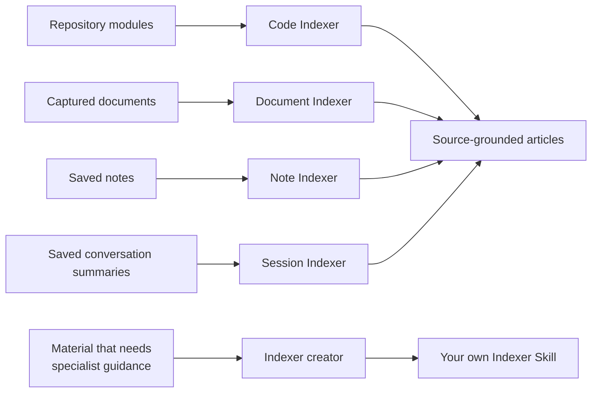

# Built-in Indexers

<!-- context:section id="goal" -->
An **Indexer** is a Skill that tells the Agent how to investigate one kind of source and how to write source-grounded articles from it. There are four kinds of Indexer — **code, document, note and session** — and each kind can have several Skills. Context ships one Skill per kind, and a creator Skill writes new Indexers when you need one.

This subsection covers Indexers from the reader's side: start here to see what the built-in ones already cover. Go on to [Choosing, Replacing and Disabling Indexers](providers-and-customization.md), [Creating an Indexer](creating-an-indexer.md) or [Writing Indexer Guidance](code-indexers.md) only when they do not fit your material.

<!-- /context:section -->

<!-- context:section id="at-a-glance" -->
## At a glance

| Kind | Skill | Reads |
| --- | --- | --- |
| Code | `context-code-indexer` | Repository modules |
| Document | `context-markdown-indexer` | Captured documents and same-repository docs |
| Note | `context-note-indexer` | Saved notes, excerpts and observations |
| Session | `context-sessions-indexer` | Saved conversation summaries |
| Creator | `context-indexer-create` | Your request for a new Indexer |

The Indexers work during planning and writing. The creator is an authoring assistant: it writes a new Indexer Skill for code, documents, notes or session summaries when you ask for one.
<!-- /context:section -->

<!-- context:section id="code" -->
## Code: `context-code-indexer`

- **What you get:** articles about an authorized module of a registered repository — its technology, the capability families it exposes, its contracts and integration points — grouped into reader topics that you confirm in the work-start report. Article outlines suit 16 kinds of module, from monorepo containers, web applications, component and SDK libraries and CLI tools to API services, event consumers, storage repositories, adapters, contract sources and generated sources.
- **How it reads:** during planning it looks at the module's structure and representative source; while writing it reads the actual implementation and contracts each article needs. Partial counts are named as partial.
- **What it will not do:** parse the whole repository, list every symbol or build a relationship graph during planning; write knowledge directly or modify your repository.
- **Add a note or document instead when** the knowledge is business intent or rationale that the code does not show. Code establishes implemented behavior; notes and documents explain why.
<!-- /context:section -->

<!-- context:section id="documents" -->
## Documents: `context-markdown-indexer`

- **What you get:** articles organized around reader questions rather than source files, keeping the useful guidance, examples and limits of the original, with citations to the passages used. Article outlines suit 13 kinds of document, from domain references, product requirements and technical guides to runbooks, FAQs, decision records, incident reviews, test validation, release and migration guides, and documentation sites.
- **How it reads:** planning starts from document titles, opening excerpts and heading outlines, with full reading where the grouping is unclear; writing reads the relevant full source. One heading does not mean one article.
- **What it will not do:** produce knowledge from same-repository docs and Skills you only linked, unless you ask — those stay originals and serve as supporting evidence. See [Linking Existing Docs and Skills](../registering-sources/same-repository-docs.md).
- **Add a note instead when** the knowledge lives in people's heads or chat rather than in a document; see [Notes and Conversation Summaries](../registering-sources/notes.md).
<!-- /context:section -->

<!-- context:section id="notes" -->
## Notes: `context-note-indexer`

- **What you get:** a note either strengthens an existing page or, when it answers an independent reader question, becomes its own article. It has nine reader profiles of its own (domain reference, product requirements, technical guide, user and developer guide, runbook, FAQ, decision record, incident review, test validation) and can also write in the style of each code and document profile, for example a note about an API service or a runbook.
- **How it reads:** saved notes, excerpts and observations, read directly.
- **What it will not do:** scan host history, fetch a URL you have not approved or alter evidence to fit a claim.
- **Add a document or session summary instead when** the material is a maintained document (add it as a document source) or a conversation whose decisions you want kept (save a summary).
<!-- /context:section -->

<!-- context:section id="sessions" -->
## Session summaries: `context-sessions-indexer`

- **What you get:** from a saved conversation summary, the problem, the decisions actually reached, the reasons needed to understand them, the open questions and where they apply — with "proposed", "agreed", "implemented" and "verified" kept distinct. A summary need not concern code. A linked commit or merge request records what was discussed; it does not prove that a change merged, deployed or passed tests.
- **How it reads:** a bounded summary prepared by the host or another tool, read directly.
- **What it will not do:** scan chat history, load a full transcript or reconstruct a conversation from a diff.
- **Add a note instead when** you only want to keep an excerpt or an observation rather than a conversation's decisions.
<!-- /context:section -->

<!-- context:section id="creator" -->
## The creator: `context-indexer-create`

`context-indexer-create` writes a reusable Indexer Skill in the directory you choose. Ask for it in plain language — it is not a slash command — and say explicitly that you want a new Context Indexer Skill for code, documents, notes or session summaries.

It writes Skills only: it does not set up a knowledge workspace or start production. At the end it reports the files it created, the inputs it supports and its remaining limitations. See [Creating an Indexer](creating-an-indexer.md) for the full walkthrough.
<!-- /context:section -->

<!-- context:section id="installation" -->
## How they are installed

Installing the Context plugin (see [Installation](../../product/getting-started/installation.md)) makes all the built-in Indexers available to Claude Code, Codex and Cursor. The four Indexers are installed without a plugin prefix, so they keep the same names in every host. Restart or refresh the Agent host after installing.
<!-- /context:section -->

<!-- context:section id="selection" -->
## How the Agent chooses them

You do not call an Indexer directly; the Agent chooses the ones that fit your material when Context work starts. Ordinary coding and design conversations do not start it, so invoke Context explicitly or continue an active Context conversation. How the choice works, and how to replace or disable an Indexer, is described in [Choosing, Replacing and Disabling Indexers](providers-and-customization.md).
<!-- /context:section -->

<!-- context:section id="combining" -->
## Several Indexers on one module

Several Skills may examine different aspects of the same module, and their findings go into the same article rather than producing copies. Code establishes implemented behavior, while authorized notes or documents can explain business intent and rationale.

A note that only supports an existing page is written into that page. A note that answers an independent reader question can become its own article.

Next:

- [Choosing, Replacing and Disabling Indexers](providers-and-customization.md) covers steering the choice in a workspace.
- [Creating an Indexer](creating-an-indexer.md) and [Writing Indexer Guidance](code-indexers.md) cover writing your own.
- [The Indexer System](../../architecture/knowledge/indexer-system.md) explains how Indexers fit into the production lifecycle.
<!-- /context:section -->
