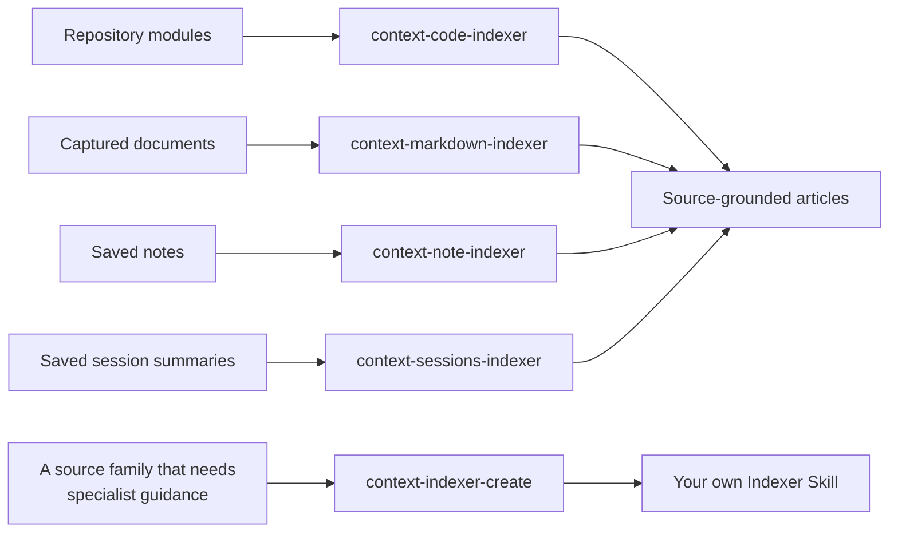

# Community Indexers

<!-- context:section id="goal" -->
An **Indexer** is a Skill that tells the Agent how to investigate one kind of source and how to write source-grounded articles from it. It helps the Agent understand authorized material; it does not own workflow routing, source authorization, Review or the permanent identity of an article. Several Indexers can contribute to the same module or article.

The community edition ships four Indexer Skills — for code, documents, notes and session summaries — and one creator Skill that writes new Indexers. All of them are maintained in `plugins/context/skills/` of the Context repository, and `context plugin install` makes them available to your Agent host.

<!-- /context:section -->

<!-- context:section id="at-a-glance" -->
## At a glance

| Category | Skill | Source directory |
| --- | --- | --- |
| Code | `context-code-indexer` | [plugins/context/skills/context-code-indexer](https://github.com/context4ai/context/tree/main/plugins/context/skills/context-code-indexer) |
| Documents | `context-markdown-indexer` | [plugins/context/skills/context-markdown-indexer](https://github.com/context4ai/context/tree/main/plugins/context/skills/context-markdown-indexer) |
| Notes | `context-note-indexer` | [plugins/context/skills/context-note-indexer](https://github.com/context4ai/context/tree/main/plugins/context/skills/context-note-indexer) |
| Session summaries | `context-sessions-indexer` | [plugins/context/skills/context-sessions-indexer](https://github.com/context4ai/context/tree/main/plugins/context/skills/context-sessions-indexer) |
| Creator | `context-indexer-create` | [plugins/context/skills/context-indexer-create](https://github.com/context4ai/context/tree/main/plugins/context/skills/context-indexer-create) |

The first four are Indexer Provider Skills that the Context workflow uses during planning and writing. The creator is an authoring assistant: it writes a new Indexer Skill for code, documents, notes or session summaries when you ask for one.
<!-- /context:section -->

<!-- context:section id="code" -->
## Code: `context-code-indexer`

- **Reads:** the authorized module of a registered repository, starting from the directory and file navigation the CLI supplies.
- **Investigation produces:** the relevant technology, the visible capability families, and proposed reader topics and writing batches. It may inspect representative source, but it does not parse the whole repository, enumerate every symbol or build a relationship graph during planning. Partial counts are named as partial.
- **Writing reads:** the actual implementation and contracts needed for each reader question. Drafts go to the Agent's temporary directory and are submitted through the current CLI action; the Skill never writes formal knowledge or modifies the source repository.
- **Bundled resources:** `references/indexer.md` with investigation and writing guidance, an article catalog for each module profile, diagram and source-visual guidance, and a template for each profile. The profiles cover 16 kinds of module, from monorepo containers, web applications, component and SDK libraries and CLI tools to API services, event consumers, storage repositories, adapters, contract sources and generated sources.
- **Tests:** anonymized fixture sets under `tests/fixtures/`.

Source: [context-code-indexer on GitHub](https://github.com/context4ai/context/tree/main/plugins/context/skills/context-code-indexer).
<!-- /context:section -->

<!-- context:section id="documents" -->
## Documents: `context-markdown-indexer`

- **Reads:** captured documents. Same-repository docs and authored Skills registered as repo-content stay originals; the Skill uses them only as bounded supporting evidence unless you explicitly ask for knowledge production from them.
- **Investigation produces:** topics and writing batches decided from the CLI's document titles, bounded opening excerpts and complete H2/H3 outlines, with selective full reading where needed. The outline is navigation, not proof of a claim and not an instruction to write one article per heading.
- **Writing reads:** the relevant full source, keeping its useful guidance, examples and limits, with citations to the actual regions used.
- **Bundled resources:** planning guidance (`references/semantic-planning.md`), writing guidance (`references/indexer.md`), reader outcomes (`references/classification.md`) and article boundaries (`references/structure-and-artifacts.md`), plus article catalogs and templates that are not read by default. Its 13 document profiles range from domain references, product requirements and technical guides to runbooks, FAQs, decision records, incident reviews, test validation, release and migration guides, and documentation sites.
- **Tests:** anonymized fixture sets under `tests/fixtures/`, such as document-routing cases.

Source: [context-markdown-indexer on GitHub](https://github.com/context4ai/context/tree/main/plugins/context/skills/context-markdown-indexer).
<!-- /context:section -->

<!-- context:section id="notes" -->
## Notes: `context-note-indexer`

- **Reads:** saved notes, excerpts and observations, by direct reading. These sources normally need no parser or separate inventory pass.
- **Investigation produces:** a useful skeleton rather than an exhaustive fact ledger, and article targets proposed against existing topics with the help of `references/classification.md`.
- **Writing reads:** the selected material, guided by `references/writing.md`; when a note revises or combines existing topics, `references/updates-and-composition.md` and `references/extension-placement.md` apply.
- **Bundled resources:** nine reader profiles of its own (domain reference, product requirements, technical guide, user and developer guide, runbook, FAQ, decision record, incident review, test validation) and a `note/`-prefixed extension profile for each code and document profile, such as `note/api-service` or `note/runbook`. Templates and article catalogs are loaded only when needed.
- **Boundaries:** it does not scan host history, fetch an unapproved URL, alter evidence to fit a claim or write formal knowledge.
- **Tests:** anonymized profile fixtures under `tests/fixtures/`.

Source: [context-note-indexer on GitHub](https://github.com/context4ai/context/tree/main/plugins/context/skills/context-note-indexer).
<!-- /context:section -->

<!-- context:section id="sessions" -->
## Session summaries: `context-sessions-indexer`

- **Reads:** a bounded summary of a conversation, prepared by the host or an external supplier. The Indexer does not scan chat history, load a full transcript or synthesize a conversation from a diff. The summary need not concern code or have a commit.
- **Investigation produces:** a skeleton and article targets from direct reading, in the same way as the Note Indexer.
- **Writing extracts:** the problem, the decisions actually reached, the reasons needed to understand them, remaining questions and applicability — keeping "proposed", "agreed", "implemented" and "verified" distinct. An optional `changes` association (a full `commit` SHA or an `mr` URL) records what was discussed; it does not prove that a change merged, deployed or passed tests.
- **Bundled resources:** the same kinds of references, templates and article catalogs as the Note Indexer, loaded only when needed.

Source: [context-sessions-indexer on GitHub](https://github.com/context4ai/context/tree/main/plugins/context/skills/context-sessions-indexer).
<!-- /context:section -->

<!-- context:section id="creator" -->
## The creator: `context-indexer-create`

`context-indexer-create` writes a reusable Indexer Skill in the directory you choose. It activates only when you explicitly ask to create a new Context Indexer Skill for code, documents, notes or session summaries — not for indexing existing sources, ordinary coding, knowledge queries or choosing an installed Skill. It is not a slash command, so ask for it in plain language.

It writes Skills only: it does not initialize a knowledge workspace or start production. It delivers a `SKILL.md` with only the references, templates or scripts that are useful, and no Provider registration manifest, version or hash verification flow. At the end it reports the files it created, the inputs it supports and its remaining limitations. Installing the new Skill makes it available, not selected.

See [Creating an Indexer](creating-an-indexer.md) for the full walkthrough.

Source: [context-indexer-create on GitHub](https://github.com/context4ai/context/tree/main/plugins/context/skills/context-indexer-create).
<!-- /context:section -->

<!-- context:section id="installation" -->
## How they are installed

`context plugin install` installs the Context Agent integration. A global installation creates the host-namespaced Context entry and also projects the four Indexer Skills as **unnamespaced** Skills for Claude, Codex and Cursor: into the shared `~/.agents/skills` directory for Codex and Cursor, and into `~/.claude/skills` for Claude. Their names therefore stay `context-code-indexer`, `context-markdown-indexer`, `context-note-indexer` and `context-sessions-indexer`, without a plugin prefix.

The creator is different: it ships inside the host-specific plugin roots, next to the production, project-planning and query entries. Restart or refresh the Agent host after installing.

Installing an Indexer makes it discoverable. It does not enable it for every Context knowledge workspace.
<!-- /context:section -->

<!-- context:section id="selection" -->
## How the Agent selects them

You do not call an Indexer directly. Indexer Skills are activated only through the Context workflow, so invoke Context explicitly or continue an active Context conversation; ordinary coding and design discussions do not start it.

When work starts, the Agent declares the relevant Skills that are available in the host. It then selects the ones that fit the actual materials and reader task, and records that choice in the current planning schema. There is no separate Provider selection, primary-owner or resolution stage to pass. The Agent:

- respects Skills you have disabled in the host;
- respects an explicit business replacement, such as your own Indexer standing in for a built-in one;
- reads only the selected guidance, without scanning plugin caches or building another Skill registry.

Skill names are guidance, not version pins or evidence of completed reading. See [Providers and Customization](providers-and-customization.md) for replacing or disabling an Indexer.
<!-- /context:section -->

<!-- context:section id="combining" -->
## Several Indexers on one module

Several Skills may examine different aspects of the same module. The Agent combines their findings without making any one of them the permanent owner. Code establishes implemented behavior, while authorized notes or documents can explain business intent and rationale. Contributions from several selected Skills go into the same article rather than producing copies.

A note that only supports an existing page is written into that page, using its evidence and read scope. A note that answers an independent reader question can become its own article through the selected Note Indexer, whether that is the default one or a business replacement. A compatible extension layer is selected explicitly when specialized interpretation is needed; another Skill is not enabled merely because a note exists.

Next:

- [The Indexer System](../../architecture/knowledge/indexer-system.md) explains how Indexers fit into the production lifecycle.
- [Creating an Indexer](creating-an-indexer.md), [Code Indexers](code-indexers.md) and [Document Indexers](document-indexers.md) cover writing your own.
- [Providers and Customization](providers-and-customization.md) covers combining, replacing and disabling Indexers.
<!-- /context:section -->
