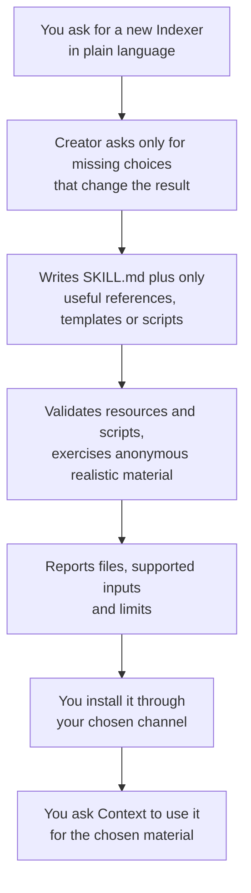

# Creating an Indexer

<!-- context:section id="goal" -->
An Indexer is source-specific investigation and writing guidance: it helps the Agent understand authorized material and produce useful articles. When the built-in Indexers do not know enough about a technology or a family of documents, you can ask the Agent to create one with the **`context-indexer-create`** Skill.

The creator writes a reusable Skill in the directory you choose. It writes Skills only: it does not set up a knowledge workspace or start knowledge production. Your new Indexer contributes investigation and writing guidance; the Context workflow still decides the purpose, scope and scheduling of each task.


<!-- /context:section -->

<!-- context:section id="when" -->
## When a custom Indexer helps

Write a custom Indexer when a technology or document family keeps needing guidance that the built-in Indexers do not carry — for example, a framework whose services are declared in its own files, or a document family with its own structure. Before you start, decide which change you actually need:

| You need | Do this |
| --- | --- |
| The wording, readers or page format of one workspace are not right | Adjust the outline or the page templates; see [Customizing Pages and Themes](../outputs-and-sites/page-and-theme-customization.md). No new Indexer. |
| The built-in Indexer still fits, but a framework or business layer needs extra guidance | Create a specialist that works alongside the built-in one on the same module. |
| The built-in Indexer's way of reading and writing this material does not suit you, and the rules will be reused across projects | Create an independent Indexer and ask Context to use it instead of the built-in one for that material. |

How several Indexers work together, and how to switch one in a workspace, is described in [Choosing, Replacing and Disabling Indexers](providers-and-customization.md).

Do not create an Indexer just because a topic is unfamiliar. When writing choices can solve the problem — a different outline, grouping or headings — adjust the outline instead.
<!-- /context:section -->

<!-- context:section id="asking" -->
## How to ask for it

The creator is not a slash command. Ask for it in plain language, and say explicitly that you want a new Context Indexer Skill for code, documents, notes or session summaries; asking to index existing sources or to choose an installed Skill does not start it. It works in your conversation language and asks only for missing source, reader or capability choices that materially affect the result.

Have these ready:

- **Where to create it** — the creator writes into the directory you choose.
- **Which material family** — code, documents, notes or session summaries, and the technology or document type within it.
- **Realistic anonymous samples** — the creator exercises realistic anonymous material for the capability it claims.

For example:

```text
Create a Context Indexer Skill for code built with the Acme RPC framework.
Put it in ./skills/acme-rpc-indexer. Acme RPC services are declared in
*.acme files and registered in each module's server entry. Use the anonymized
sample module in ./fixtures/acme-sample to check it.
```
<!-- /context:section -->

<!-- context:section id="output" -->
## What it produces

- A `SKILL.md` with a discoverable name and a precise description of when the Skill helps, which sources it understands and its real limits.
- References for substantial source-specific guidance, when needed.
- Templates, when they help readers.
- Scripts, only when a concrete repeated operation needs deterministic assistance.

Bundled resources are referenced with portable relative paths. A simple note interpreter needs no script or template catalog.

When it finishes, the creator reports the files it created, the inputs the Skill supports, how any helper behaves and the remaining limitations.
<!-- /context:section -->

<!-- context:section id="anatomy" -->
## What a good Indexer contains

A good Indexer explains which source signals identify its material and how to examine them cheaply, offers bounded helpers only where they add something, suggests reader topics without fixing a page count, and guides source-grounded writing. What that means for each family, with examples, is in [Writing Indexer Guidance](code-indexers.md): see its Code Indexers and Document Indexers sections.
<!-- /context:section -->

<!-- context:section id="validation" -->
## How the creator validates it

The creator validates the Skill's references and any scripts, then exercises realistic anonymous material for the capability the Skill claims. It keeps three levels of evidence apart: static validation, review of model output, and a real production run. It does not silently install dependencies or claim tests that could not run.

| Check | What it covers |
| --- | --- |
| Frontmatter and every referenced local resource | The package is complete |
| New scripts against small anonymous fixtures | Empty input, a bounded partial scan, claimed failure and recovery behavior, no escape from the selected scope, no secret or source-body dumps |
| Useful output, insufficient evidence and a revision of an existing article | The guidance works beyond the happy path |
| Representative differences for each advertised family | For example an unadopted proposal, a document needing deeper reading, or two technologies in one module |

A static resource check does not prove semantic quality, and a reviewed example does not prove that the Skill works in a real production run. Do not claim support for families you have not tested.
<!-- /context:section -->

<!-- context:section id="try" -->
## Try it in a test workspace

After the creator's checks pass, run one real Context flow in a separate test knowledge workspace before you share the Skill. This is the only level of evidence that shows the Skill working through the existing workflow, including confirming the work-start report and submitting pages. Ask for it explicitly — the creator starts no production of its own.

Install the Skill where your host can see it (see [Choosing, Replacing and Disabling Indexers](providers-and-customization.md) for the locations), start `/c4a:context` in the test workspace, and check the generated pages against the samples you gave the creator.
<!-- /context:section -->

<!-- context:section id="install" -->
## Installing it and putting it to use

Keep the Skill portable and install it through the channel you prefer, then refresh or restart the Agent host and confirm the new Skill is visible.

Installing makes a Skill available, not chosen. Continue the workspace through `/c4a:context` and say which material should now use the new Skill, which built-in Indexer it replaces, if any, and that other sources keep their current choice. Ask the Agent which Indexers it chose and for which material, then check the pages it writes.

Nothing about the Skill has to be restored later. Approved pages, sources and long-term scope decisions survive a new machine, while drafts and the Skill choices of a task stay temporary. A new user can start a fresh production run without your former Skill.

Next:

- [Writing Indexer Guidance](code-indexers.md) — investigation signals, helpers, planning and writing guidance for code and document Indexers.
- [Choosing, Replacing and Disabling Indexers](providers-and-customization.md) — how several Indexers work together, and how to replace or disable one.
<!-- /context:section -->
