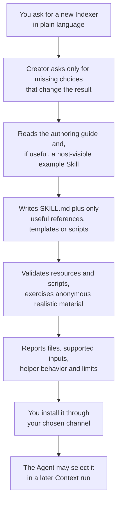

# Creating an Indexer

<!-- context:section id="goal" -->
An Indexer is source-specific investigation and writing guidance: it helps the Agent understand authorized material and produce useful articles. When the built-in Indexers do not know enough about a technology or a family of documents, you can ask the Agent to create one with the **`context-indexer-create`** Skill.

The creator writes a reusable Skill in the directory you choose. It writes Skills only: it does not initialize a Context knowledge workspace or start knowledge production. Your new Indexer contributes investigation and writing guidance; the current Context stage still supplies the purpose, scope, scheduling and submission schemas.


<!-- /context:section -->

<!-- context:section id="when" -->
## When a custom Indexer helps

Write a custom Indexer when a technology or document family keeps needing guidance that the built-in Indexers do not carry — for example, a framework whose services are declared in its own files, or a document family with its own structure. A reusable specialist Skill describes how to interpret that source, how to investigate a lightweight skeleton, any optional bounded helpers, and how to write from it. Organization and project knowledge belongs in its own Skills rather than in community examples.

Do not create one just because a topic is unfamiliar. When writing choices can solve the problem — a different outline, grouping or headings — adjust the outline instead. An unfamiliar topic is not a request for a new Provider; an actual tooling gap is explained, with its recovery, outside the knowledge page.
<!-- /context:section -->

<!-- context:section id="asking" -->
## How to ask for it

There is no slash command for the creator. It activates when you explicitly ask, in plain language, to create a new Context Indexer Skill for code, documents, notes or session summaries. It does not activate for indexing existing sources, ordinary coding, knowledge queries or choosing an installed Skill.

The creator works in your conversation language and asks only for missing source, reader or capability choices that materially affect the result. Before you start, have these ready:

- **Where to create it** — the creator writes into the directory you choose.
- **Which material family** — code, documents, notes or session summaries, and the technology or document type within it.
- **Realistic anonymous samples** — the creator exercises realistic anonymous material for the capability it claims.

For example:

```text
Create a Context Indexer Skill for code built with the Acme RPC framework.
Put it in ./skills/acme-rpc-indexer. Acme RPC services are declared in
*.acme files and registered in each module's server entry. Use the anonymized
sample module in ./fixtures/acme-sample to check it.
```
<!-- /context:section -->

<!-- context:section id="output" -->
## What it produces

| You get | You do not get |
| --- | --- |
| A `SKILL.md` with a discoverable name and a precise description of when the Skill helps, which sources it understands and its real limits | A `context-indexer.yaml` or other Provider registration manifest |
| References for substantial source-specific guidance, when needed | A primary/extension binding |
| Templates, when they help readers | A version or hash verification flow or integrity receipts |
| Scripts, only when a concrete repeated operation needs deterministic assistance | A per-symbol fact ledger, article producer records or a persistent producer log |

Bundled resources are referenced with portable relative paths. A simple note interpreter needs no script, manifest, profile registry or template catalog.

When it finishes, the creator reports the files it created, the inputs the Skill supports, how any bounded helper behaves and the remaining limitations.
<!-- /context:section -->

<!-- context:section id="anatomy" -->
## What a good Indexer contains

**Recognizable signals and cheap investigation.** The Skill explains which source signals identify its material and how to examine them cheaply. The result of investigation is a **skeleton**: the source structure, recognizable features, names, counts that have actually been established, and entry locations.

- For code, it identifies useful feature families from declarations or registrations, with names and locations. A dependency or filename is a hint, not proof of runtime behavior.
- For documents, it uses titles, opening excerpts and heading hierarchy, with optional full reading to settle grouping.
- For saved notes and sessions, it interprets the provided record directly rather than scanning history.

**Bounded helpers, if any.** A technology-specific helper has an explicit input boundary, bounded time and output, and a useful stopping behavior. It returns names, counts and entry locations — not source bodies or a full symbol or relationship graph. It separates checked counts from totals, names unfinished scope, never turns file counts into feature counts or a timeout into an empty result, and stores large results in temporary files. It does not install dependencies or parse the whole repository by default; expensive semantic analysis belongs to selected writing tasks. Direct Agent investigation is a valid default when a helper adds nothing.

**Topic guidance that does not own the plan.** The Skill describes which reader questions the visible signals can suggest and what further evidence the writer needs. A route family, component or storage boundary may justify a recurring outline, but never an automatic fixed number of pages. Code can establish structure while documents supply better business topics. The Agent still selects Skills and article batches.

**Writing guidance.** The Skill explains source authority, meaningful reader output, real references and revision behavior, and keeps examples, assumptions and confirmed facts distinct. It consumes the current task directory rather than a schema copied from a past release, and writes drafts to the designated temporary directory. It never writes formal knowledge or adds Skill identity to formal content.

The details for each family are in [Code Indexers](code-indexers.md) and [Document Indexers](document-indexers.md).
<!-- /context:section -->

<!-- context:section id="validation" -->
## How it is validated

The creator validates the Skill's references and any scripts, then exercises realistic anonymous material for the capability the Skill claims. It keeps three levels of evidence apart: static validation, review of model output, and a real production run. It does not silently install dependencies or claim tests that could not run.

What to check, and what each check proves:

| Check | What it covers |
| --- | --- |
| Frontmatter and every referenced local resource | The package is complete |
| New scripts against small anonymous fixtures | Empty input, a bounded partial scan, claimed failure and recovery behavior, no escape from the selected scope, no secret or source-body dumps |
| Useful output, insufficient evidence and a revision of an existing article | The guidance works beyond the happy path |
| Representative differences for each advertised family | For example an unadopted proposal, a document needing deeper reading, or two technologies in one module |
| An actual Context run in an isolated knowledge workspace, if available and requested | Report confirmation and file submission through the existing workflow |

A static resource check does not prove semantic quality, and a reviewed example does not prove that CLI submission works. Do not claim support for families you have not tested.
<!-- /context:section -->

<!-- context:section id="install" -->
## Installing it and making it selectable

Keep the package portable and install it through the channel you prefer. Installation makes a Skill available, not selected: the host lists the available Skills, and the Agent chooses the relevant ones for the actual materials and reader task, respecting disabled Skills and explicit business replacements. Planning records only temporary usage of the Skills it chose.

Nothing about the Skill has to be restored later. Formal articles, sources and long-term scope decisions survive a new machine, while drafts, candidates, Skill choices and execution receipts stay temporary. A new user can start a fresh production run without your former Skill bundle.

The creator starts no production of its own. When you want to use your new Indexer, start Context production through its existing entry.

Next:

- [Code Indexers](code-indexers.md) — investigation signals, helpers and writing guidance for frameworks and technologies.
- [Document Indexers](document-indexers.md) — outlines, grouping and visuals for document families.
- [Providers and Customization](providers-and-customization.md) — how several Indexers combine, and how to replace or disable one.
<!-- /context:section -->
