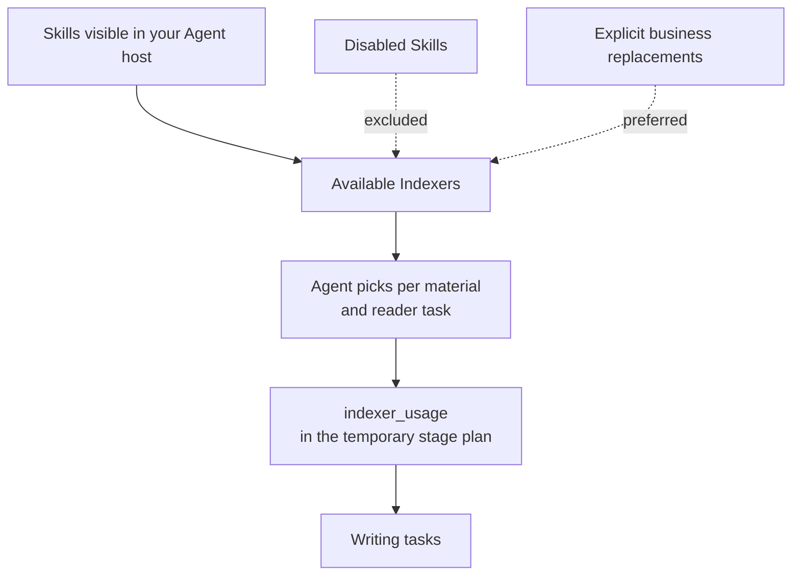

# Providers and Customization

<!-- context:section id="goal" -->
In Context, an Indexer Skill is also called an **Indexer Provider**: a bundle that provides investigation and writing guidance for one kind of source. This page explains how Providers are chosen and combined for your Context knowledge workspace, how to steer that choice — adding a specialist, replacing a built-in, disabling one — and what is and is not recorded about it.

<!-- /context:section -->

<!-- context:section id="selection" -->
## How selection works

When a stage is planned, the Agent declares the relevant Skills available in the current host and whether it can schedule sub-agents. It then picks the Indexers that fit the actual material and reader task and records them, with any configuration, as `indexer_usage` in the temporary stage plan; the CLI hands that guidance back during planning and writing.

There is no Provider resolution stage and no primary owner to select. The Agent does not inspect caches, compare Skill hashes, resolve exact versions or keep a second installation registry — installing and enabling Skills belongs to the host. A Skill name is a discovery hint, not proof that the Skill fits.
<!-- /context:section -->

<!-- context:section id="combine" -->
## Combining Indexers on one module

Several Indexers can explain different aspects of one module, and their findings can support the same article. A typical combination is the general `context-code-indexer` together with a specialist for the module's framework, or a code Indexer for structure with notes that explain business intent. Combining needs no primary or extension binding: each Skill contributes guidance, and a different source type alone does not call for another page.
<!-- /context:section -->

<!-- context:section id="steer" -->
## Adding, replacing and disabling

| You want to | Do this |
| --- | --- |
| Add a specialist | Create it with [Creating an Indexer](creating-an-indexer.md) and install it where your host can see it. Installation makes it available, not selected. |
| Prefer your team's Indexer over a built-in one for some material | State the replacement explicitly in your request or standing instructions; the Agent respects explicit business replacements. |
| Stop an Indexer from being used | Disable the Skill in your Agent host; the Agent respects disabled Skills. |
| Adjust the guidance for one task | Say so in the task. Choices recorded in `indexer_usage` are temporary and do not change the Skill. |

Where a needed structural fact is missing from code, writing guidance cannot create it; that calls for a parser. See [Code Extraction](../../architecture/knowledge/code-extraction.md).
<!-- /context:section -->

<!-- context:section id="where" -->
## Where custom Indexers live

| Location | Visible to |
| --- | --- |
| A repository's `.claude`, `.cursor` or `.agents` directory | Anyone opening that repository in the matching host; no plugin namespace |
| A user-level directory: `~/.agents/skills` (Codex, Cursor) or `~/.claude/skills` (Claude Code) | All your projects on that machine; the shipped Indexers are installed here too |
| A plugin you distribute | Everyone who installs the plugin |

Keep the bundle portable and use your usual installation channel. An Indexer release may carry ordinary version metadata, but production never verifies an Indexer version or hash before working.
<!-- /context:section -->

<!-- context:section id="records" -->
## What the workflow records

| Recorded | Not recorded |
| --- | --- |
| Formal articles, their sources and real references | Skill identity on articles, sections or production results |
| Long-term requirements in `src/indexers.yaml`: purpose, reader goals, coverage domains and authorized sources | Production assignments or Indexer choices |
| Temporary `indexer_usage`, drafts and receipts under `.tmp` | Skill hashes, version pins or a producer log |

With intact temporary state, current work can resume or retry. After clearing `.tmp` or cloning elsewhere, new production starts from formal knowledge and sources, without restoring the former Skill bundle.
<!-- /context:section -->

<!-- context:section id="manifest" -->
## Provider manifests

The shipped Indexers also carry a `context-indexer.yaml` Provider manifest (protocol `context.indexer.provider/v1`) declaring their domains, activation signals, profiles, resources and supported customization steps. The SDK exposes this protocol and its validators. A new Indexer does not need a manifest — `context-indexer-create` deliberately does not generate one — and production does not require it. For the protocol and the workflow's use of Indexers, see [The Indexer System](../../architecture/knowledge/indexer-system.md).
<!-- /context:section -->
