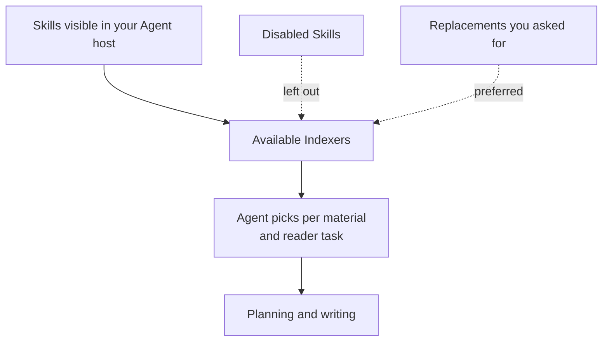

# Choosing, Replacing and Disabling Indexers

<!-- context:section id="goal" -->
Read this page when the built-in Indexers do not quite fit: you want a team's specialist Indexer used for some material, a built-in Indexer replaced, or one stopped altogether. Start from [Built-in Indexers](community-indexers.md) to see what the shipped Indexers already cover; how the workflow uses Indexers internally is described in [The Indexer System](../../architecture/knowledge/indexer-system.md).


<!-- /context:section -->

<!-- context:section id="selection" -->
## How the Agent chooses

You do not pick Indexers by hand. When a stage is planned, the Agent looks at the Skills installed and enabled in your Agent host, picks the ones that fit the actual material and reader task, and uses their guidance for planning and writing. A Skill's name is only a hint; the Agent decides whether it fits the material in front of it.

The Agent always:

- leaves out Skills you have disabled in the host;
- follows an explicit replacement you have asked for, such as your own Indexer standing in for a built-in one.

The work-start report shows which Skills the Agent intends to use, so you can correct the choice before writing starts; see [Confirming the Work-Start Report](../planning-and-production/start-reports.md).
<!-- /context:section -->

<!-- context:section id="install-vs-select" -->
## Installing is not selecting

Installing an Indexer in your host makes it discoverable; it does not switch it on for every knowledge workspace. What a workspace keeps long term is its purpose, reader goals, coverage and authorized sources — not a list of Indexers. Each time work is planned, the Agent chooses again from the Skills the host makes available, for the material in front of it.

So after installing a new Indexer, say in your request which material should use it when that matters to you, and check the Indexing guidance line of the work-start report. Disabling a Skill in the host takes it out of the next choice.
<!-- /context:section -->

<!-- context:section id="combine" -->
## Several Indexers on one module

Several Indexers can explain different aspects of one module, and their findings support the same article. A different source type alone does not call for another page. Two patterns are common:

- **Different Indexers for different sources or modules.** Each source or module gets the Indexer that suits it — for example the Code Indexer for a service and the Note Indexer for the notes its on-call engineers keep.
- **Two Indexers on the same module.** The general `context-code-indexer` explains the module's structure, and a specialist for the module's framework, or notes that explain business intent, add what the structure does not show.
<!-- /context:section -->

<!-- context:section id="replace" -->
## Replacing a built-in Indexer

You can replace a built-in Indexer for part of a workspace — for example, your team's on-call Q&A Indexer instead of the Note Indexer for a range of notes.

1. Install and enable the new Skill in your host; see [Creating an Indexer](creating-an-indexer.md).
2. Continue the workspace through `/c4a:context` and state the replacement explicitly:

   ```text
   For the notes under oncall/, use oncall-qa-indexer instead of the Note Indexer. Keep the current choice for all other sources.
   ```

3. Ask the Agent which Indexers it actually chose and for which material, then check the pages it writes.
4. When nobody needs the old Skill any more, disable it in the host.

Keep the Context plugin installed while you do this. It also carries the production, planning, question and creation entries, and the other built-in Indexers still serve the rest of your sources.
<!-- /context:section -->

<!-- context:section id="steer" -->
## At a glance

| You want to | Do this |
| --- | --- |
| Add a specialist | Create it with [Creating an Indexer](creating-an-indexer.md) and install it where your host can see it, then say in your request which material should use it. |
| Prefer your team's Indexer over a built-in one for some material | State the replacement explicitly in the workspace, as in "Replacing a built-in Indexer" above. |
| Stop an Indexer from being used | Disable the Skill in your Agent host. |
| Adjust the guidance for one task | Say so in the task. The choice applies to that task only and does not change the Skill. |

When a structural fact is missing from what the Agent can see in code, writing guidance cannot create it; that calls for a parser. See [Code Extraction](../../architecture/knowledge/code-extraction.md).
<!-- /context:section -->

<!-- context:section id="where" -->
## Where custom Indexers live

| Location | Visible to |
| --- | --- |
| A repository's `.claude`, `.cursor` or `.agents` directory | Anyone opening that repository in the matching host; no plugin namespace |
| A user-level directory: `~/.agents/skills` (Codex, Cursor) or `~/.claude/skills` (Claude Code) | All your projects on that machine; the shipped Indexers are installed here too |
| A plugin you distribute | Everyone who installs the plugin |

Keep the Skill portable and use your usual installation channel.
<!-- /context:section -->
