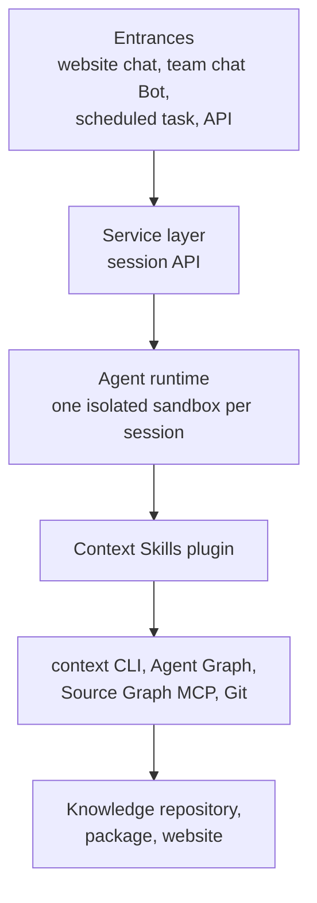

# Building a Knowledge Service

<!-- context:section id="goal" -->
A **knowledge service Agent** is a resident Agent that uses the Context Skills to produce, update and answer from a team's knowledge, with people reviewing at the key decision points. It is not a new Agent platform: you take an existing Agent runtime and give it the Context Skills plugin, a Bot prompt and remote retrieval.

The same Skills work anywhere — in a hosted Agent runtime or in a local coding Agent such as Claude Code, Codex or Cursor. A resident service pays off for knowledge a team shares: production involves a lot of searching and confirmation, and questions need an answer at any time. Knowledge for a small module can simply live with its repository under `docs/`.

> **Status.** The community edition does not ship a Bot implementation. The runtime and service interface below describe the design planned for this site's own Bot. The Skills, the flows and the interaction lessons have been proven in practice.
<!-- /context:section -->

<!-- context:section id="layers" -->
## Layers

| Layer | Made of | Responsible for |
| --- | --- | --- |
| Entrances | Website chat, team chat Bot, scheduled tasks, API calls | Questions, production or update requests, routine patrols |
| Service layer | Session API | Authentication, rate limiting, one runtime per session, relaying the event stream, rendering results as web messages or chat cards, collecting ratings |
| Agent | Hosted Agent runtime | One isolated sandbox per session; system prompt plus the Bot prompt; picks Skills by intent |
| Skills | Context Skills plugin | Production: `context`, `context-plan` and the four Indexers. Retrieval: `context-inspect-search`. Same-repository docs: `context-repo-content` |
| Foundations | `context` CLI with Agent Graph, Source Graph MCP, Git | Advancing and resuming the workflow, reading code remotely by commit, committing the Context knowledge workspace |
| Outputs | Knowledge repository (Git), knowledge package, documentation site | Published together after a build |
<!-- /context:section -->

<!-- context:section id="flows" -->
## Three flows

| Flow | Steps |
| --- | --- |
| Production | Prepare the environment (restore the workspace and source versions, `context`) → plan (the Bot prompt recognizes intent, `context-plan`) → capture (code pinned to a commit, documents snapshotted) → write (Indexer Skills, each section with source references) → review (references checked automatically, people review the diff report) → build and publish → archive (version and changelog) |
| Retrieval | Prepare (mount the plugin and packages) → recognize a question → find knowledge (`context-inspect-search`: indexes first, then page bodies and evidence) → if knowledge is not enough, read originals by commit through Source Graph → answer conclusion-first with sources |
| Update | Triggered by a request in chat, by a gap found while answering and confirmed by the user, or by a scheduled patrol → assess impact (compare old and new source versions, find affected articles) → revise only the affected parts and their references → people review the diff report → publish → report changed articles and the new version |
<!-- /context:section -->

<!-- context:section id="runtime" -->
## Choosing a runtime

Any hosted Agent runtime with an isolated sandbox per session works; choose on:

- **Sandbox start time** — cold start dominates the first answer.
- **Session length limit** — production sessions run long.
- **File system persistence** — whether the Context knowledge workspace and installed tools survive between sessions.
- **Egress control** — which sources and services the sandbox may reach.

Keep the service layer on a generic session interface — create a session, send a message, read the event stream, end the session — so that switching runtimes does not change the Skills.
<!-- /context:section -->

<!-- context:section id="configure" -->
## Configuring the Bot

The Bot prompt is the Bot's trusted instance configuration. Use it to:

- **Set review policy.** A Bot setting can override any `context.gate.*` switch for every task it runs; precedence is Bot, then fully managed, then ordinary defaults, and an authorized task-scoped override of the two review switches still wins for that task. See [Managed Mode and Review Policy](../planning-and-production/managed-mode-and-review-policy.md).
- **Set retrieval order.** `CONTEXT_QUERY_SOURCE_MODE` (`repo-first`, `package-first`, `dual`) and `CONTEXT_QUERY_ACCESS_MODE` (`auto`, `remote`, `local`) come from the host or Bot configuration. See [Asking Questions](../querying-knowledge/asking-questions.md).
- **Describe patrols.** Scheduled tasks need their own prompts; see [Scheduled Updates](../updates-and-versions/scheduled-updates.md).

How people interact with the Bot day to day is in [Using the Bot in Team Chat](./using-the-bot-in-team-chat.md).
<!-- /context:section -->
