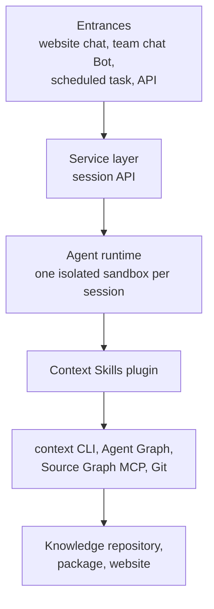

# Building a Knowledge Service

<!-- context:section id="goal" -->
A **knowledge service Agent** is a resident Agent that uses the Context Skills to produce, update and answer from a team's knowledge, with people reviewing at the key decision points. It is not a new Agent platform: you take an existing Agent runtime and give it the Context Skills plugin, a Bot prompt and remote retrieval.

The same Skills work anywhere — in a hosted Agent runtime or in a local coding Agent such as Claude Code, Codex or Cursor. A resident service pays off for knowledge a team shares: production involves a lot of searching and confirmation, and questions need an answer at any time. Knowledge for a small module can simply live with its repository under `docs/`.

You bring the runtime, the entrances and the service layer; Context brings the Skills and the workflow behind them. This page walks through how the pieces fit, what the service does, how to pick a runtime and what to put in the Bot prompt. Day-to-day use by a team is in [Using the Bot in Team Chat](./using-the-bot-in-team-chat.md).
<!-- /context:section -->

<!-- context:section id="layers" -->
## How the pieces fit

- **Entrances** are where requests come from: website chat, a team chat Bot, scheduled tasks and API calls. They carry questions, production or update requests, and routine patrols.
- **The service layer** is a session API you run. It handles authentication and rate limiting, starts one runtime per session, relays the event stream, renders results as web messages or chat cards, and collects ratings.
- **The Agent runtime** gives each session its own isolated sandbox, runs the system prompt plus your Bot prompt, and picks Skills by what the person asked for.
- **The Context Skills plugin** does the knowledge work: production, questions with sources, and same-repository docs. The Skills and the entries they map to are listed in [Skills](../../product/reference/context/skills.md).
- **The foundations** underneath are the `context` CLI with Agent Graph, the Source Graph MCP and Git. They advance and resume the workflow, read code remotely by commit and commit the knowledge workspace.
- **The outputs** — the knowledge repository in Git, the knowledge package and the documentation site — are published together after a build.
<!-- /context:section -->

<!-- context:section id="setup" -->
## Setting up the service

1. **Pick a runtime** that gives every session an isolated sandbox; see [Choosing a runtime](#choosing-a-runtime) below.
2. **Install Context in the runtime image**: the `context` CLI and the Context plugin, as in [Installation](../../product/getting-started/installation.md). Preinstall the knowledge packages and the knowledge workspace too, so sessions do not install and clone each time — cold start is the main reason a first answer is slow.
3. **Connect remote retrieval** so the Agent can read code by commit instead of cloning repositories in the sandbox; see [Reading Code Evidence Remotely](../querying-knowledge/reading-code-evidence-remotely.md).
4. **Write the Bot prompt** with your review policy and retrieval order; see [Configuring the Bot](#configuring-the-bot) below.
5. **Connect the entrances** through your service layer, and decide who may do what: public visitors ask questions, maintainers produce, update and publish. See the boundaries in [Using the Bot in Team Chat](./using-the-bot-in-team-chat.md).

Then try it the way your team will: ask a question you know the answer to, and ask for a small update and follow it through to the review report.
<!-- /context:section -->

<!-- context:section id="flows" -->
## What the service does

The service runs three flows, all through the same Skills.

- **Production.** The Agent prepares the environment by restoring the workspace and the source versions, recognizes a production request and plans it, captures sources (code pinned to a commit, documents snapshotted), writes each section with source references, checks the references automatically and gives people a diff report to review. It then builds, publishes, and archives a version with a changelog entry.
- **Questions.** With the plugin and packages mounted, the Agent recognizes a question and searches the knowledge — indexes first, then page bodies and evidence. If the knowledge is not enough, it reads the originals by commit through Source Graph. The answer comes conclusion-first, with sources. See [Asking Questions](../querying-knowledge/asking-questions.md).
- **Updates.** An update starts from a request in chat, from a gap found while answering that the user confirms, or from a scheduled patrol. The Agent compares the old and new source versions to find the affected articles, revises only those parts and their references, and gives people a diff report. After publishing, it reports the changed articles and the new version. See [Updating Knowledge](../updates-and-versions/updating-knowledge.md).

Your decisions are the same as when you work locally: confirm the plan, review the diff report and agree to publish — unless the Bot's review policy delegates some of them.
<!-- /context:section -->

<!-- context:section id="runtime" -->
## Choosing a runtime

Any hosted Agent runtime with an isolated sandbox per session works. Compare runtimes on:

- **Sandbox start time.** Cold start dominates the first answer.
- **Session length limit.** Production sessions run long.
- **File system persistence.** Whether the knowledge workspace and installed tools survive between sessions.
- **Egress control.** Which sources and services the sandbox may reach.

Keep the service layer on a generic session interface — create a session, send a message, read the event stream, end the session — so that switching runtimes does not change the Skills.
<!-- /context:section -->

<!-- context:section id="configure" -->
## Configuring the Bot

The Bot prompt is the Bot's trusted instance configuration. Use it to:

- **Set review policy.** A Bot setting applies to every task the Bot runs and takes precedence over fully managed and ordinary defaults; for example, a Bot can always send the review report to people while publishing within its configured target without asking. See [Fully Managed Mode](../planning-and-production/managed-mode-and-review-policy.md).
- **Set retrieval order and access.** Choose whether questions read the workspace's approved knowledge first, a package first, or both, and whether code is read remotely or locally. See [Asking Questions](../querying-knowledge/asking-questions.md).
- **Describe patrols.** Scheduled tasks need their own prompts that state their scope, what to do when nothing changed, and which situations need a person. See [Scheduled Updates](../updates-and-versions/scheduled-updates.md).

What can go wrong: a policy that does not match how your reviewers work. If the workflow asks for a human decision that the policy said to skip, the Agent stops and reports the mismatch instead of approving on its own.
<!-- /context:section -->
