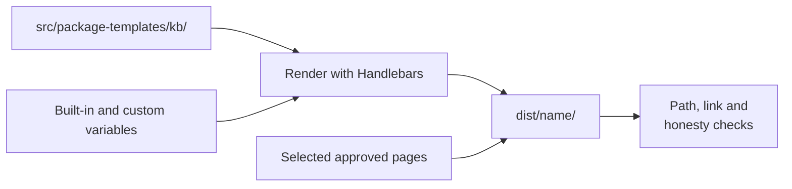

# Custom Output Templates

<!-- context:section id="goal" -->
Every knowledge package is rendered from a **package template** in your knowledge workspace, by default `src/package-templates/kb/`. The template supplies the package entry page, the query Skill and any instructions for Agents; the build renders it and adds the selected approved pages. The generated default is a usable generic starting point. Customize it when your package needs project terminology, curated navigation, routing rules or task-specific Skills, for example:

> Rename the query Skill to `android-query` and group the entry page by module.


<!-- /context:section -->

<!-- context:section id="review" -->
## Accept or edit before the first build

A newly generated template must be accepted as is or edited before the first build. The Agent asks you to confirm: accept the generic default, or edit files under `src/package-templates/` (yourself or by asking the Agent). Context records which template files you accepted; it does not judge the template's prose.
<!-- /context:section -->

<!-- context:section id="layout" -->
## What the template contains

```text
src/package-templates/
├── kb/
│   ├── AGENTS.md
│   ├── wikis/
│   │   └── index.md
│   └── skills/
│       └── knowledge-query/
│           ├── SKILL.md
│           └── scripts/
│               └── search.mjs
└── llms/
    └── llms.txt
```

A knowledge package template must contain at least one `SKILL.md` and `wikis/index.md`; a template with only `AGENTS.md` is rejected. Each rendered Skill lives at `skills/<skill-name>/SKILL.md` with a matching `name` in its front matter. To give the query Skill a project prefix, rename its template folder — for example `skills/android-query/` — since Context never derives Skill names from the package name. Add another Skill only when you want behavior beyond knowledge lookup.
<!-- /context:section -->

<!-- context:section id="entry" -->
## The entry page and navigation

`wikis/index.md` is the package's entry page. Tell readers what the package covers, who it is for and how to query it. Every selected root — `wikis/`, `guides/`, `rules/`, `feats/` — always gets an index. By default, small directories fold into their nearest generated ancestor index, and a directory gets its own `index.md` only when it would expose more than 50 entries to its parent; you can ask for one index per directory or a different threshold.

For curated navigation, loop over the built-in variables in `wikis/index.md`:

```handlebars
{{#each knowledgeGroups}}
## {{title}} ({{count}})
{{#each items}}
- [{{title}}]({{href}})
{{/each}}
{{/each}}
```

| Variable | Gives you |
| --- | --- |
| `{{displayName}}`, `{{packageName}}` | Package display name and name |
| `{{knowledgeCount}}`, `{{knowledgeTimestamp}}` | Number of selected pages and the latest timestamp |
| `{{knowledgeItems}}` | Selected page metadata for loops |
| `{{knowledgeGroups}}` | Pages grouped by root and first directory |
| `{{knowledgeTreeNodes}}`, `{{knowledgeTree}}` | Nested tree, or its Markdown preview |
| `{{wikisRoot}}` … `{{featsRoot}}` | Package-relative root paths, for links inside Skills |

The complete list, with loops, conditionals and helpers, is in [Template Variables](../../product/reference/context/template-variables.md). Your own values can be passed to the template as custom variables.
<!-- /context:section -->

<!-- context:section id="skill" -->
## The query Skill

The default `knowledge-query` Skill already carries the structure-first query discipline and a search fallback. Edit its template when you need project terminology, entry points or task workflows. Put authoring notes in template comments or separate guidance — not in a final section addressed to authors inside the finished Skill.
<!-- /context:section -->

<!-- context:section id="rules" -->
## Rules the build enforces

- **No second knowledge source.** Template prose that describes coverage, scope, known gaps or limits must be backed by approved knowledge, the package inventory or rendered structure data; otherwise the build reports it. Facts belong in approved pages.
- **No collisions.** Template files are rendered first; a rendered path may not land on a selected page or a generated index. Rename the template file or exclude that page from the package.
- **Valid links.** Links in every root index and generated child index must resolve inside the package; broken ones are reported.
- **Fix at the source.** Repair the template, the approved page or the package declaration and rebuild; never patch `dist/`.

These checks cover structure, not whether the selected knowledge is meaningful for your readers — look through the output yourself. The template API is in [Package Templates](../../product/reference/context/package-templates.md).
<!-- /context:section -->
