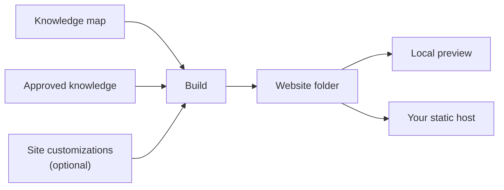

# Documentation Sites

<!-- context:section id="goal" -->
A Context documentation site is a static website built from the same approved knowledge as your knowledge package. Once it is turned on, every build writes the package and a sibling website folder. You preview the website locally and upload it to any static host.

<!-- /context:section -->

<!-- context:section id="enable" -->
## What to ask for

| You ask for | The Agent does |
| --- | --- |
| Package and website | Builds both from one package declaration |
| Package only | Turns the website off and rebuilds; the old website folder is deleted |
| Add a website later | Turns the website on, places any pages that are not yet in navigation, and rebuilds |
| Website only for sharing | Builds the package too, and shares only the website folder |

A typical request:

> Add a documentation site titled "Project knowledge" in English, hosted under `/docs/`, with a link to our repository on the homepage.

The Agent sets the site title, language, address prefix and homepage for you. The address prefix only changes the site's URLs, not its output folder. The website folder is named after the package, minus one trailing `-kb`: `project-kb` builds `dist/project-kb/` and `dist/project-site/`. Every option the Agent can set is listed under Site options in [Project API](../../product/reference/context/project-api.md).
<!-- /context:section -->

<!-- context:section id="features" -->
## What the site offers

- **Homepage** — every top-level section of the knowledge map as a card with a short preview of its pages, plus resource cards.
- **Navigation** — sections in the top bar; the left sidebar shows only the current section's pages. Each section's landing page shows its groups as cards.
- **Search** — local search, opened with the search button or Cmd/Ctrl+K; no search service needed.
- **Theme** — light and dark. The site opens in light mode until the reader switches, and remembers that choice; see [Customizing Pages and Themes](page-and-theme-customization.md).
- **Missing pages** — an unknown address shows a 404 page in the reader's language with a link back home.
- **Diagrams** — Mermaid rendered in the browser with fit, 100%, zoom, full-screen and source controls. An invalid diagram shows its source with a notice instead of blocking publication.
- **Provenance** — each page ends with its sources: repository entries link to the recorded revision, document entries to their registered URL. Inline code that names a cited repository file or directory links to that path at the recorded revision.
- **Source map** — on by default, each page ends with a map instead of a plain list: the page's sections in the middle, the documents they cite around them, grouped by where each one comes from. Hovering highlights what a section or document links to, clicking a document opens the cited lines, and a List view shows the same documents with their line ranges; narrow screens show only the list. Below it, other pages citing the same documents are linked. The map is computed during the build from the recorded references, so no extra step is needed; `site.sourceMap: false` returns the plain list.
- **LLM Docs and Changelog** — the site can link the plain-text [LLM Docs](llm-docs.md) produced by the same build, and the knowledge base's changelog.

Code samples and raw HTML are displayed as content, never executed.
<!-- /context:section -->

<!-- context:section id="navigation" -->
## Navigation comes from the knowledge map

The knowledge map decides the sidebar. Each entry points to a page by its identity, so renaming a label or moving a page to another group never changes its URL, and one page can appear in several places while keeping one URL. Every selected page needs a place in the map before the build; if some are missing, the Agent places them or asks you where they belong. Groups can stay empty while their pages are still planned.

The sidebar keeps the order you give the map at every level. Articles and directories can sit side by side in that order: a section can open with an overview and a quick start, followed by a Guides directory and a Reference directory. Each section's landing page follows the same order, showing every directory as a card and gathering consecutive articles that sit outside a directory into one shared card at their place in the sequence. To change the order, ask the Agent to reorder the entries; see [Reorganizing at Scale](../review-and-revision/reorganizing-at-scale.md). Context versions before 0.7.82 always listed directories ahead of their sibling articles, whatever order the map gave.

You can also ask the Agent for extra links in the top bar (for example a link back to a documentation home), items in the More menu (for example release notes kept outside the map), icon links, or a different target for the site title. Links that start with `/` point to the same domain, so a site under `/docs/` can link to a sibling application. The exact settings are in [Project API](../../product/reference/context/project-api.md).
<!-- /context:section -->

<!-- context:section id="home-cards" -->
## Homepage resource cards

Resource cards point readers to places beyond the site, such as the repository that maintains this knowledge. A card opens a link, offers a command to copy, or both, and a featured card also appears among the actions at the top of the homepage.

The values come from real sources, never from guesses: settings you have confirmed, the workspace's repository remotes, or real deployment results. Unknown destinations are left out, with no invented links and no empty placeholder cards. Changing the cards means a rebuild; the hosted site changes the next time you deploy.
<!-- /context:section -->

<!-- context:section id="build" -->
## Previewing

Ask the Agent to preview the site:

> Build the site and open a local preview.

The Agent serves the website folder through a local HTTP server. The website is generated in a staging folder first, so a failed build keeps the previous package and site. The Agent's completion report lists the package, the website and LLM text separately — each as generated, failed or not selected — with navigation coverage and the preview URL it checked.

A build does not re-read your source repositories, so you can build and deploy without them checked out. Before deploying, the Agent still checks whether cited sources have changed, moved or gone missing, and tells you if any pages need an update.
<!-- /context:section -->

<!-- context:section id="deploy" -->
## Deploying

Deploy the **contents of the website folder** with your chosen static hosting tool. Context's build includes no hosting service, login or deployment step. After every successful website build the Agent tells you which folder to deploy and, if you have authorized a target, uses a compatible deployment Skill. Only the website folder is published — never sources, private workspace state or the whole package — and success is reported only after the hosted URL is checked.

Once the site is live, ask the Agent to record its public address in the package, so query Skills can link answers to site pages. The address is an access hint, not proof of publication, and rebuilds keep it.

To change pages, slots and colors, see [Customizing Pages and Themes](page-and-theme-customization.md); for other languages, [Multilingual Sites](multilingual-sites.md).
<!-- /context:section -->
